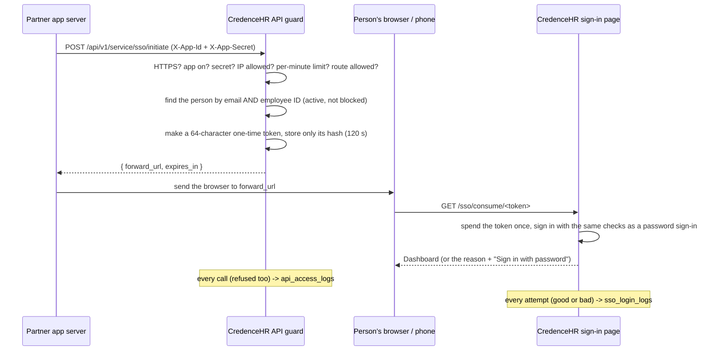

# CredenceHR Partner Sign-in (SSO) API

Let people who are already signed in to **another application** (360 ERP, or any
other partner app) open **CredenceHR** without typing a password.

Every partner application gets **its own App ID and App Secret**, its own IP list,
request limit, link life and on/off switch — so one can be changed, switched off or
removed without affecting the others.

> Code: `Erp360InboundSsoRoutes.ts` (server), `src/components/SsoConsume.tsx`
> (the sign-in page), `src/components/Erp360SignInCard.tsx` (settings).
> The opposite direction (CredenceHR → 360 ERP) is `Erp360SsoRoutes.ts` and the
> `ERP360_*` settings in `.env`.

---

## Contents

1. [How it works](#1-how-it-works)
2. [Setup in CredenceHR (Superadmin) — বাংলায়](#2-setup-in-credencehr-superadmin--বাংলায়)
3. [API reference](#3-api-reference)
4. [The sign-in link](#4-the-sign-in-link)
5. [Who can be signed in](#5-who-can-be-signed-in)
6. [Code examples](#6-code-examples)
7. [Testing](#7-testing)
8. [Troubleshooting](#8-troubleshooting)
9. [Security](#9-security)
10. [Server requirements](#10-server-requirements)

---

## 1. How it works



1. The partner app's **server** (never a browser — the secret must not reach one)
   asks CredenceHR for a one-time link.
2. CredenceHR checks the app, finds the person, and returns `forward_url`.
3. The partner app sends the person's browser to `forward_url`.
4. CredenceHR signs them in and opens the **Dashboard**.

---

## 2. Setup in CredenceHR (Superadmin) — বাংলায়

**কোথায়:** Admin Panel → **Active Users** → **Partner app sign-in (SSO)**
(শুধু Superadmin দেখেন; API-ও শুধু Superadmin-এর জন্য।)

### নতুন application যোগ করা
1. **Add application** চাপুন → নাম লিখুন (যেমন `360 ERP`, `Accounts Portal`) →
   **Make its keys**।
2. হলুদ বাক্সে **X-App-Id** আর **X-App-Secret** দেখাবে। দুটোই কপি করে ওই
   application-এর টিমকে নিরাপদে দিন (email-এ খোলা না পাঠানোই ভালো)।
   **Secret আর কখনো দেখাবে না** — CredenceHR-এ শুধু তার hash থাকে।
3. "I've saved it" চাপুন।

প্রতিটা application-এর নিজের key। একটা application বন্ধ করলে বা মুছলে বাকিগুলো
আগের মতোই চলে।

### প্রতিটা application-এর setting

| Setting | কী করে |
|---|---|
| নাম | তালিকা আর log-এ দেখায়; বদলানো যায় |
| **Switched on** | বন্ধ করলে ওই application আর link বানাতে পারে না (`401 This app is switched off.`) |
| **Its server IPs** | শুধু এই IP থেকে ডাকা যাবে (কমা দিয়ে একাধিক)। ফাঁকা = যেকোনো IP। লাইভে অবশ্যই বসান। |
| **Requests per minute** | প্রতি মিনিটে কতবার link চাওয়া যাবে (ডিফল্ট ৬০, ১–১০০০) |
| **Link valid for (seconds)** | link কতক্ষণ চলবে (ডিফল্ট ১২০, ৩০–৬০০) |
| **New secret** | নতুন Secret বানায়; পুরনোটা **সাথে সাথে** অকেজো। Secret হারালে বা ফাঁস হওয়ার সন্দেহ হলে। |
| **Remove** | application মুছে দেয়; তার App ID সাথে সাথে বন্ধ, না-খোলা link-গুলো বাতিল। log থেকে যায়। |

বদল করলে **Save** চাপবেন।

### Log দেখা
**Show recent sign-ins and calls** → বাঁয়ে sign-in-এর চেষ্টা (সবুজ সফল, লাল ব্যর্থ,
কারণসহ), ডানে প্রতিটা API call (200 / 401 / 403 / 422 / 429)। একাধিক application থাকলে
উপরের তালিকা থেকে একটা বেছে শুধু তার log দেখা যায়।

---

## 3. API reference

### `POST /api/v1/service/sso/initiate`

Called by the partner app's **server**. HTTPS only.

**URL**

```
https://hr.credencegroupbd.com/api/v1/service/sso/initiate
```

**Headers**

| Header | Required | Value |
|---|---|---|
| `X-App-Id` | yes | The App ID CredenceHR gave this application, e.g. `360erp_3f9a1c2b7d4e8a01` |
| `X-App-Secret` | yes | The 64-character App Secret |
| `Content-Type` | yes | `application/json` |
| `Accept` | recommended | `application/json` |

**Body (JSON)**

| Field | Required | Type | Notes |
|---|---|---|---|
| `email` | **yes** | string | The person's CredenceHR login email **or** their office email in CredenceHR |
| `employee_id` | **yes** | string | Their Employee ID in CredenceHR (e.g. `CPL-0101`). Must be the **same person** as `email` |
| `name` | no | string | Not used for matching |
| `request_ip` | no | string | The person's own IP, for the log |
| `redirect_path` | no | string | Accepted for compatibility; CredenceHR always opens the Dashboard |

```json
{
  "email": "someone@credencehousinglimited.com",
  "employee_id": "CPL-0101",
  "name": "Someone",
  "request_ip": "103.120.10.5"
}
```

**Success — `200 OK`**

```json
{
  "forward_url": "https://hr.credencegroupbd.com/sso/consume/3f9a1c...e8a0 (64 hex characters)",
  "expires_in": 120
}
```

`expires_in` is in seconds (the application's "Link valid for" setting).

**Errors**

All errors are JSON with a `message`; `422` also has `errors` per field.

| HTTP | `message` | Meaning |
|---|---|---|
| 401 | `Missing app credentials.` | `X-App-Id` or `X-App-Secret` header missing |
| 401 | `Invalid app credentials.` | Unknown App ID or wrong secret (or the secret was replaced) |
| 401 | `This app is switched off.` | The Superadmin switched this application off |
| 403 | `HTTPS is required.` | Called over plain http |
| 403 | `This IP address is not allowed.` | The caller's IP is not in the application's IP list |
| 403 | `This app may not use this route.` | This route isn't given to the application |
| 422 | `The given data was invalid.` | `email` / `employee_id` missing or malformed — see `errors` |
| 422 | `No CredenceHR account matches this email and employee ID.` | No one, or not the same person, or no CredenceHR login |
| 422 | `This employee is not active.` | The employee is marked inactive |
| 422 | `This account is blocked.` | The CredenceHR account is blocked |
| 429 | `Too many requests. Try again in a minute.` | Over the application's per-minute limit |
| 500 | `Something went wrong. Please try again.` | Unexpected error (details only in the server log) |

```json
{
  "message": "The given data was invalid.",
  "errors": {
    "email": ["The email field is required."],
    "employee_id": ["The employee id field is required."]
  }
}
```

---

## 4. The sign-in link

Send the person's browser to `forward_url` — a redirect or a new tab.

- Works **once**, within `expires_in` seconds. A second open, or a late one, shows
  *"This sign-in link has expired or was already used…"* and a **Sign in with password** button.
- The token is removed from the address bar as soon as the page opens.
- The sign-in passes **exactly the same checks as a password sign-in** (blocked
  account, mobile-app access, the one-phone limit, workspace, new-joiner login…).
  If one fails, the page shows the reason.
- On success the person lands on the **Dashboard**. If someone else was signed in
  on that browser, that sign-in is ended first.
- **Android phone browser:** the page asks *Open in the CredenceHR app* (opens the
  installed app with `credencehr://sso/consume/<token>`) or *Continue in the
  browser*. In the app the person allows location, as for a password sign-in.
- iPhone and computers: signs in straight away in the browser.

---

## 5. Who can be signed in

The person is found by **both** `email` and `employee_id`, and must:

- have an Employee record in CredenceHR **linked to a CredenceHR login**,
- have that `employee_id`, and that `email` as their login email or office email
  (letters' case and spaces around the email don't matter),
- be an **active** employee,
- not be blocked.

Superadmin accounts can be signed in this way too (if they have an Employee record).
**No account is ever created** — someone without a CredenceHR login gets `422`.

---

## 6. Code examples

### PHP (Laravel)

```php
use Illuminate\Support\Facades\Http;

$res = Http::withHeaders([
    'X-App-Id'     => config('services.credencehr.app_id'),
    'X-App-Secret' => config('services.credencehr.secret'),
])->acceptJson()->timeout(10)->post('https://hr.credencegroupbd.com/api/v1/service/sso/initiate', [
    'email'       => $user->email,
    'employee_id' => $user->employee_id,
    'name'        => $user->name,
    'request_ip'  => request()->ip(),
]);

if ($res->ok()) {
    return redirect()->away($res->json('forward_url'));
}
return back()->withErrors($res->json('message') ?? 'CredenceHR sign-in failed');
```

### Node.js

```js
const r = await fetch('https://hr.credencegroupbd.com/api/v1/service/sso/initiate', {
  method: 'POST',
  headers: {
    'X-App-Id': process.env.CREDENCEHR_APP_ID,
    'X-App-Secret': process.env.CREDENCEHR_APP_SECRET,
    'Content-Type': 'application/json',
    Accept: 'application/json'
  },
  body: JSON.stringify({ email: user.email, employee_id: user.employeeId, request_ip: req.ip })
});
const data = await r.json();
if (r.ok) res.redirect(data.forward_url);
else res.status(r.status).send(data.message);
```

### Python

```python
import os, requests

r = requests.post(
    "https://hr.credencegroupbd.com/api/v1/service/sso/initiate",
    headers={"X-App-Id": os.environ["CREDENCEHR_APP_ID"], "X-App-Secret": os.environ["CREDENCEHR_APP_SECRET"]},
    json={"email": user.email, "employee_id": user.employee_id},
    timeout=10,
)
if r.ok:
    return redirect(r.json()["forward_url"])
```

### curl / PowerShell

```bash
curl -X POST https://hr.credencegroupbd.com/api/v1/service/sso/initiate \
  -H "X-App-Id: <app id>" -H "X-App-Secret: <secret>" -H "Content-Type: application/json" \
  -d '{"email":"someone@credencehousinglimited.com","employee_id":"CPL-0101"}'
```

```powershell
$h = @{ "X-App-Id" = "<app id>"; "X-App-Secret" = "<secret>" }
$b = '{"email":"someone@credencehousinglimited.com","employee_id":"CPL-0101"}'
Invoke-RestMethod -Method Post -Uri "https://hr.credencegroupbd.com/api/v1/service/sso/initiate" -Headers $h -ContentType "application/json" -Body $b
```

Keep the App ID and Secret in the partner server's configuration (e.g. `.env`),
never in front-end code or a mobile app.

---

## 7. Testing

### Postman
1. **POST** `https://hr.credencegroupbd.com/api/v1/service/sso/initiate`
   (on a test server reached by its IP: `http://<ip>:3000/...` — see the note below).
2. **Headers:** `X-App-Id`, `X-App-Secret`, `Content-Type: application/json`.
3. **Body → raw → JSON:** `{ "email": "...", "employee_id": "..." }` of a real
   employee who has a CredenceHR login.
4. **Send** → copy `forward_url` → open it within 2 minutes in a **private / incognito**
   window (so your own sign-in isn't replaced) → that person's Dashboard opens.

> **Test server on plain http** (e.g. `http://192.168.x.x:3000`): `https://` with port
> 3000 doesn't work (the server itself speaks http), and http is refused with
> `HTTPS is required.` For a test only, put `SSO_ALLOW_HTTP="1"` in that server's
> `.env` and restart; remove it afterwards. `http://localhost` is always allowed.

### Checklist

| Do | Expect |
|---|---|
| Correct request | `200` + `forward_url`; opening it → Dashboard as that person |
| Open the same link again | "expired or was already used" |
| Open it after the link life | same |
| Change one character of the secret | `401 Invalid app credentials.` |
| Another person's employee ID with this email | `422 No CredenceHR account matches…` |
| Empty body `{}` | `422` with the missing fields |
| Switch the application off | `401 This app is switched off.` |
| Put another IP in its IP list | `403 This IP address is not allowed.` |
| Call over http (not localhost) | `403 HTTPS is required.` |
| Block the account, then open a fresh link | the page says the account is blocked |

Then check **Show recent sign-ins and calls** in the settings.

---

## 8. Troubleshooting

| Symptom | Cause / fix |
|---|---|
| Postman: SSL error / "Could not get response" | `https://` with `:3000` — use the domain (`https://hr…`) or `http://<ip>:3000` |
| `404` / `Not found` | That server doesn't have this version of CredenceHR yet |
| `403 HTTPS is required.` on the live domain | Nginx doesn't pass the scheme on: add `proxy_set_header X-Forwarded-Proto $scheme;` and reload Nginx |
| `401 Invalid app credentials.` though the secret looks right | Spaces copied before/after it, or someone pressed **New secret** |
| `422 …email field is required` though it's in the body | The body wasn't sent as JSON — Body → raw → JSON, and the `Content-Type` header |
| `422 No CredenceHR account matches…` | Email and employee ID aren't the same person, or the employee has no CredenceHR login (Employees → link the login) |
| `forward_url` starts with the wrong address | Set `PUBLIC_APP_URL` in the server's `.env` (e.g. `https://hr.credencegroupbd.com`) and restart |
| `429` | Over the per-minute limit — wait a minute or raise it in the settings |
| Link opens the login page with "expired" | Opened twice (some chat apps / email scanners open links first), or later than the link life |
| Android: "Open in the CredenceHR app" does nothing | The installed app is older than this feature — install the latest APK, or use *Continue in the browser* |

---

## 9. Security

- **Server to server only.** The secret never goes to a browser or a phone app.
- **HTTPS only**, per-application **IP list**, **per-minute limit**, and a per-application
  **route permission** (`sso.initiate`).
- **Secrets:** 64 random characters, stored **only as a SHA-256 hash**, compared in
  constant time. Shown once; **New secret** replaces it and the old one stops at once.
- **Links:** a 256-bit (64 hex) one-time token, stored only as a hash, valid
  30–600 s (default 120), used up in a single step — it can never be used twice —
  and taken out of the address bar at once. Sign-in attempts are limited per IP.
- **Same rules as a password sign-in** (`finishLogin()`): blocked account, mobile-app
  access, one-phone limit, workspace, onboarding. No account is ever created.
- **Logs:** every API call (refused ones too) → `api_access_logs`; every sign-in
  attempt (good or bad) → `sso_login_logs`. Shown in the settings, per application.
- **Only a Superadmin** can add, change, switch off or remove applications.

Tables (see `docs/architecture/database/data-dictionary.md`): `api_clients`,
`sso_login_requests`, `api_access_logs`, `sso_login_logs`.

---

## 10. Server requirements

In the CredenceHR server's `.env`:

```
PUBLIC_APP_URL="https://hr.credencegroupbd.com"   # forward_url is built on this
# SSO_ALLOW_HTTP="1"                              # test servers on plain http only
```

In Nginx (in front of CredenceHR):

```
proxy_set_header X-Forwarded-Proto $scheme;
proxy_set_header X-Forwarded-For   $proxy_add_x_forwarded_for;
```

Opening the Android app from a phone browser needs the APK built with this
feature (Android build #41 or later).
