# CredenceHR — পুরো Application Workflow

> ভিত্তি: কোড পড়ে ও চালিয়ে (২৫ অক্টোবর ২০২৬, branch `claude/nice-fermi-0tale9`)। প্রতিটি ধাপে ফাইলের নাম দেওয়া আছে, যাতে যাচাই করা যায়।
> ডায়াগ্রামগুলো Mermaid-এ লেখা। GitHub/VS Code-এ নিজে আঁকা হয়; ইন্টারনেট ছাড়া দেখতে `docs/architecture/index.html` খুলুন।

---

## ১. সিস্টেমের বড় ছবি (Architecture)

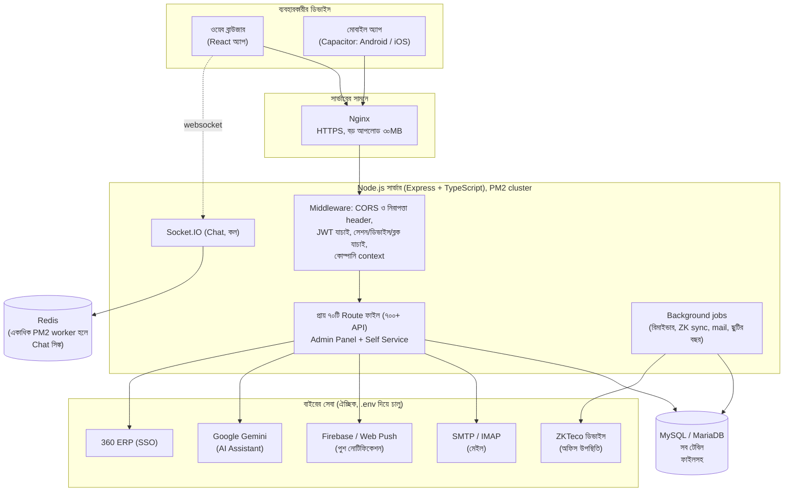

**মূল কথা:** একটাই সার্ভার প্রসেস ওয়েব পেজ, API আর Chat দেয়। ডাটা একটাই ডাটাবেসে (ফাইলসহ)। Background job শুধু এক worker-এ চলে (`jobRunner.ts`), যাতে রিমাইন্ডার দুবার না যায়।

---

## ২. একটি রিকোয়েস্টের জীবন (Request Lifecycle)

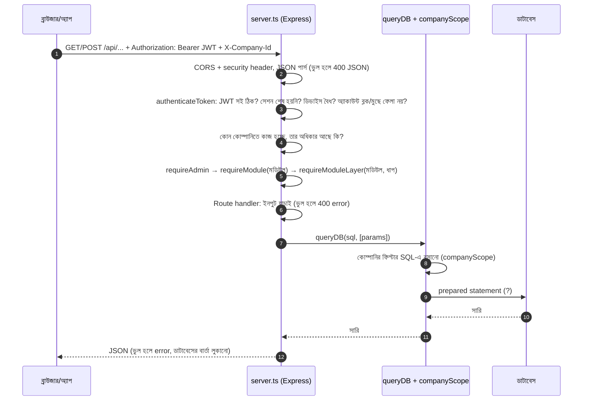

ফাইল: `server.ts` (`authenticateToken`, `requireAdmin`, `requireModule`, `requireModuleLayer`), `SessionSecurity.ts`, `DeviceRoutes.ts`, `AccountBlock.ts`, `companyContext.ts`, `companyScope.ts`, `ApiErrors.ts`, `WebSecurity.ts`।

---

## ৩. লগইন workflow

Login ID: কর্মীর **Employee ID** (যেমন `CPL-0201`, ছোট/বড় হাতের অক্ষর একই ধরা হয়); ইমেইল দিয়েও চলে। Employee ID-ই `users.username`, তাই দুজনের এক হতে পারে না; Employee ID বদলালে Login ID-ও বদলায় (`EmployeeLoginId.ts`)। Employee record ছাড়া অ্যাকাউন্ট (Superadmin, Project login) আগের Login ID-তেই চলে। সার্ভার চালু হলে যেসব কর্মীর login-এ username নেই, তারা নিজের Employee ID পায়। Admin Panel → Users → কারও Account → **Change Login ID** খুললে তাঁর বর্তমান email ও username দেখায়; নতুন email, নতুন username বা দুটোই দেওয়া যায় — যা বদলানো হয়েছে শুধু সেটাই save হয়। হাতে দেওয়া username পরে Employee record save করলেও থাকে।

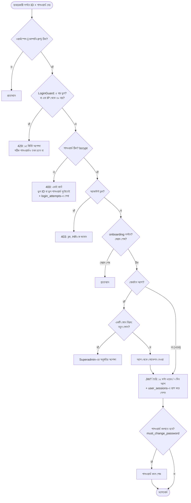

**বিকল্প প্রবেশ:** (ক) **Forgot password:** ইমেইলে ৬ অঙ্কের কোড (১৫ মিনিট, ৫ চেষ্টা) অথবা "HR-কে বলুন" (HR একটি অস্থায়ী পাসওয়ার্ড দেয়)। (খ) **Fingerprint/Passkey:** অ্যাপে ফোনের Keystore/Keychain-এর সিক্রেট, ওয়েবে WebAuthn passkey। দুটোই পাসওয়ার্ডের একই নিয়ম (ব্লক, ডিভাইস, কোম্পানি) মানে। অ্যাপে লগইন পাতায় fingerprint-এর জানালা নিজে একবার খোলে — অ্যাপ পুরো পর্দায় আসার পরে; আগে আঙুল, তারপর লোকেশন, তারপর সার্ভার। জানালা না খুললে বা সেন্সর ব্যস্ত থাকলে চালু করা fingerprint মুছে যায় না, "Sign in with fingerprint" চাপলেই আবার চেষ্টা হয়; শুধু ফোনের সংরক্ষিত চাবি সত্যিই না থাকলে (fingerprint বদলানো/মোছা) আবার চালু করতে বলে (`src/lib/fingerprint.ts`, টেস্ট `npm run test:fingerprint`)।
ফাইল: `AuthRoutes.ts`, `LoginGuard.ts`, `PasswordResetRoutes.ts`, `FingerprintRoutes.ts`, `SessionSecurity.ts`।

**সেশন শেষ হয় যখন:** ওয়েবে ১২ ঘণ্টা বা ৬০ মিনিট নিষ্ক্রিয়; অ্যাপে ৭ দিন বা ৩ দিন না খুললে (Superadmin বদলাতে পারে); Logout; Superadmin কাউকে বের করে দিলে; পাসওয়ার্ড বদলালে (বাকি সব সেশন); অ্যাকাউন্ট ব্লক হলে।

---

## ৪. কে কী দেখবে: অনুমতির সিদ্ধান্ত

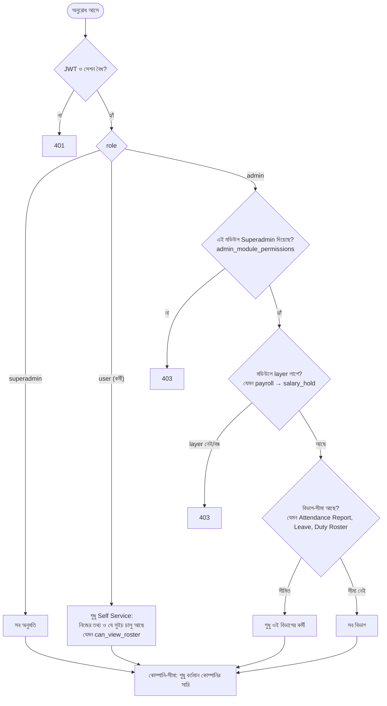

- **Layer:** একই মডিউলের ভেতরে ভাগ। যেমন Payroll: `read`, `salary_hold`, `audit_approve`, `accounts_pay`। যে layer ডিফল্টে বন্ধ (🔒), Superadmin টিক না দিলে কেউ পায় না। পুরো তালিকা: `security/access-control-matrix.md`।
- **নিয়ম (CLAUDE.md):** প্রতিটি নতুন ফিচারে UI লুকানো **এবং** API বন্ধ, দুটোই লাগে।
- **কোম্পানি বদলে কাজ (সাধারণ নিয়ম):** মাদার কোম্পানির HR-কে Superadmin sister company-র প্রবেশাধিকার ও সেখানকার Module Access দেন (Admin Panel → Companies → Company access); HR উপরের company switcher-এ ওই কোম্পানি বেছে সেখানকার কাজ করেন। একটা কোম্পানি বাছা থাকলে শুধু সেই কোম্পানির কর্মী ও রেকর্ড আসে।
- **All companies mode (আলাদা অনুমতি, ডিফল্টে বন্ধ):** Superadmin একই পাতায় "All companies mode" টিক দিলে switcher-এ **All companies** আসে। তখন যে কোম্পানিগুলোতে প্রবেশাধিকার আছে, সবগুলোর কর্মী এক তালিকায় (নামের পাশে কোম্পানির কোড) — রেকর্ড খোলা ও বদলানো (প্রোফাইল, ব্যাংক অ্যাকাউন্ট, ছুটি, উপস্থিতি…) কোম্পানি না বদলেই। নিয়ম: (১) প্রবেশাধিকার নেই এমন কোম্পানি আসে না; (২) নতুন রেকর্ড switcher-এ আগে বাছা কোম্পানিতে যায়; (৩) settings ও Module Access ওই বাছা কোম্পানির; (৪) বেতন (payroll) চালানো আগের মতো প্রতিটা কোম্পানিতে আলাদা — CBL-এর বেতন CBL বেছে চালাতে হয়। কোনো একটা কোম্পানি বাছলে আবার আগের মতো এক কোম্পানি। চালু/বন্ধ করা `user_access_audit`-এ থাকে।

---

## ৫. কর্মীর পুরো জীবনচক্র (HR-এর প্রধান প্রবাহ)

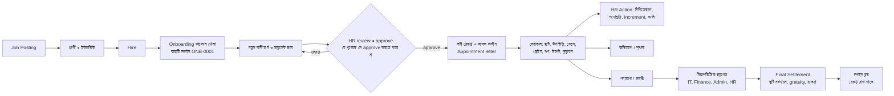

ফাইল: `RecruitmentRoutes.ts`, `OnboardingSelfServiceRoutes.ts`, `HROperationsRoutes.ts`, `ExitOffboardingRoutes.ts`, `EmployeeRecordsGuard.ts`।
Recruitment (ATS)-এ interview: HR তারিখ-সময়, দৈর্ঘ্য, কীভাবে (সামনাসামনি venue / online link / ফোন), interviewer আর candidate-এর জন্য নোট দিয়ে interview ঠিক করেন। পরে সময় বা জায়গা বদলানো, interviewer বদলানো বা বাতিল করা যায় — প্রতিটি বদল কারণসহ `candidate_interview_events`-এ থাকে (আগের → নতুন), আর interviewer-কে bell alert ("Interview scheduled / moved / place changed / cancelled") যায়। Candidate-কে email পাঠানো আলাদা অনুমতি (Recruitment → **Email candidates**, কাউকে আপনাআপনি দেওয়া হয় না): বদলের পরেই খসড়া খোলে (বদলানো যায়), interview-এর email-এর সাথে calendar invite (`.ics`, বাতিল হলে CANCEL) যায়, প্রতিটি email (পাঠানো / ব্যর্থ) `candidate_emails`-এ থাকে। শেষ বদলের পরে email না গেলে তালিকায় "Candidate not emailed yet" দেখায়। Offer / Regret / অন্য বার্তাও একইভাবে পাঠানো যায়। SMTP চালু না থাকলে কিছু পাঠানো যায় না, বাকি সব চলে।

গুরুত্বপূর্ণ: onboarding চলাকালে নতুন ব্যক্তি **কর্মী নন** (`all_employees`-এ নেই), তাই headcount, payroll, উপস্থিতিতে আসে না। শুধু "My Onboarding" পেজ খোলা যায় (বাকি সব 403 `ONBOARDING_ONLY`)।

**SIM ও ID card requisition** (`RequisitionRoutes.ts`, টেবিল `employee_requisitions`): কর্মী Self Service → "SIM & ID Card" থেকে (সুইচ `users.can_request_items`, ডিফল্টে বন্ধ) আর নতুন joiner My Onboarding থেকে (HR Ops Settings → "Joiners can ask for a SIM / ID card", ডিফল্টে বন্ধ) SIM বা ID card চান (New / Lost / Damaged / Replacement)। HR Operations → "SIM & ID Card" (layer `requisitions`, explicit-only) থেকে HR issue করে: SIM হলে Mobile Bill-এ ওই কর্মীকে আগে দেওয়া SIM বেছে নেয়, ID card হলে কার্ড নম্বর লেখে (onboarding checklist-এর "ID card issued" নিজে টিক হয়); অথবা কারণসহ turn down। কর্মী alert পান। Joiner-এর request onboarding approve হলে কর্মীর নামে যায়; তার আগে issue করা যায় না।

---

## ৬. ছুটির workflow

- ব্যালেন্স: ছুটির বছর শুরুতে নীতি (workflow) অনুযায়ী বসে; বছর শেষে rollover job চলে (`LeaveRoutes.ts`, ৬ ঘণ্টা পরপর পরীক্ষা)।
- কত দিন কাটবে: প্রতিটি Leave Type-এর নীতিতে HR ঠিক করেন (Leave Manage → Leave Policies → "Weekends & holidays inside the leave", `leave_category_policies.count_off_days`)। **Count them** (আগের মতো, default) হলে শুরু থেকে শেষ পর্যন্ত সব দিন কাটে। **Don't count them** হলে শুধু কর্মীর কাজের দিন কাটে: তাঁর শাখা-দলের Holiday Calendar, তার ওপর Duty Roster, অর্থাৎ payroll যে ক্যালেন্ডারে কাজের দিন গোনে (`leaveDayCount.ts`)। সংখ্যাটা সবসময় server গোনে। ফর্ম `GET /api/leave-applications/day-count` থেকে সেটা দেখায়, আর শুধু ছুটির দিনে পড়া আবেদন ফিরিয়ে দেওয়া হয়। Data Import-এ Days ঘর ফাঁকা থাকলেও একই নিয়মে গোনা হয়। বেতন দুই নিয়মেই এক: ছুটির ভেতরের সাপ্তাহিক বা সরকারি ছুটি কখনো বিনা বেতনে গোনা হয় না।
- অনুমোদনকারী ঠিক করে **Approval Template** (`approval_templates`/`_steps`/`_step_approvers`)। কর্মীর সুপারভাইজার বা নির্দিষ্ট ব্যক্তি/ভূমিকা হতে পারে।

---

## ৭. Approval engine (সব অনুমোদনের সাধারণ ইঞ্জিন)

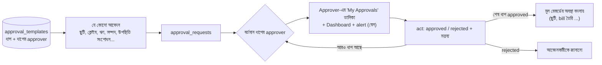

**কে প্রথম অনুমোদন দেন:** কর্মীর Direct Supervisor (না থাকলে Department Supervisor) ধাপ ১, তারপর Template-এর layer। Supervisor নিজে আবেদন করলে সরাসরি Template-এর layer-এ যায় (টেস্ট `test-logs/2026-10-25/07-supervisor-chain.log`, ৩৬/৩৬)।
**Supervisor ও Template দুটোই না থাকলে:** আবেদন "approver নেই" অবস্থায় অপেক্ষা করে (`approval_requests.awaiting_approver = 1`)। কর্মী alert পান এবং নিজের পেজে "No approver set yet — tell HR" দেখেন। Superadmin ও Approvals মডিউলের Admin alert পান। শুধু Superadmin সিদ্ধান্ত দিতে পারেন: আবেদনটা তাঁর "My Approvals"-এ "No approver set" চিহ্নসহ আসে, Admin Panel → Approvals-এও থাকে। Supervisor বা Template সেট হলে আবেদন নিজে থেকে সেখানে সরে যায়: কেউ Approvals তালিকা খুললে, নইলে প্রতি ১০ মিনিটে (`rehomeAwaitingApprovals`)। টেস্ট: `test-logs/2026-10-25/09-no-approver-after-fix.log`।
**Template কাকে লাগবে:** Admin Panel → Approvals → Templates → "Assign to Employees" ট্যাবে প্রতিটি কর্মীর জন্য আলাদা Template বাছা যায়। Department, Designation, User ও Template দিয়ে (একাধিক বেছে, টাইপ করে খুঁজে) তালিকা ছোট করে, একটি Template বেছে **Assign** চাপলে ছোট করা সব কর্মীকে একসাথে সেট হয় (`PUT /api/template-assignments/bulk`, একজনের জন্য `PUT /api/template-assignments`; দুটোতেই Approvals মডিউলের Edit/Add layer লাগে)।
**Ad-hoc approver (মাঝখানে আরেকজনকে যোগ):** যে Layer-এ আবেদনটা অপেক্ষা করছে তার approver Approve Application-এ **Add approver** চেপে একজনকে বেছে কারণ লিখে পাঠাতে পারেন (Module Access-এর switch **Approvals — add an ad-hoc approver**, `users.can_add_adhoc_approver`, শুরুতে বন্ধ; Superadmin সবসময়)। তখন আবেদনটা শুধু সেই মানুষের কাছে যায় (`approval_requests.adhoc_approver_id`), তিনি alert পান আর কার্ডে দেখেন কে কেন চেয়েছেন। তিনি **Approve** করলে আবেদন একই Layer-এ আগের approver-এর কাছে ফিরে আসে (Layer এগোয় না, alert যায়); **Reject** করলে পুরো আবেদন বাতিল। আবেদনকারী নিজে বা নিজেকে বাছা যায় না, একসাথে একজনই। Trail-এ `adhoc_added` আর `adhoc: true`-সহ approve থাকে। API: `GET /api/my-approvals/adhoc-candidates`, `POST /api/my-approvals/:id/adhoc`।

ফাইল: `ApprovalRoutes.ts` (তালিকা ও act: `GET /api/my-approvals`, `POST /api/my-approvals/:id/act`), `Alerts.ts` (notification)।

---

## ৮. উপস্থিতি: তিন উৎস, একটি হিসাব

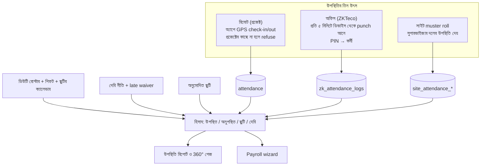

- রোস্টারে "Off" বা শিফট দিলে ওই কর্মীর ওই দিনের ছুটি/কর্মদিবস ও দেরির সময় বদলে যায় (`RosterRoutes.ts`)।
- ভুল উপস্থিতি: কর্মী **সংশোধন আবেদন** দেয় → Approval। In Time ওই দিনের; Out Time In Time-এর আগে দিলে সেটা night shift ধরে পরদিন সকালের সময় হিসেবে যায় (ফর্মে "Next day" লেখা দেখায়)। অন্য তারিখের সময় বা In-এর আগের Out সার্ভার নেয় না।
- ZK ডিভাইসের PIN কর্মীর সাথে না জুড়লে punch কারো নামে যায় না (Unlinked PINs তালিকা)।

---

## ৯. Payroll workflow (HR → Audit → Accounts)

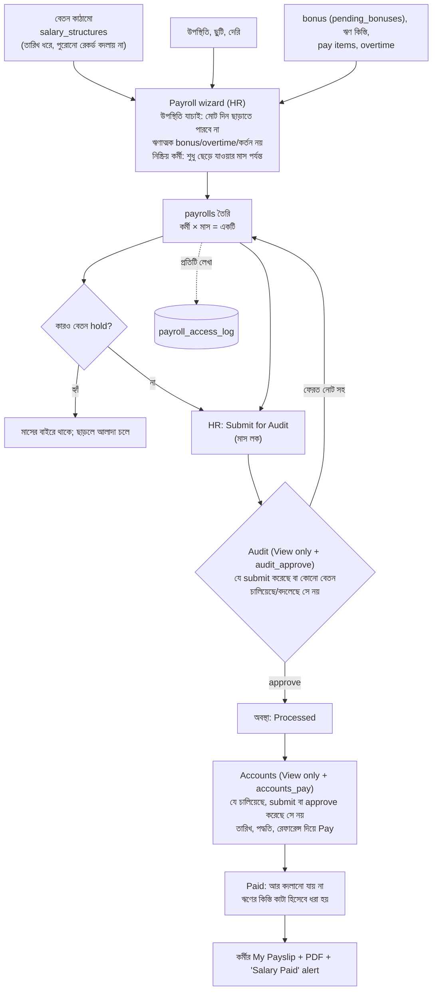

**হিসাব:** net = মোট আয় (বেসিক + ভাতা + overtime + bonus) − কর − PF − ঋণ কিস্তি − অনুপস্থিতি/দেরি কর্তন − অন্য কর্তন। কর ও PF **হাতে/কাঠামোতে দেওয়া** (আয়কর স্ল্যাবের স্বয়ংক্রিয় হিসাব নেই)।
**কে কোন layer পায়:** HR = "Payroll" (`read`, বানানো ও বদলানো)। Audit = "View only" (`payroll_view`) + Audit Approve। Accounts = "View only" + Accounts Pay। View only সব পেজ ও রিপোর্ট দেখে, কিছু বদলাতে পারে না। নিয়মগুলো Superadmin-এর জন্য খাটে না।
**Payslip পাঠানো (Payroll → Payslips):** একজনকে (সারির Email/PDF), কয়েকজনকে (টিক দিয়ে বা নাম/ID/বিভাগ খুঁজে বেছে "Email Selected" / "PDF of Selected"), অথবা কাউকে না বাছলে সবাইকে। Email পাঠানোর আগে কতজনকে যাবে তা জিজ্ঞেস করে। প্রত্যেকে নিজের payslip PDF পান (`POST /api/payroll/:id/email`, Payroll module ও "Payroll" layer লাগে)।
**Run Payroll-এ খোঁজা ও বাছা:** Attendance & Leave, Adjustments আর Preview & Calculate — তিন ধাপেই নাম / Employee ID / পদ / বিভাগ লিখে খোঁজা আর বিভাগ বাছাই (লিখে খোঁজা যায়)। Attendance & Leave-এ "Select all / Unselect all" (খোঁজা থাকলে "Select shown / Unselect shown") আর মাথার checkbox শুধু দেখানো কর্মীদের বদলায়; তাই খুঁজে খুঁজে কয়েকজনকে বাছা যায়। খোঁজা শুধু দেখানো বদলায় — হিসাব ও submit সব বাছা কর্মীর হয়, Preview-এর মোট পুরো run-এর।
**দেরি মাফ (Late waiver):** Run Payroll → Attendance & Leave-এ Late সংখ্যায় চাপলে প্রতিটি দেরির দিন আসে; কোনো দিন **Waive** করতে **কারণ লেখা বাধ্যতামূলক** (৩ অক্ষরের কম হলে server 400), সাথে চাইলে একটা ফাইল (ছবি, PDF, Word, Excel; ৫ MB পর্যন্ত — `late_waivers.attachment_*`)। মাফ করা দিনে কারণ আর ফাইলের লিংক দেখায় (`GET /api/payroll/late-waivers/:id/attachment`, Payroll module); Un-waive করলে দিনটা আবার গোনা হয়।
**Approval-এ Salary sheet:** Payroll → Approval-এ মাসের প্রতিটি কর্মীর বেতন স্ক্রিনেই দেখা যায় — দিন (Working / Present / Absent / Leave / LWP), Late, Gross, অনুপস্থিতি/দেরি কর্তন, অন্য কর্তন, Net, আগের মাসের Net-এর তুলনায় % বদল, কোথায় পাবে (Bank/MFS), Status। খোঁজা, বিভাগ বাছাই, "Net changed 10%+ / New this month / On hold / Absent-late cut" ফিল্টার, মোট সারি, সারিতে চাপলে পুরো ভাঙন, যা দেখাচ্ছে তার Excel। Layer `approval_sheet` (Payroll-এর ভেতরে; সাধারণ দেখা, তাই layer সেভ না থাকলে ডিফল্টে থাকে; Audit/Accounts-এর layer সেভ করা থাকলে এটা টিক দিতে হয়) — `GET /api/payroll/approval/:month/salary-sheet`।

**Approval-এ Top Sheet:** Payroll → Approval-এ Accounts-এর কাগজের Top Sheet-এর মতো — মাসের বেতন **Branch / site অনুযায়ী** এক সারিতে (চাইলে Department অনুযায়ী): Actual Salary (Basic + Allowance, কাটা ছাড়া), Salary after deduction (Absent / LWP / Late কাটার পরে), Allowance (Overtime + Bonus + Allowance-এর লাইন), Arrear (Arrear adjustment), Gross Salary, Other Deduction (Other + Recovery + কাটার লাইন), Advance, TDS, Loan, Employee Contribution (PF), Net Salary, আর কীভাবে দেওয়া হলো — By EBL Card / By Cash / By Bank (কর্মীর Payment ভাগ থেকে; যে Bank account-এর নাম বা ব্যাংকের নামে "Card" আছে সেটা Card; ভাগ না থাকলে run-এর Payment method; MFS থাকলে আলাদা column)। Head Office প্রথমে, তারপর A–Z; নিচে TOTAL আর **Prepared / Authorized / Approved By** — মাসটা যিনি Submit (HR), Approve (Audit) আর Pay (Accounts) করেছেন, নাম ও তারিখসহ। সাইটের নামে চাপলে সেই সাইটের নিজের sheet: প্রতি কর্মী (নাম, পদ, ID, যোগদানের তারিখ, Working Day, Present…Net Payable, Bank / Card / Cash, Remarks) আর নিচে "Salary Payable / Less: Advance & Deduction / Total withdraw / From Bank / From EBL Card / From Cash / Total Withdraw From Cash and Bank" (কাগজের sheet-এর মতো শেষেরটা Cash + Bank)। Hold-এ থাকা বেতন এ মাসে দেওয়া হয় না, তাই sheet-এ নেই (আলাদা লেখা থাকে)। Excel: প্রথম sheet Top Sheet, তারপর প্রতি সাইটের আলাদা sheet; PDF একইভাবে (প্রতি সাইট নতুন পাতায়); Email-এ PDF। Layer `top_sheet` (সাধারণ দেখা, তাই layer সেভ না থাকলে ডিফল্টে; সেভ করা থাকলে টিক দিতে হয়) — `GET /api/payroll/approval/:month/top-sheet?by=branch|department`।

**Advance আর Loan আলাদা:** `employee_advances.kind` (`advance` / `loan`) — কর্মীর Loan / Salary Advance request থেকে আসা সারি তার ধরন নেয়, HR-এর "New Loan / Advance"-এ Type বাছা যায় (আগের হাতে লেখা সারি Advance)। প্রতি payroll run-এ কিস্তির মোট আগের মতো `advance_deduction`-এ, তার Loan অংশ `payrolls.loan_deduction`-এ (Generate, Run Payroll ও Edit-এর সময় লেখা হয়); Top Sheet-এ Advance = মোট − Loan, তাই এই পরিবর্তনের আগের মাসগুলোতে সবটা Advance-এ দেখায়।
**Approval-এ Month comparison:** এই মাস বনাম আগের মাস (বা বাছা যেকোনো মাস) — মোট Net ও কর্মীর সংখ্যা, পার্থক্য ও %; **কেন মোট বদলাল** (আগের মাসের Net → নতুন কর্মী + → চলে যাওয়া/বেতন হয়নি − → বাকিদের Basic, Allowances, Overtime, Bonus, Extra pay, অনুপস্থিতি/LWP/দেরি কর্তন, Tax, PF, Loan, অন্য কর্তনের বদল → এই মাসের Net; যোগফল সবসময় মেলে); department পাশাপাশি (দুই মাসের Net, পার্থক্য, New/Left/Changed); প্রতি কর্মী — নতুন হলে যোগদানের তারিখ, চলে গেলে Exit request-এর ধরন, শেষ কর্মদিবস ও কারণ (না থাকলে Inactive / এই মাসে বেতন হয়নি), বদলালে প্রতিটি অংশ আগে → পরে ও তার কারণ (কত দিন absent, কত ঘণ্টা OT, কতবার late)। Excel-এ তিন শিট। Layer `month_compare` (সাধারণ দেখা, ডিফল্টে থাকে) — `GET /api/payroll/approval/:month/compare?vs=`।
**কর্মীর বেতন অ্যাকাউন্ট বদল:** যোগ/বদল/মোছা `employee_change_log`-এ (পুরনো → নতুন, কে) থাকে, কর্মী "Salary account changed" alert পায়।
ফাইল: `PayrollRoutes.ts`, `PayrollApprovalRoutes.ts`, `PayrollItemsRoutes.ts`, `PayslipRoutes.ts`।

---

## ১০. Conveyance Bill Claim → Disbursement

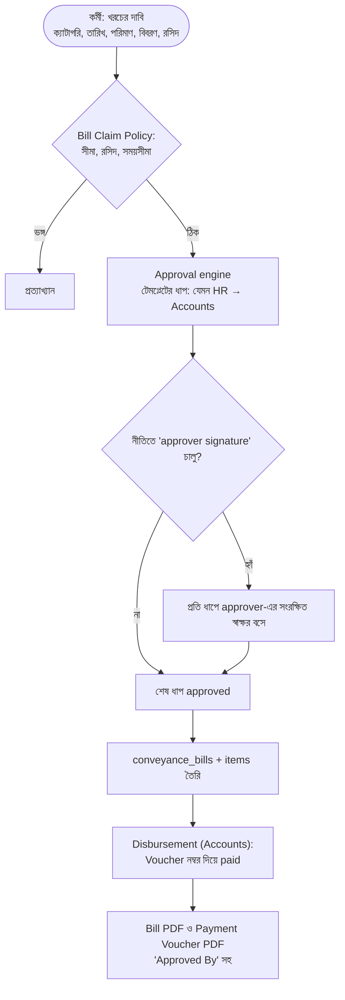

**Conveyance Disburser (Pay Out) layer:** টেমপ্লেটের শেষ ধাপ এই ধরনের হলে, আগের সব layer approve করার পর claim-টা এখনও Bill হয়নি, কিন্তু Admin Panel → **Disbursement**-এ উপরে "Claims waiting to be paid out" অংশে **Pending** হিসেবে দেখায় (`GET /api/disbursement/awaiting-claims`, Disbursement module লাগে)। সেই layer-এর লোক (বা Superadmin) এখান থেকে বা Approve Application থেকে Voucher দিয়ে **Disburse** করেন — claim approved হয়, নিজের Bill পায় ও paid হয় (`POST /api/my-approvals/:id/act`)। Disbursement module-এর অন্যরা দেখেন কার অপেক্ষায় আছে, কিন্তু Disburse করতে পারেন না।

**Movement Claim** আলাদা: কর্মী কোথাও গেলে GPS-সহ ক্লেইম, একই Approval engine (`MovementClaimRoutes.ts`)।
ফাইল: `ConveyanceBillClaimRoutes.ts`, `BillClaimPolicy.ts`।

---

## ১১. ই-স্বাক্ষর (Document Vault)

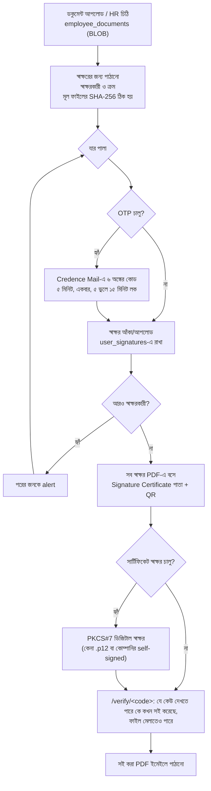

ফাইল: `DocumentVaultRoutes.ts`, `ESignRoutes.ts`, `ESignCertificate.ts`। Adobe Reader-এ "valid" দেখাতে লাইসেন্সপ্রাপ্ত CA-র সার্টিফিকেট দরকার (self-signed-এ "validity unknown")।

---

## ১২. PEPM: প্রকল্পের MPR চক্র

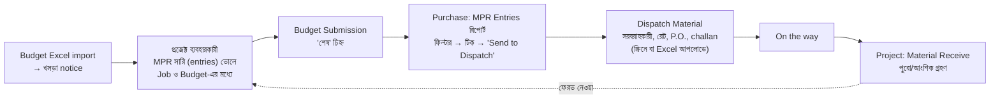

অনুমতি: Reports মডিউলের layer `dispatch_material`, `dispatch_all` (দুটোই 🔒)। Receive-এর সুইচ `can_receive_material`। ফাইল: `EntriesRoutes.ts`, `MprDispatchRoutes.ts`, `BudgetImportRoutes.ts`।

**Job Edit অনুমোদন:** Final Submit হয়ে যাওয়া Job-এ `can_job_edit` থাকা ব্যবহারকারী নতুন Job, Add MPR বা Delete MPR চাইলে সেটা সরাসরি হয় না, `job_edit_requests`-এ জমা থাকে। PEPM Manage → MPR Edit Log → Job Edit Approvals থেকে Approve/Reject (মডিউল `editlog`)। Details-এ দেখায় কী বদলাবে: মোছার সারির সব তথ্য (dispatch/receive হয়ে থাকলে সতর্কতা), যোগ হওয়া সারির Budget Qty আগে → পরে, আর Job-এর সব MPR সারি, বদলটা জায়গামতো চিহ্নিত (`GET /api/job-edits/:id/context`, একই `editlog` gate)। কয়েকটা অনুরোধ টিক দিয়ে একসাথে Approve/Reject করা যায় (প্রতিটা একই `POST /api/job-edits/:id/act` দিয়ে যায়; যেটা আর approve করা যায় না সেটা জানানো হয়, বাকিগুলো হয়ে যায়)।

---

## Dashboard-এর উপরের অংশ (কম্পিউটারে)

"Welcome back!"-এর বদলে (`DashboardGreeting.tsx`): ক্যালেন্ডারের পাতায় আজকের তারিখ, সময় অনুযায়ী শুভেচ্ছা, একটাই সার্চ বক্স (Ctrl K) — Pages (sidebar-এর নিজের মেনু, তাই যার যে পেজ খোলার অনুমতি নেই তা আসে না; `src/lib/navRegistry.ts`), People (Employee Directory, যা সবাই আগে থেকেই দেখে) আর "Waiting for you" (নিজের Approve Application তালিকা)। পাশে Check in (My Attendance কার্ডে নিয়ে যায়, check-in থাকলে Check out), + মেনুতে দ্রুত কাজ (Apply leave, New MPR entry, Book a ride, Conveyance claim, Request to HR — যার যেটা আছে)। নিচে আজকের চিপ: check-in হয়েছে কিনা ও কখন (`GET /api/attendance/today-summary` — শুধু নিজের সময়), কয়টা অনুমোদন অপেক্ষায়, কয়টা কাজের শেষ দিন আজ বা পেরিয়েছে।

## Monthly Attendance Report → Department Summary

Admin Panel → Monthly Attendance Report-এর তৃতীয় ট্যাব **Department Summary** (Attendance Reports module-এর layer `dept_summary`; সাধারণ পড়া, তাই layer না রাখা অ্যাকাউন্ট ডিফল্টে পায়; Superadmin সবসময়)।

- **One day:** বাছা দিনে প্রতি department-এ কতজন Present, Absent, Leave, Delay, Extreme Delay। **Whole month:** মাসের প্রতিটি দিন যোগ করে (person-days), আজ পর্যন্ত।
- Present / Absent / Leave আসে Monthly report-এর একই হিসাব থেকে (`computeMonthlyReport`: Weekend/Holiday, Duty Roster, approved leave, joining date); Delay / Extreme Delay payroll-এর late policy থেকে (`computeLateDatesByEmployee`, salary month অনুযায়ী)। Delay-এর দিনও Present-এ গোনা। Attendance % = (Present + Leave) ÷ working days। শুধু Active কর্মী।
- Filter: Departments (একাধিক), Project। Department সীমা থাকা Admin শুধু নিজের department দেখেন।
- যেকোনো সংখ্যায় চাপলে কারা — দিনে কে কখন ঢুকেছে বা কোন ছুটি, মাসে কার কত দিন। PDF (department টেবিল) ও Excel (Summary + People শিট)।
- API: `GET /api/attendance/report/department-summary?mode=day&date=` বা `mode=month&year=&month=` (`PayrollRoutes.ts`)।

## Monthly Attendance Report → Custom Report (Attendance Report Builder)

Admin Panel → Monthly Attendance Report-এর চতুর্থ ট্যাব **Custom Report** (Attendance Reports module-এর layer `custom_report`; একই হাজিরার ডাটা পড়া, তাই layer না রাখা অ্যাকাউন্ট ডিফল্টে পায়; layer বাছা থাকলে টিক না দিলে পায় না; Superadmin সবসময়)। HR-এর যেকোনো প্রশ্ন — "৯:০৫-এর পরে কে এসেছে", "৬টার আগে কে বের হয়েছে", "এ মাসে ৩ বারের বেশি দেরি কার", "check-out দেয়নি কারা", "৮ ঘণ্টার কম কাজ" — কলাম ধরে শর্ত দিয়ে।

- **প্রতিটি সারি = এক কর্মীর এক দিন** (`attendanceCustomRows`, `PayrollRoutes.ts`): তারিখ, বার, নাম, Employee ID, পদ, Department, Status (Present / Absent / Leave / Holiday / Weekend / Off), In, Out, কাজের ঘণ্টা, Late (On time / Delay / Extreme), কত মিনিট দেরি, কত মিনিট আগে বের, overtime মিনিট, check-out নেই, Shift ও তার শুরু-শেষ, Source (Remote / Office), Project, ছুটির ধরন, Holiday। Present / Absent / Leave আসে `computeMonthlyReport` থেকে, Delay / Extreme payroll-এর late policy থেকে (`computeLateDatesByEmployee`), শিফট Duty Roster থেকে; roster-এ শিফট না থাকলে late policy-র শুরু আর "Office ends" (ডিফল্ট ১৮:০০)। Roster-এর Off day / Weekend / Holiday-তে কাজ করলে দেরি বা আগে বের ধরা হয় না, পুরো কাজের সময় overtime।
- **শর্ত:** যেকোনো কলাম + অপারেটর (আগে / পরে / মধ্যে, =, ≥, <, এর মধ্যে, আছে / নেই…); সব শর্ত মিলবে (all) বা যেকোনো একটা (any)।
- **দেখাবে:** বিস্তারিত (প্রতিদিন) বা সারাংশ — কর্মী / Department / পদ / দিন / বার অনুযায়ী ভাগ; প্রতিটি দলে কর্মী, দিন, Present, Absent, Leave, Late, Extreme, check-out নেই, আগে বের, overtime দিন ও ঘণ্টা, গড় In / Out / ঘণ্টা, Attendance %। "শুধু যেখানে" (যেমন Late ≥ ৩) আর বেশি থেকে কম সাজানো।
- এক ক্লিকের তৈরি প্রশ্ন (chip), Period (আজ, গতকাল, এ সপ্তাহ, এ মাস, গত মাস, নিজের তারিখ — সর্বোচ্চ ৯২ দিন), Departments (একাধিক), Employee (`SearchSelect` — নাম · ID · পদ · Department), কলাম বাছাই, PDF ও Excel।
- Department সীমা থাকা Admin শুধু নিজের department-এর সারি পান (অন্য department চাইলেও খালি), কর্মী বাছাইয়ের তালিকাতেও শুধু তাঁরা।
- API: `POST /api/attendance/report/custom`, `GET /api/attendance/report/custom/people` (`PayrollRoutes.ts`, `requireAdmin` + layer `custom_report`)।
- **AI Assistant:** একই প্রশ্ন লিখে বা বলে করা যায় — "আজ ৯:০৫-এর পরে কে কে এসেছে", "২৮ অক্টোবর ৬টার আগে কে বের হয়েছে", "এ মাসে ৩ বারের বেশি late কারা", "গত মাসে check out দেয়নি কারা", "এ সপ্তাহে ৮ ঘণ্টার কম কাজ", "অক্টোবরের late department wise", "Finance department-এর absent"। Local bot নিজে সময় (বের হওয়ার ১–৮টা মানে সন্ধ্যা), তারিখ / সপ্তাহ / মাস, শর্ত আর ভাগ বোঝে (`parseAttendanceQuestion`), টুল `attendance_custom_report` একই API ডাকে প্রশ্নকারীর token দিয়ে — তাই layer না থাকলে "অনুমতি নেই", department সীমা থাকলে শুধু সেই department। উত্তরের সাথে PDF / Excel।

## Management Dashboard (পুরো কোম্পানি, এক মাস)

Admin Panel → **Management Dashboard** (মডিউল `management_dashboard`; Module Access-এ যাকে দেওয়া হয় সে-ই দেখে, Superadmin সবসময়)। একটা read-only API (`GET /api/management-dashboard?month=YYYY-MM&departments=…`, `ManagementDashboardRoutes.ts`) চালু টেবিলগুলো থেকে হিসাব করে, নিজের কোনো টেবিল নেই। মাস আর Department (একাধিক) বাছা যায়, সব সংখ্যা আগের মাসের সাথে তুলনাসহ:

- **উপরের ৬টা সংখ্যা:** Headcount (সক্রিয় কর্মী), Attendance (Monthly Attendance report-এর একই হিসাব — office punch + remote + site + approved leave, roster ও late policy মেনে), Salary cost (Payroll-এর net, মাস run না হলে "Not run yet"), আজ ছুটিতে, অনুমোদনের অপেক্ষায় (৩+ দিন আটকে), Targets (task-এর weight ধরে অগ্রগতি)।
- **কার্ড:** যোগদান/প্রস্থান (৬ মাস; প্রস্থান = বাতিল নয় এমন exit-এর last working day), department-ভিত্তিক হাজিরা, মাসের খরচ (donut: বেতন, লোন/অগ্রিম, disbursed conveyance, মোবাইল বিল), অনুমোদন কত দ্রুত (ধরন অনুযায়ী অপেক্ষায় আর গড় দিন), PEPM প্রজেক্টে এ মাসের MPR মূল্য ও পথে/পৌঁছানো মাল, department-ভিত্তিক টার্গেট, Workforce, Recruitment pipeline, গাড়ি ও সম্পদ।
- **Needs attention:** নিয়ম দিয়ে তৈরি — ৩+ দিন আটকে থাকা অনুমোদন, ১০%+ দেরিতে আসা department, আগের মাসের চেয়ে ৩ pt-এর বেশি হাজিরা কমা, deadline পেরোনো টার্গেট, ৫%-এর বেশি বেতন বৃদ্ধি, চলমান resignation, খোলা grievance।
- যেকোনো কার্ড বা সারিতে চাপলে ডান থেকে বিস্তারিত প্যানেল খোলে (department বা ব্যক্তি অনুযায়ী ভাঙা), সেখান থেকে Excel-এ export।

## HR Data Import: কে Excel থেকে ডাটা ঢোকাতে পারে

Admin Panel → **HR Data Import** নিজস্ব মডিউল (`data_import`)। Employees, Leave বা Attendance মডিউল থাকা মানে শুধু দেখা/কাজ করা — Excel থেকে ঢোকানো নয়।

- Module Access → HR Data Import চালু করে প্রতিটি ধরনের জন্য আলাদা টিক: Import Employee Details, Leave, Movement Claims, Conveyance Bill Claims, Remote Attendance, Office Attendance। সব শুরুতে বন্ধ।
- একটা ধরন দেখা ও import করা যায় তখনই যখন ডাটার নিজের মডিউল **এবং** সেই টিক দুটোই আছে (`GET /api/data-import/kinds`, `POST /api/data-import/:kind` — না থাকলে 403)।
- বেতন (Salary Setup bulk upload) আগের মতো Payroll layer `salary_bulk_upload` দিয়ে।
- যাঁরা আগে শুধু মডিউল থাকায় import করতেন, তাঁদের নতুন টিক দিতে হবে।

## ১৩. যোগাযোগ: Notice, Chat, Mail, Alerts

| ব্যবস্থা | কীভাবে চলে |
|---|---|
| **Notice** | Admin HTML লেখে → সার্ভার `NoticeSafety.ts` দিয়ে পরিষ্কার করে → টার্গেট (সবাই বা নির্দিষ্ট ব্যক্তি, `notice_targets`) → লগইনের পর popup ও Notice board |
| **Chat** | Socket.IO; রুম, ব্যক্তিগত মেসেজ; edit (১৫ মিনিট), unsend, forward, pin, reaction; ফাইল ডাটাবেসে। Module Access-এর সুইচে চালু। Chat তালিকায় ও মানুষ বাছার ঘরে (New Chat / Group / Community / Add Members) **Department** filter — একাধিক department বাছা যায় (`/api/chat/directory`-র department থেকে); Group-এ "Select all shown" দিয়ে বাছা department-এর সবাইকে একসাথে নেওয়া যায় |
| **Credence Mail** | নিজস্ব মেইল ক্লায়েন্ট; IMAP/SMTP দিয়ে মেইল সার্ভারের সাথে; পাসওয়ার্ড AES-256-GCM-এ এনক্রিপ্ট; গ্রুপ, ফিল্টার, টেমপ্লেট, নির্ধারিত পাঠানো |
| **Alerts (বেল)** | সার্ভারে `createAlert()`; অ্যাপে পুশ (Firebase), ওয়েবে Web Push। বেলের popup-এর "Clear all" ও মুছুন শুধু popup থেকে সরায় (`alerts.hidden_in_bell`, `POST /api/alerts/bell-clear`, `/:id/bell-hide`); Alerts পেজে (বেলের "View all") কোনো alert কখনো মোছা যায় না — Clear all বা মুছুন নেই, server-এ DELETE route-ও নেই; সব alert ৫০টা করে পাতায় (Prev / Next, ২৫–২০০ প্রতি পাতা; `GET /api/alerts?page=&page_size=&show=all|unread|read`), All / Unread / Read ট্যাব সংখ্যাসহ, আর প্রতিটা alert-এ Read ↔ Unread বোতাম (`POST /api/alerts/:id/read`, `/:id/unread`)। মানচিত্র (Leaflet) নিজের stacking layer-এ থাকে, তাই popup সবসময় মানচিত্রের উপরে খোলে |
| **AI Assistant** | কর্মীর প্রশ্ন → স্থানীয় নিয়মে উত্তর; Gemini চালু থাকলে প্রশ্ন ও ফল Google-এ যায়। সব ডাটা **প্রশ্নকারীর নিজের token দিয়ে** অ্যাপের নিজের API থেকে আনে, তাই যা দেখার অধিকার নেই তা দেখায় না; নিজে কিছু লেখে না। **রিপোর্ট:** Attendance Report Builder (শর্ত দিয়ে যেকোনো হাজিরার প্রশ্ন — `attendance_custom_report`, layer `custom_report`), Reports & Insights-এর ১৫টা (হাজিরা, remote check-in, movement / bill claim, category, conveyance bill, disbursement, ছুটির আবেদন, ধরন অনুযায়ী ছুটি, asset register / handover / requisition, ride history, vehicle utilization — `company_report`), Department Summary, Payroll Salary sheet ও Month comparison, HR Operations-এর Employee Reports (salary register, loan, training, document, nominee, শিক্ষা, অভিজ্ঞতা, blood group directory…), Mobile Bill, Employee Tracking (এখন কে, Stay Report), Duty Roster, Break, PEPM (MPR entries, Budget submission, Dispatch), Management Dashboard, Grievance, আর লগ (Payroll activity, entry edit, office punch)। প্রতিটা আসে সেই রিপোর্টের **নিজের API** থেকে প্রশ্নকারীর token দিয়ে, তাই পাতার মতোই module, layer, Department / Tracking সীমা ও কোম্পানি যাচাই হয়; যেখানে API পাতার চেয়ে ঢিলা (PEPM entries — admin role সব পায়), সেখানে Assistant আগে পাতার নিয়ম (Reports module + Read layer, server-এর `hasModuleLayer`) যাচাই করে। সময়কাল ("গত মাস", "এ বছর", "অক্টোবর", "আজ") local bot নিজে বোঝে; **হাজিরার প্রশ্নে মাস:** নিজের হাজিরা ও নিজের দেরির দিন সবসময় **বেতনের মাসে** (Payroll → Salary month setting, `salary_month_settings`; My Attendance যেমন) — "এই মাস", "গত মাস", "অক্টোবর" মানে সেই বেতনের মাস (যেমন ২৬ তারিখ শুরু হলে নভেম্বর = ২৬ অক্টোবর – ২৫ নভেম্বর, আজ পর্যন্ত)। HR-এর রিপোর্টে (অন্যের হাজিরা `employee_attendance`, Attendance Report Builder) আগের মতো **ক্যালেন্ডার মাস**, Monthly Attendance Report-এর মতো; প্রশ্নে "salary month / বেতনের মাস" (বা "গত salary month") বললে তবেই Payroll থেকে সেই বেতনের মাসের তারিখ — দুই ক্যালেন্ডার মাস জুড়লে দুটো মাসের রিপোর্ট থেকে শুধু ওই দিনগুলো গোনা হয়। উত্তরে "বেতনের মাস" ও তারিখ লেখা থাকে; Gemini-কেও এই নিয়ম আর তারিখ জানানো হয়। Login কোনো Employee record-এ যুক্ত না থাকলে (যেমন Superadmin) "নিজের" প্রশ্নের উত্তরে বলে নিজের তথ্য নেই — Employees দেখার অধিকার থাকলে নিজেই কীভাবে যুক্ত করবেন (Employees → Link Existing), না থাকলে HR-কে বলতে; আর হাজিরা রিপোর্টের অধিকার থাকলে সেই মাসের পুরো কোম্পানির হাজিরা (Department অনুযায়ী) দেখায়। উত্তরে অন্য লিপির অক্ষর (Gemini কখনো "의" ঢুকিয়ে দেয়) বাদ যায়। দিন, সপ্তাহ, বছর আগের মতো; Gemini যেটা দিয়ে উত্তর দেয় (রিপোর্টের নাম সহ) তা শিখে রাখে। **ফর্ম পূরণ (খসড়া কার্ড):** "ছুটি চাই…" → ছুটির আবেদন, "কাল ১০টায় অফিস থেকে গুলশান যাব গাড়ি লাগবে" → Book a Ride (`prepare_ride_booking`), "গতকাল চেক ইন দিতে ভুলে গেছি ৯:১০-এ এসেছি" → Timesheet-এর Correct Attendance (`prepare_attendance_correction`, শুধু যাঁর Remote Attendance + Timesheet চালু), "ব্যাংকে যাচ্ছি movement check in করো" / "পৌঁছে গেছি check out" → Movement Claim (`prepare_movement_claim`, শুধু যাঁর Movement Claim চালু; খোলা claim থাকলে তার Check Out কার্ড — বোতাম চাপার মুহূর্তের লোকেশন ও সময় নেয়, `/api/claims/check-in`, `/api/claims/:id/check-out`)। Assistant শুধু কার্ড পূরণ করে; কর্মী দেখে নিজে বোতাম চাপলে পাতার মতোই একই API-তে (`/api/leave-applications`, `/api/vehicles/requisitions`, `/api/attendance/corrections`) তাঁর নিজের token দিয়ে যায়, সব যাচাই সেখানে। Gemini থাকলে Gemini বোঝে; না থাকলে local bot নিজের parser দিয়ে (তারিখ, সময়, কোথা থেকে / কোথায়, ইন / আউট) একই কার্ড বানায়, আর Gemini যেসব কথায় এগুলো দিয়েছে তা `assistant_learned`-এ শিখে রাখে। **Voice** (Module Access → "AI Assistant — voice", `users.can_use_assistant_voice`, শুরুতে বন্ধ; Gemini লাগে): 🎤 চেপে বলা প্রশ্ন ১৬ kHz WAV হয়ে `POST /api/assistant/transcribe`-এ যায়, Gemini লিখে দেয়, তারপর লেখা প্রশ্নের মতোই উত্তর; বলা প্রশ্নের উত্তর নিজে পড়ে শোনায়, প্রতিটি উত্তরে "শুনুন" বোতাম — ডিভাইসের নিজের কণ্ঠ, না থাকলে Gemini-র কণ্ঠ (`POST /api/assistant/speak`); Assistant-এর উপরে 🔊 বোতামে প্রত্যেকে নিজের কণ্ঠ বাছেন — ফোনের নিজের কণ্ঠ (স্বয়ংক্রিয়, বা ফোনে একাধিক বাংলা কণ্ঠ থাকলে তার একটি) অথবা Gemini-র ১৫টা কণ্ঠের একটি (নারী / পুরুষ, যেমন মিষ্টি ও প্রাণবন্ত — Aoede), প্রতিটি চেপে আগে শুনে দেখা যায়; বাছাই ওই ডিভাইসে মনে থাকে, server শুধু তালিকার নাম নেয় (`TTS_VOICES`, অন্যথায় `GEMINI_TTS_VOICE`) — উত্তর বাক্যে ভাগ হয়ে যায়, ছোট প্রথম অংশ তৈরি হলেই বাজা শুরু, বাকিগুলো বাজতে বাজতে তৈরি হয়; একবার তৈরি অংশ ব্রাউজারে আর ১০ মিনিট সার্ভারে মনে থাকে, তাই আবার শুনলে সঙ্গে সঙ্গে বাজে। রেকর্ড কোথাও জমা থাকে না, এক মিনিট পর্যন্ত। **Email (রিপোর্ট পাঠানো):** Assistant-এর উত্তরের Email বোতাম (যাঁর "Email reports" চালু) খোলে **Credence Mail-এর নিজের New message window** (`openMailCompose`, `src/components/mail/ComposeLauncher.tsx` — Mail → Write-এর একই `MailCompose`): প্রশ্নকারীর নিজের mailbox, তাঁর default **signature**, template, Cc / Bcc, আর রিপোর্টের PDF আগে থেকেই সংযুক্ত; Send করলে `/api/mail/send` দিয়ে তাঁর নিজের ঠিকানা থেকে যায়, কপি Mail → Sent-এ; বন্ধ করলে Drafts-এ থাকে। Mail চালু না থাকলে বা mailbox যুক্ত না থাকলে window খোলে না, কী করতে হবে বলে দেয় — server-এর `.env` SMTP account-এ কখনো যায় না। অন্য পাতার রিপোর্ট Email আগের মতো server-এর SMTP থেকে (`/api/reports/email`, যেটা `via: "own"` দিলে প্রেরকের mailbox দিয়েও পাঠাতে পারে)। |

---

## ১৪. Background jobs (একটি worker-এ)

| কাজ | কত পরপর | ফাইল |
|---|---|---|
| ZKTeco ডিভাইস থেকে punch আনা | ৫ মিনিট | `zkSync.ts` (node-cron) |
| অপেক্ষমাণ approval নতুন approver-এ সরানো | ১০ মিনিট | `server.ts` |
| HR/সাইট/টাস্ক/টার্গেট রিমাইন্ডার | ৩০–৬০ মিনিট | `HrRemindersRoutes.ts`, `TaskRoutes.ts`, `TargetRoutes.ts`, `SiteAttendanceRoutes.ts` |
| ছুটির বছর rollover পরীক্ষা | ৬ ঘণ্টা | `LeaveRoutes.ts` |
| Onboarding মেয়াদ শেষ | ১ ঘণ্টা | `OnboardingSelfServiceRoutes.ts` |
| Mail: নির্ধারিত পাঠানো / ফোল্ডার watch / পুরোনো blob পরিষ্কার | ১ মিনিট / ১ মিনিট / ৬ ঘণ্টা | `MailRoutes.ts` |
| Vehicle ride মেয়াদ | ১ মিনিট | `VehicleManagementRoutes.ts` |
| নির্ধারিত HR রিপোর্ট | ১০ মিনিট | `HrOpsReportsRoutes.ts` |

---

## ১৫. ডিপ্লয়মেন্ট

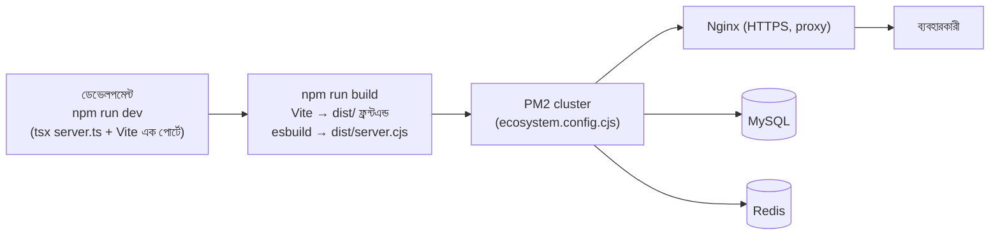

Node ≥ ২২। `.env`-এর মূল চাবি: `DB_*`, `JWT_SECRET`, `ADMIN_EMAIL/PASSWORD`, `CORS_ORIGINS`, `MAIL_ENCRYPTION_KEY`, `REDIS_URL`, `GEMINI_API_KEY` বা একাধিক key `GEMINI_API_KEYS="key1,key2"` (ঐচ্ছিক — একটার সীমা শেষ হলে সেটা বিশ্রামে যায় আর পরেরটা একই প্রশ্নেই উত্তর দেয়; chat, কথা লেখা ও পড়া সবখানে; সব শেষ হলে local bot), `ESIGN_CERT_*` (ঐচ্ছিক)।

---

## Book a Ride: ফোনের প্রথম পাতা

ফোনে (APK বা ছোট পর্দা) পেজের নাম header-এ logo-র জায়গায় বসে, পেজের ভেতরের শিরোনাম, tab আর "1 Route — 2 Ride details" সারি থাকে না; ফোনের Back প্রথমে খোলা তালিকা থেকে booking-এ, তারপর Book a Ride থেকে বের করে। Ride Status, Approved by Me, My Trips, Direct Book (যার যেটা আছে) একটা **My rides** বোতামের ভেতরে, পাশে খোলা ride-এর সংখ্যা। Pickup আর destination একটা card-এ (সবুজ বিন্দু → বেগুনি চৌকো); নিচে chip: Home / Work (save করা জায়গা, switch থাকলে), Projects (মানচিত্রে সব প্রজেক্ট), Map; Recent-এর ৩টা, বাকিগুলো "See all recent"-এ। লেখার সময় একটাই তালিকা: জায়গার প্রস্তাব, মিলে যাওয়া প্রজেক্ট, "Use … as typed" আর "Choose on map"। কম্পিউটারের পেজে মানচিত্রের বাঁ-উপরে **Projects** বোতাম: location দেওয়া সব প্রজেক্ট নামসহ pin হয়ে মানচিত্রে আসে, পাশে খোঁজার ঘরসহ তালিকা (`/api/vehicles/places/projects`); pin বা তালিকায় চাপলে প্রজেক্টের নামেই যেটা সক্রিয় (pickup বা destination) সেটা বসে। Zoom বোতাম ডান-নিচে।

## Book a Ride: pickup / destination মানচিত্রে বাছাই

মানচিত্র পুরো পর্দা জুড়ে, মাঝখানে স্থির pin ("This is your pickup point")। মানচিত্র থামলে pin-এর নিচের ঠিকানা আসে (`/api/vehicles/places/reverse`), আর নিচের প্যানেলে প্রস্তাব: ৫ কিমির মধ্যে সবচেয়ে কাছের অফিস / প্রজেক্ট সাইট (Projects-এর location, দূরত্বসহ — `/api/vehicles/places/nearby`), নিজের save করা জায়গা, আগে ব্যবহার করা গন্তব্য। খোঁজার icon চাপলে খোঁজার ঘর মানচিত্রের উপরে বসে (পেছনটা ঝাপসা হয় না), ফল নিচের প্যানেলে নম্বরসহ আসে আর মানচিত্রে প্রতিটার নম্বর দেওয়া চিহ্ন বসে; pin প্রথম ফলে চলে যায়, যে ফলে চাপা হয় সেটাই বাছাই হয়। Pin-এর ডগা ঠিক মানচিত্রের কেন্দ্রে, তাই যেখানে pin সেখানকার জায়গাই যায়; **Projects** বোতামও মানচিত্রের উপরেই খোলে (ঝাপসা নয়): location দেওয়া সব প্রজেক্ট মানচিত্রে নিজের pin আর নামসহ দেখায়, সবগুলো একসাথে পর্দায় আঁটে, নিচে তালিকা (কাছেরটা আগে, দূরত্বসহ — `/api/vehicles/places/projects`); নাম বা এলাকা লিখলে মানচিত্র আর তালিকা দুটোই ছোট হয়; pin বা তালিকায় চাপলে সেটা বাছাই, Back চাপলে মানচিত্র আগের জায়গায় ফেরে; "Add missing place" pin-এর জায়গার নিজের দেওয়া নাম বসায়। Bookmark দিয়ে জায়গাটা Home / Work / Other হিসেবে ড্রাইভারের জন্য নোটসহ save হয় (`ride_saved_places`, একজনের নিজের, Home ও Work একটাই করে, সর্বোচ্চ ৩০টা) — এটা Self Service switch **Book a Ride — saved places** (`users.can_save_ride_places`, শুরুতে বন্ধ); না থাকলে বোতাম লুকানো আর API 403। Save করা জায়গা বাছলে ride-এ ঠিকানার সাথে ড্রাইভারের নোটও যায়।

## ১৬. যা এই workflow-তে ধরা নেই

আসল ফোন অ্যাপের ভেতরের প্রবাহ (GPS, ক্যামেরা), প্রতিটি ছোট রিপোর্ট ও পেজ, মডিউলভিত্তিক সব এজ-কেস। বিস্তারিত দেখতে `docs/CredenceHR-Code-Guide-for-Laravel-Developers-BN.md` ও সংশ্লিষ্ট `*Routes.ts` ফাইলের শুরুর মন্তব্য পড়ুন (প্রতিটি ফাইলে প্রবাহ লেখা আছে)।

---

## Android app: ফোনের Back বোতাম

ফোনের Back প্রথমে সবচেয়ে উপরের খোলা popup / sheet / ধাপ বন্ধ করে (`backButtonStack.ts`, প্রতিটা popup `useBackButtonClose` দিয়ে নিজেকে রাখে)। কিছু খোলা না থাকলে পুরো পাতা এক ধাপ পেছায় (`App.tsx`): Chat / Alerts / Profile / যেকোনো Self Service পাতা → যেখান থেকে খোলা হয়েছিল (Dashboard); Admin Panel-এর কোনো পাতা → Admin Dashboard → User Dashboard। শুধু User Dashboard-এ "Press back again to exit", ২ সেকেন্ডের মধ্যে আবার চাপলে app বন্ধ।

## Timesheet → Correct Attendance: কে কখন জানতে পারে

কর্মী সংশোধনের আবেদন দিলে Approval Template / Supervisor-এর প্রথম ধাপের approver alert আর ফোনে push পান — "Attendance Correction Awaiting Your Approval" (click করলে Approve Application)। এক ধাপ approve হলে পরের ধাপের approver-ও একইভাবে জানেন (`ApprovalRoutes.ts` notifyNextStepApprovers)। শেষে approve বা reject হলে কর্মী নিজে alert পান, reject-এর কারণসহ; click করলে Timesheet খোলে (`server.ts` finalizeAttendanceCorrection / rejectAttendanceCorrection)।

## Vehicle Management → Inventory → Drivers

Inventory-তে দুটো ভাগ: Vehicles আর Drivers। Driver যোগ হয় শুধু Employees থেকে (নাম · Employee ID · পদ · বিভাগ লিখে খোঁজা); নাম, মোবাইল, বিভাগ Employee record থেকে আসে, এখানে রাখা হয় শুধু License নম্বর, ধরন, মেয়াদ, সাধারণ গাড়ি আর Active / Inactive (`vehicle_drivers`, `VehicleManagementRoutes.ts`)। Login নেই এমন কর্মীকে driver করা যায় না (live map-এ অবস্থান লাগে)। তালিকায় কেউ থাকলে ride-এ গাড়ি দেওয়ার সময় (Assign, Approve & Assign, Direct Book, Direct Assign) শুধু Active driver বাছা যায় — কে ফাঁকা, কার ride booked বা চলছে, কার License শেষ পাশে লেখা থাকে (`GET /api/vehicles/driver-picker`); License শেষ হলে server নেয় না। তালিকা খালি থাকলে আগের মতো যেকোনো অ্যাকাউন্ট। কেউ নিজে গাড়ি চালিয়ে নিতে চাইলে তাঁকে আগে Drivers-এ License সহ যোগ করতে হয় — তারপর তাঁর নিজের ride-এ তাঁকেই driver বাছা যায়; booking-এ আলাদা "নিজে চালাব" বিকল্প নেই। License শেষের ৩০ দিন আগে (বা শেষ হলে) Vehicle Management-এর লোকজন আর Superadmin একবার alert পান। তালিকা দেখা Vehicle Management module-এ; যোগ / বদল / বাদ "Manage drivers" layer-এ।

## আরও কিছু notification

- **নতুন ফোন (Device Access):** Superadmin approve করলে অ্যাকাউন্টটা "New phone approved" পায়, ফিরিয়ে দিলে "New phone not approved" (`DeviceRoutes.ts`)।
- **Asset ফেরত চাওয়া:** নিচে "Asset: কার হাতে দেওয়া, ফেরত কীভাবে যায়" দেখুন।
- **E-sign বাতিল:** HR সই নেওয়া বাতিল করলে যাঁর সইয়ের অপেক্ষায় ছিল তিনি "Signature no longer needed" পান (`ESignRoutes.ts`)।

## Asset: কার হাতে দেওয়া, ফেরত কীভাবে যায়

- **দেওয়া (Fulfill & Hand Over):** store keeper ফর্মে লেখেন কার হাতে দিলেন — কর্মী নিজে, নাকি তাঁর হয়ে অন্য কেউ (Employee হলে নাম · ID · পদ · বিভাগ লিখে খুঁজে; বাইরের কেউ হলে নাম আর মোবাইল দুটোই লাগে), কবে (ভবিষ্যতের সময় নেয় না) আর অবস্থা। Asset কর্মীর নামেই থাকে; কর্মী alert-এ জানেন কার হাতে দেওয়া হলো, আর আগের মতো Accept & Acknowledge করেন। Fulfill আর Approve & Fulfill দুই পথেই একই (`asset_assignments.handed_to_*`, `handed_over_at`)।
- **ফেরত পাঠানো:** কর্মী My Asset → Return / Replace-এ কারণ (Not needed / Replace — faulty / Leaving / Other), নিজের চোখে অবস্থা (Good / Damaged / Lost) আর "কীভাবে store-এ পৌঁছাবে" (নিজে আনবেন, নাকি কারও মাধ্যমে — Employee বা নাম + মোবাইল) দেন। Damaged / Lost / Other হলে note লাগে। একই item-এ দ্বিতীয়বার ফেরত পাঠানো যায় না। ফেরত যায় **যিনি দিয়েছিলেন সেই store keeper-এর কাছে**: তিনি "Asset coming back to you" alert পান; Asset Management-এর লোকজন আর Superadmin "Asset return requested" পান। দুটো alert-ই click করলে My Asset → Returns to receive খোলে।
- **গ্রহণ (Receive):** My Asset-এ "Returns to receive" ট্যাব শুধু তখনই দেখায় যখন কিছু ফেরত আসছে — store keeper নিজের দেওয়া item দেখেন, Asset Management সবগুলো (Admin Panel → Asset Management → Returns to receive-এও)। Receive-এ কার কাছ থেকে পেলেন (আগে থেকে ভরা) আর অবস্থা মিলিয়ে দেন: Good → stock-এ (available), Damaged → Maintenance, Lost → disposed। কর্মী "Return received" alert পান, item তাঁর নাম থেকে সরে যায়। store keeper না থাকলে বা তাঁর অ্যাকাউন্ট বন্ধ হলে Asset Management গ্রহণ করে।
- **ইতিহাস:** প্রতিটা item-এ History — দেওয়া (কে, কার হাতে, কার হয়ে), Acknowledge, ফেরত পাঠানো (কার মাধ্যমে, কারণ), গ্রহণ (কে, কার কাছ থেকে, অবস্থা), নতুনটা উপরে (`GET /api/assets/:id/timeline`)। Asset Management সব দেখে; কর্মী নিজের অংশ; যে store keeper দিয়েছিলেন তিনিও।

## Admin Dashboard: Coming up — next 60 days

HR Operations → Dashboard-এর "Coming up — next 60 days" (probation ও চুক্তি শেষ, ডকুমেন্টের মেয়াদ, অবসর, increment; ৩০ দিন আগের মেয়াদোত্তীর্ণ থেকে ৬০ দিন সামনে, পাশে Confirm / Extend / Renew / Increment বোতাম) Admin Dashboard-এও দেখায় — শুধু যাঁদের HR Operations আর তার "Reminders — receive & view" layer আছে। এটা দেখালে ছোট "HR Alerts" (৩০ দিন) বক্সটা আর আলাদা করে দেখায় না; layer না থাকলে আগের মতো HR Alerts থাকে।

## Profile → My Service Book

কর্মীর নিজের Service Book (নিজের Employee 360, শুধু দেখা যায়) এখন **Profile** পাতায়। Desktop-এ উপরে বড় ছবিসহ header (ক্যামেরা বোতামে Personal Data খুলে ছবি বদল), বাঁ দিকে মেনু (My Service Book, Contact & Account, Personal Data, My Asset, Appearance, Notifications, Fingerprint, Change Password / Username, Feedback, Logout), ডানে যেটা বাছা — শুরুতে My Service Book। ফোনে দুটো ট্যাব: Service Book আর Settings। শুধু যাঁদের Module Access-এ "My Service Book" (`users.can_view_service_book`, ডিফল্টে বন্ধ) চালু, তাঁরাই দেখেন; server-এ `/api/hr-ops/my/p360` আগের মতোই এই সুইচ যাচাই করে। My Letters & Service Record-এ আর Service Book ট্যাব নেই — সেখানে সবার জন্য Service Record। Assistant-এর "My Service Book খুলুন" বোতাম সরাসরি Profile-এর Service Book খোলে।

**ফোনের পাতার header-এর রং (Profile → Settings → Appearance):** ফোনে (APK, iPhone Home Screen, মোবাইল ব্রাউজার) Timesheet, My Claims, Leave, My Tasks, My Targets, Approve Application (header-এ "Approvals") ও Documents to Sign-এর header-এ রঙিন bar নেই; গোল সাদা বোতাম, মাঝে শিরোনাম, পেছনে নরম আলো যা নিচে পাতার রঙে মিশে যায়, স্ক্রল করলে কাচের মতো ঝাপসা। আলোর রং কর্মী নিজে বাছেন — Violet & pink, Warm orange বা Sky blue; না বাছলে থিমের রং (Classic → Sky blue, Apple Glow → Violet)। পছন্দটা এই ডিভাইসেই থাকে (localStorage `mpr_header_glow`, `<html data-glow>`), server-এ কিছু যায় না। Desktop আগের মতোই।

**নতুন profile ছবি — Superadmin-এর অনুমোদন:** Personal Data-য় নতুন ছবি দিলে সেটা সাথে সাথে বসে না — `profile_photo_requests`-এ "অপেক্ষায়" থাকে, পুরনো ছবিই সবখানে দেখায়; Personal Data-য় নতুন ছবিসহ "New photo waiting for approval" আর **Cancel request**। আবার নতুন ছবি দিলে অপেক্ষার ছবিটাই বদলে যায় (একটাই অনুরোধ)। সব Superadmin alert পান ("New Profile Photo to Approve"), Admin Panel → Users → **Photo approvals** (অপেক্ষার সংখ্যাসহ; alert চাপলেও খোলে): পুরনো আর নতুন ছবি পাশাপাশি, **Approve** করলে নতুন ছবি বসে, **Reject** করলে কারণ লিখতে হয় আর পুরনো ছবি থাকে; দুই ক্ষেত্রেই কর্মী alert পান, Reject-এর কারণ Personal Data-য় দেখায়। সিদ্ধান্তের পর অনুরোধের ছবির কপি মুছে যায়। Superadmin-এর নিজের ছবি আর onboarding চলাকালীন joiner-এর ছবি (HR পুরো onboarding দেখে) সরাসরি বসে। **ছবির নিয়ম (৩ ধাপ, `PhotoRulesSheet.tsx`, লেখা English):** যাঁর ছবিতে অনুমোদন লাগে (`photo_needs_approval`), তাঁর ক্যামেরা বোতাম আর Personal Data-র নীল badge "New photo shows after Superadmin approval · Photo rules" আগে খোলে liquid-glass নির্দেশনা — ১) What a good photo looks like (ধূসর পাসপোর্ট-ধাঁচের নারী ও পুরুষ reference, ✓ Good, আর ৪টা নিয়ম), ২) These will be rejected (সাদা পেছনে ছেলে / মেয়ের কার্টুন, ওপরে লাল ✕: Sunglasses / mask / cap, Group / someone else, Blurry / dark, Flowers / nature / logo, Filters / stickers, Too far away — চাপলে কারণ; আর Text / frame, Old photo), ৩) Confirm and pick ("This is a clear, recent photo of me" সুইচ চালু করলে তবেই **Take photo** — সামনের ক্যামেরা — বা **Gallery**)। Superadmin Reject-এ একই নিয়মের তালিকা থেকে এক চাপে কারণ বসান (`PHOTO_REJECT_REASONS`), তাই কর্মী যে নিয়ম দেখেছেন সেই লেখাতেই কারণ পান। API: `POST /api/profile/photo` (→ `pending`), `GET/DELETE /api/profile/photo/pending`, `GET /api/profile/photo-requests`, `GET …/:id/image`, `POST …/:id/approve|reject` (`profileRoutes.ts`)।

## Employee Tracking: কে কাকে দেখবে

Admin Panel → Users → Module Access → Employee Tracking টিক দিলে নিচে "Who they can see on Employee Tracking" খোলে: বিভাগের checklist আর "Add an employee" (নাম · Employee ID · পদ · বিভাগ লিখে খোঁজা)। কিছু বাছা না থাকলে ওই অ্যাকাউন্ট সবাইকে দেখে; বাছা থাকলে শুধু টিক দেওয়া বিভাগের কর্মী আর আলাদা করে যোগ করা কর্মীরা (`PUT /api/users/:id/tracking-scope`, `TrackingScope.ts`)। এই সীমা live map, Currently Tracked / Not Tracked, notice পাঠানো, Notice Report, path history, Stay Report ও Live Follow-এ সার্ভারেই বসে। বিভাগের নাম বদলালে সীমাও সাথে বদলায়।

## একই ফোনে account বদল

Log out করে অন্য account-এ ঢুকলে header, drawer ও Profile-এর ছবি নতুন account-এর আসে: `useProfilePhoto` token বদলালে আগের ছবি সাথে সাথে মুছে দেয় আর browser cache ছাড়া আনে; সার্ভার নিজের ছবির উত্তর `no-store` পাঠায়। নতুন account-এর ছবি না থাকলে নামের আদ্যক্ষর দেখায়।

## Android app update

- প্রতিটা build-এর versionCode আগেরটার চেয়ে বড় (২০২৬-এর ১ জানুয়ারি থেকে কত মিনিট, `android/app/build.gradle`)। GitHub আর Android Studio দুই জায়গাতেই এক নিয়ম।
- পর্দাগুলো server থেকে আসে, তাই এই popup-এর আগে বানানো পুরনো APK-তেও popup দেখায় (`src/components/AppUpdatePrompt.tsx`)। শুধু এক চাপে নামানোটা নতুন APK-তে হয় (`MainActivity.java`-র DownloadListener)।
- "Later" চাপলে ওই version-এর জন্য এক দিন আর দেখায় না। Popup সব app ব্যবহারকারীর জন্য, কোনো অনুমতির দরকার নেই, কারণ APK নিজেই লগইন পাতায় সবার জন্য খোলা।
- **iPhone:** App Store ছাড়া iPhone-এ app দেওয়া যায় না (Apple-এর সই লাগে)। তাই iPhone/iPad-এ login পাতা Safari-র "Add to Home Screen"-এর তিন ধাপ দেখায় (`AddToHomeScreen.tsx`), আর একই web app আইকন থেকে পুরো পর্দায় খোলে (`manifest.webmanifest`)। Home Screen থেকে খুললে APK বা iPhone কোনো বোতামই দেখায় না। Phone-এর width-এ web header-ও app-এর মতো purple (আগে সাদা ছিল, status bar-ও সাদা দেখাত)। iPhone-এ notification আসে Web Push দিয়ে (iOS 16.4+, শুধু Home Screen থেকে খোলা app-এ); Apple-এর push সার্ভার VAPID-এর `sub`-এ `example.com` নেয় না, তাই `WEB_PUSH_CONTACT` না থাকলে সাইটের নিজের ঠিকানা যায়।
- **ফাইল নামানো (PDF / Excel) app-এ:** APK আর iPhone app-এর WebView ব্রাউজারের মতো ফাইল নামায় না, তাই সব Excel (`saveWorkbookCrossPlatform`) আর PDF (`savePdfCrossPlatform`, `src/lib/saveFile.ts`) app-এ ফাইলটা ফোনে রেখে Share sheet খোলে (Save to Files / Downloads, Drive, WhatsApp…); ব্রাউজার আর Home Screen web app-এ সাধারণ download।
- **AI Assistant-এর কণ্ঠ iPhone-এ:** iPhone শুধু আঙুলের চাপে শব্দ বাজাতে দেয়, আর Bangla device voice নেই বলে উত্তর আসে server থেকে কয়েক সেকেন্ড পরে। তাই 🎤 আর "শুনুন" চাপার মুহূর্তেই একটা নীরব শব্দ বাজিয়ে একটাই audio player চালু রাখা হয় (`unlockAudio`, `src/lib/assistantVoice.ts`), পরের সব অংশ সেটাতেই বাজে।

## Approval Chain → Templates: Request Type হারিয়ে যেত না আর

আগে প্রতিবার server চালু হওয়ার সময় `approval_templates` / `employee_template_assignments`-এর `request_type` ENUM প্রথমে পুরনো ছোট তালিকায় (conveyance, leave, timesheet, asset) নামিয়ে তারপর বড় করা হতো। যে MySQL / MariaDB-এ sql_mode strict নয় (অনেক shared hosting), সেখানে ছোট করার ধাপেই Vehicle Requisition, Mobile Limit Request আর Loan / Advance-এর template ও assignment-এর type খালি ('') হয়ে যেত — save হতো, কিন্তু restart-এর পর তালিকা থেকে উধাও। একই কারণে `vehicle_requisitions.status`-এর 'assigned' / 'expired' ride-ও খালি হয়ে যেত। এখন `enumWiden.ts` (`widenEnum`) কলামের বর্তমান তালিকা পড়ে শুধু যা নেই তা যোগ করে, কখনো কোনো মান বাদ দেয় না। চালু হওয়ার সময় আগে খালি হয়ে যাওয়া template-এর type ফিরিয়ে আনা হয় (যে approval request-এ ব্যবহার হয়েছে, অন্য assignment, Vehicle Maintainer layer, শেষে নাম দেখে); না বোঝা গেলে log-এ লেখা থাকে, Templates থেকে আবার set করতে হয়। খালি ride status `expired_at` থাকলে 'expired', না হলে 'assigned' হয়।

## Server চালু হলে কী বদলায় না

server চালু হওয়ার সময়ের এককালীন কাজগুলো এখন একবারই চলে; কোনটা হয়ে গেছে তা `startup_migrations`-এ লেখা থাকে (`startupOnce.ts`)। আগে প্রতি restart-এ: শুধু Head office-এর জন্য দেওয়া holiday / weekend Project site-এর calendar-এও কপি হয়ে যেত; কোনো Request Type-এর সব template মুছে দিলে পুরনো Approval Chain থেকে "Migrated Global Chain" template আবার তৈরি হতো; আর Superadmin-এর নিজে বদলানো password ও নাম `.env`-এরটায় ফিরে যেত। এখন Holiday-এর কপি একবারই হয় (Project site calendar খালি থাকলে), template migration একবারই (কোনো template না থাকলে), আর `.env`-এর `ADMIN_PASSWORD` / `ADMIN_NAME` বসে শুধু যখন `.env`-এ সেগুলো বদলানো হয়েছে — তাই password ভুলে গেলে `.env` বদলে restart করলে আগের মতোই নতুনটা বসে। Role সবসময় superadmin রাখা হয়।

## Book a Ride: start না হওয়া ride বাতিল ও বন্ধ

- **Cancel:** ride শুরু হওয়ার আগ পর্যন্ত বাতিল করা যায়। Pending — rider নিজে। Approved কিন্তু গাড়ি দেওয়া হয়নি — rider, যিনি শেষ approve করেছেন, বা Vehicle Management / Vehicle Maintainer; যাঁরা গাড়ি দিতেন তাঁরা জানেন যে আর গাড়ি লাগবে না। গাড়ি ও driver দেওয়া কিন্তু Start Ride হয়নি — rider, driver, যিনি গাড়ি দিয়েছেন বা Vehicle Management; গাড়িটা সঙ্গে সঙ্গে ছাড়া পায় (নতুন booking-এ বাছা যায়), rider / driver জানেন। Book a Ride → Ride Status-এ "Cancel Request", Approved by Me / My Trips-এ আর Admin Panel → Vehicle Management → Ride Requests-এ "Cancel Ride"। শুরু হয়ে যাওয়া ride বাতিল হয় না (Complete করতে হয়)।
- **কেউ start না করলে:** গাড়ি দেওয়া ride-এর শুরুর সময় এলে driver ও যিনি দিয়েছেন একবার reminder পান। পরিকল্পিত শেষ সময় (শুরু + আনুমানিক ঘণ্টা) পেরিয়ে Ride deadline-এর grace time-ও চলে গেলে ride নিজে থেকে "expired" হয়ে বন্ধ হয়, গাড়ি ছাড়া পায়, আর rider ("দরকার হলে আবার book করুন"), driver ও যিনি দিয়েছেন — সবাই "Ride Closed — Never Started" alert পান (`VehicleManagementRoutes.ts` expireOverdueRides)। আগে এমন ride চিরকাল গাড়ি আটকে রাখত।
- **Est. Duration:** Book a Ride, Direct Book আর Emergency Requisition-এ সময় বাছা যায় 15 / 30 / 45 মিনিট, 1 ঘণ্টা থেকে 6 ঘণ্টা, Half day (4 ঘণ্টা), Full day (8 ঘণ্টা), বা Custom (যত মিনিট বা ঘণ্টা) — `DurationPicker.tsx`। রাখা হয় ঘণ্টায় (`estimated_duration_hours`), দেখানো হয় "45 min", "1 hr 30 min", "Half day (4 hrs)" (`src/lib/rideDuration.ts`)। server নেয় ৫ মিনিট থেকে ২৪০ ঘণ্টা (১০ দিন)।
- **Approve Application-এ ride:** Vehicle Requisition-এর card-এ route-এর নিচে কবে (তারিখ · সময় · Est. duration) আর Purpose দেখায় (`/api/my-approvals`-এর `vehicle_requisition_details`)। Vehicle Maintainer layer-এর "Assign Vehicle & Driver"-এর driver তালিকা অন্য সব Assign form-এর মতোই Inventory → Drivers থেকে আসে (কে ফাঁকা, কার License শেষ পাশে লেখা)।

## অপেক্ষায় থাকা অনুমোদন: Supervisor বা approver বদলালে

Leave, Conveyance, Mobile Limit, Loan / Advance, Timesheet, Asset ও Vehicle — Approval Engine-এর সব আবেদন এখন যাঁর কাছে থাকার কথা তাঁর কাছেই যায়, জমা দেওয়ার পরে কিছু বদলালেও (`server.ts` reconcilePendingApprovals, `approvalReconcile.ts`)। Supervisor / Department Supervisor বদল, কাউকে block বা inactive করা (Job Status Resigned / Terminated সহ), কর্মী transfer, Template বদল — যেকোনোটা save হলেই মিলিয়ে নেওয়া হয়, আর প্রতি ২ মিনিটে একবার এমনিও।

- **Supervisor-এর ধাপে অপেক্ষায়:** কর্মীর এখনকার active Supervisor-এর কাছে চলে যায়; তিনি "Approval waiting on you" পান, কর্মী জানেন কার কাছে গেল। আগের Supervisor যা approve করে ফেলেছেন তা যেমন ছিল থাকে। কোনো active Supervisor না থাকলে Template-এর প্রথম Layer-এ যায়; Template-ও না থাকলে "No approver set" — Superadmin alert পান ও নিজে সিদ্ধান্ত দিতে পারেন, আর Supervisor বসানো হলেই নিজে থেকে তাঁর কাছে চলে যায়। Emergency Requisition-এ হাতে বাছা approver Supervisor বদলেও থাকেন, শুধু inactive হলে সরে।
- **Template Layer-এ অপেক্ষায়:** Layer-এর লোক প্রতিবার Template থেকে পড়া হয়, block / inactive কাউকে approver ধরা হয় না। Layer-এ একজনও active না থাকলে Superadmin একবার alert পান ("Approval stuck — nobody active on the Layer"), Approve Application-এ "Layer N has nobody active — you decide as Superadmin" দেখে সিদ্ধান্ত দিতে পারেন। Layer-এ কাউকে যোগ করলে (বা কেউ আবার active হলে) তিনি alert পান আর আবেদন তাঁর Approve Application-এ আসে। চালু Layer-এ নতুন কাউকে যোগ করলেও তিনি জানতে পারেন কোন আবেদন সেখানে অপেক্ষা করছে।
- **Ad-hoc approver** inactive হলে আবেদন Layer-এ ফিরে আসে।
- **নতুন আবেদন** কখনো block / inactive Supervisor-এর কাছে যায় না।

