# CredenceHR — পুরো Application Workflow

> ভিত্তি: কোড পড়ে ও চালিয়ে (২৫ অক্টোবর ২০২৬, branch `claude/nice-fermi-0tale9`)। প্রতিটি ধাপে ফাইলের নাম দেওয়া আছে, যাতে যাচাই করা যায়।
> ডায়াগ্রামগুলো Mermaid-এ লেখা। GitHub/VS Code-এ নিজে আঁকা হয়; ইন্টারনেট ছাড়া দেখতে `docs/architecture/index.html` খুলুন।

---

## ১. সিস্টেমের বড় ছবি (Architecture)

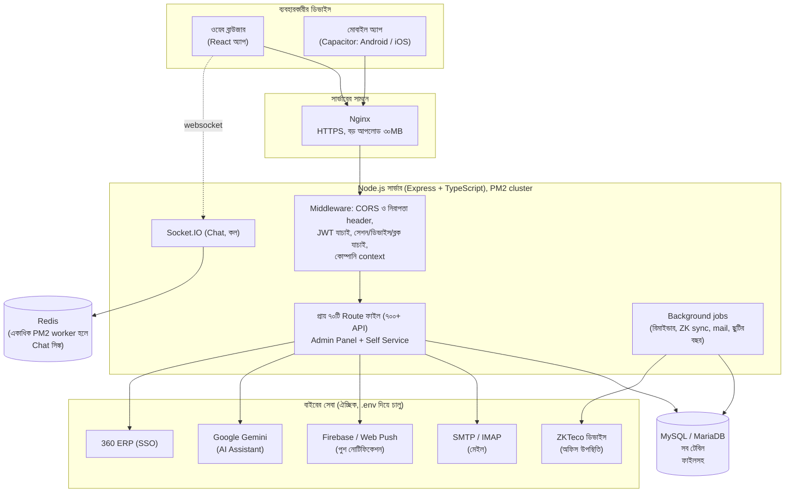

**মূল কথা:** একটাই সার্ভার প্রসেস ওয়েব পেজ, API আর Chat দেয়। ডাটা একটাই ডাটাবেসে (ফাইলসহ)। Background job শুধু এক worker-এ চলে (`jobRunner.ts`), যাতে রিমাইন্ডার দুবার না যায়।

---

## ২. একটি রিকোয়েস্টের জীবন (Request Lifecycle)

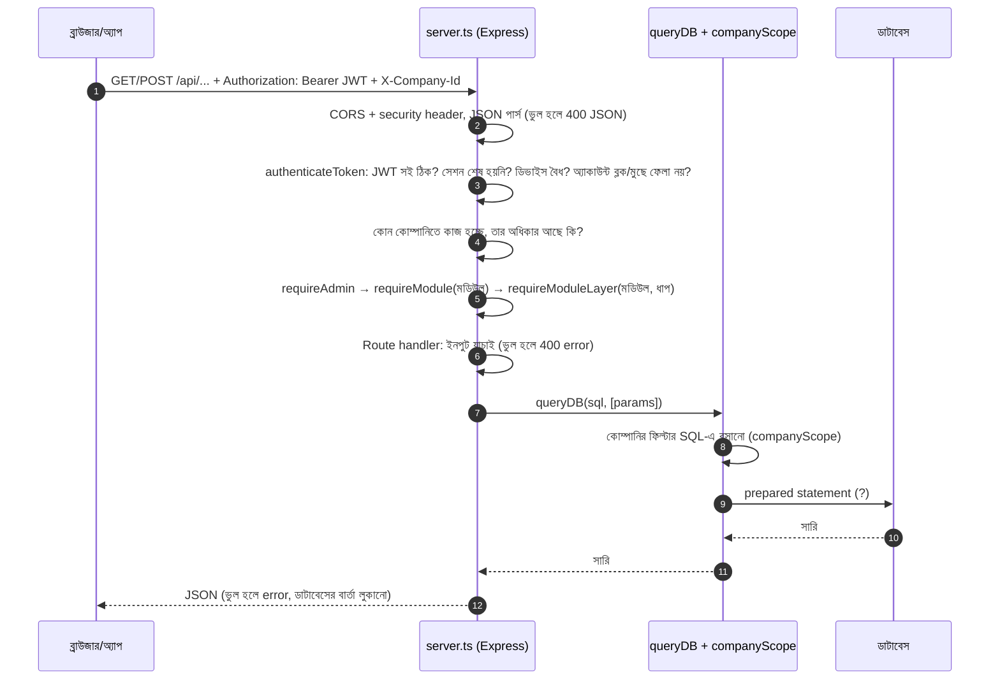

ফাইল: `server.ts` (`authenticateToken`, `requireAdmin`, `requireModule`, `requireModuleLayer`), `SessionSecurity.ts`, `DeviceRoutes.ts`, `AccountBlock.ts`, `companyContext.ts`, `companyScope.ts`, `ApiErrors.ts`, `WebSecurity.ts`।

---

## ৩. লগইন workflow

Login ID: কর্মীর **Employee ID** (যেমন `CPL-0201`, ছোট/বড় হাতের অক্ষর একই ধরা হয়); ইমেইল দিয়েও চলে। Employee ID-ই `users.username`, তাই দুজনের এক হতে পারে না; Employee ID বদলালে Login ID-ও বদলায় (`EmployeeLoginId.ts`)। Employee record ছাড়া অ্যাকাউন্ট (Superadmin, Project login) আগের Login ID-তেই চলে। সার্ভার চালু হলে যেসব কর্মীর login-এ username নেই, তারা নিজের Employee ID পায়। Admin Panel → Users → কারও Account → **Change Login ID** খুললে তাঁর বর্তমান email ও username দেখায়; নতুন email, নতুন username বা দুটোই দেওয়া যায় — যা বদলানো হয়েছে শুধু সেটাই save হয়। হাতে দেওয়া username পরে Employee record save করলেও থাকে।

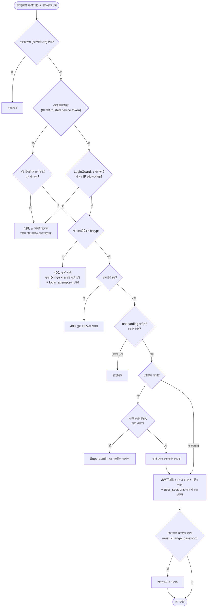

**বিকল্প প্রবেশ:** (ক) **Forgot password:** ইমেইলে ৬ অঙ্কের কোড (১৫ মিনিট, ৫ চেষ্টা) অথবা "HR-কে বলুন" (HR একটি অস্থায়ী পাসওয়ার্ড দেয়)। (খ) **Fingerprint/Passkey:** অ্যাপে ফোনের Keystore/Keychain-এর সিক্রেট, ওয়েবে WebAuthn passkey। দুটোই পাসওয়ার্ডের একই নিয়ম (ব্লক, ডিভাইস, কোম্পানি) মানে। অ্যাপে লগইন পাতায় fingerprint-এর জানালা নিজে একবার খোলে — অ্যাপ পুরো পর্দায় আসার পরে; আগে আঙুল, তারপর লোকেশন, তারপর সার্ভার। জানালা না খুললে বা সেন্সর ব্যস্ত থাকলে চালু করা fingerprint মুছে যায় না, "Sign in with fingerprint" চাপলেই আবার চেষ্টা হয়; শুধু ফোনের সংরক্ষিত চাবি সত্যিই না থাকলে (fingerprint বদলানো/মোছা) আবার চালু করতে বলে (`src/lib/fingerprint.ts`, টেস্ট `npm run test:fingerprint`)।

**নিজের username বদল:** Profile → Change Username শুরুতে বন্ধ; Superadmin Admin Panel → Users → Password requests-এ "Let people change their own username" চালু করলে আবার আগের নিয়মে (বর্তমান password দিয়ে) সবাই বদলাতে পারেন। বন্ধ থাকলে HR Users থেকে বদলে দেয়; Superadmin নিজেরটা সবসময় পারেন।
**চেনা ডিভাইস (trusted device):** পাসওয়ার্ড দিয়ে সফল login-এর পর সার্ভার ওই ফোন / browser-কে ওই account-এর জন্য একটা সই করা token দেয় (`trusted_device`; ফোনে `chr_login_devices`-এ থাকে, sign-out-এ মোছে না)। পরের login-এ token পাঠালে account-এর ৫-বার আর network-এর ৩০-বার আটকানো ওই ডিভাইসে খাটে না — তাই অন্য কেউ আপনার ID-তে ভুল password দিলে, বা পুরো অফিস একই IP থেকে আটকে গেলেও, আপনি নিজের ডিভাইস থেকে ঢুকতে পারেন। ডিভাইসের নিজের সীমা: ১৫ মিনিটে ১০ বার ভুল হলে ওই ডিভাইস ১৫ মিনিট আটকায়। চেনা ডিভাইসের ভুল account বা network-এর গোনায় যায় না। Token account-এ বাঁধা, ১৮০ দিন ব্যবহার না হলে বাতিল, প্রতি login-এ নতুন হয়, আর password বদলালে / reset হলে / সব জায়গা থেকে sign out হলে (`sessions_valid_after`) আর চলে না (`LoginGuard.ts`, `src/lib/trustedDevices.ts`)। Fingerprint / passkey login-এর নিয়ম আগের মতোই।

ফাইল: `AuthRoutes.ts`, `LoginGuard.ts`, `PasswordResetRoutes.ts`, `FingerprintRoutes.ts`, `SessionSecurity.ts`, `src/lib/trustedDevices.ts`।

**সেশন শেষ হয় যখন:** ওয়েবে ১২ ঘণ্টা বা ৬০ মিনিট নিষ্ক্রিয়; অ্যাপে ৭ দিন বা ৩ দিন না খুললে (Superadmin বদলাতে পারে); Logout; Superadmin কাউকে বের করে দিলে; পাসওয়ার্ড বদলালে (বাকি সব সেশন); অ্যাকাউন্ট ব্লক হলে।

---

## ৪. কে কী দেখবে: অনুমতির সিদ্ধান্ত

- **Layer:** একই মডিউলের ভেতরে ভাগ। যেমন Payroll: `read`, `salary_hold`, `audit_approve`, `accounts_pay`। যে layer ডিফল্টে বন্ধ (🔒), Superadmin টিক না দিলে কেউ পায় না। পুরো তালিকা: `security/access-control-matrix.md`।
- **নিয়ম (CLAUDE.md):** প্রতিটি নতুন ফিচারে UI লুকানো **এবং** API বন্ধ, দুটোই লাগে।
- **কোম্পানি বদলে কাজ (সাধারণ নিয়ম):** মাদার কোম্পানির HR-কে Superadmin sister company-র প্রবেশাধিকার ও সেখানকার Module Access দেন (Admin Panel → Companies → Company access); HR উপরের company switcher-এ ওই কোম্পানি বেছে সেখানকার কাজ করেন। একটা কোম্পানি বাছা থাকলে শুধু সেই কোম্পানির কর্মী ও রেকর্ড আসে।
- **All companies mode (আলাদা অনুমতি, ডিফল্টে বন্ধ):** Superadmin একই পাতায় "All companies mode" টিক দিলে switcher-এ **All companies** আসে। তখন যে কোম্পানিগুলোতে প্রবেশাধিকার আছে, সবগুলোর কর্মী এক তালিকায় (নামের পাশে কোম্পানির কোড) — রেকর্ড খোলা ও বদলানো (প্রোফাইল, ব্যাংক অ্যাকাউন্ট, ছুটি, উপস্থিতি…) কোম্পানি না বদলেই। নিয়ম: (১) প্রবেশাধিকার নেই এমন কোম্পানি আসে না; (২) নতুন রেকর্ড switcher-এ আগে বাছা কোম্পানিতে যায়; (৩) settings ও Module Access ওই বাছা কোম্পানির; (৪) বেতন (payroll) চালানো আগের মতো প্রতিটা কোম্পানিতে আলাদা — CBL-এর বেতন CBL বেছে চালাতে হয়। কোনো একটা কোম্পানি বাছলে আবার আগের মতো এক কোম্পানি। চালু/বন্ধ করা `user_access_audit`-এ থাকে।

---

## ৫. কর্মীর পুরো জীবনচক্র (HR-এর প্রধান প্রবাহ)

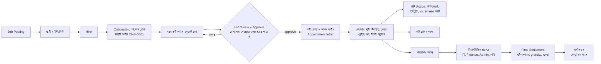

ফাইল: `RecruitmentRoutes.ts`, `OnboardingSelfServiceRoutes.ts`, `HROperationsRoutes.ts`, `ExitOffboardingRoutes.ts`, `EmployeeRecordsGuard.ts`।

জমা দেওয়ার পর joiner-এর My Onboarding পাতা নিজে থেকে HR-এর সিদ্ধান্ত দেখে নেয় (২০ সেকেন্ড পরপর, আর অ্যাপ / ট্যাব সামনে এলে; `OnboardingShell.tsx`): ফেরত দিলে সাথে সাথে HR-এর কারণ আর খোলা ফর্ম দেখায়, approve বা cancel হলে লগইন পাতায় নিয়ে যায় — sign out করে আবার ঢুকতে হয় না।
Recruitment (ATS)-এ interview: HR তারিখ-সময়, দৈর্ঘ্য, কীভাবে (সামনাসামনি venue / online link / ফোন), interviewer আর candidate-এর জন্য নোট দিয়ে interview ঠিক করেন। পরে সময় বা জায়গা বদলানো, interviewer বদলানো বা বাতিল করা যায় — প্রতিটি বদল কারণসহ `candidate_interview_events`-এ থাকে (আগের → নতুন), আর interviewer-কে bell alert ("Interview scheduled / moved / place changed / cancelled") যায়। Candidate-কে email পাঠানো আলাদা অনুমতি (Recruitment → **Email candidates**, কাউকে আপনাআপনি দেওয়া হয় না): বদলের পরেই খসড়া খোলে (বদলানো যায়), interview-এর email-এর সাথে calendar invite (`.ics`, বাতিল হলে CANCEL) যায়, প্রতিটি email (পাঠানো / ব্যর্থ) `candidate_emails`-এ থাকে। শেষ বদলের পরে email না গেলে তালিকায় "Candidate not emailed yet" দেখায়। Offer / Regret / অন্য বার্তাও একইভাবে পাঠানো যায়। SMTP চালু না থাকলে কিছু পাঠানো যায় না, বাকি সব চলে।

Candidate-এর ভুল তথ্য (নাম, email, ফোন, source) Recruitment থেকেই ঠিক করা যায়: প্রতিটা candidate-এর পাশে **Edit** (আলাদা অনুমতি Recruitment → **Edit candidate details**, `edit_candidates`, কাউকে আপনাআপনি দেওয়া হয় না; `PUT /api/job-candidates/:id/details`)। Candidate-এর New Joiner Onboarding খোলা থাকলে (draft / submitted / sent back) onboarding রেকর্ডের নাম, email, ফোন আর অস্থায়ী login-এর নামও একসাথে ঠিক হয় — HR-এর review আর "Already on file" যাচাই সেগুলোই দেখে। Joined হয়ে গেলে Employee রেকর্ড বদলায় না (সেটা Employees থেকে)।

গুরুত্বপূর্ণ: onboarding চলাকালে নতুন ব্যক্তি **কর্মী নন** (`all_employees`-এ নেই), তাই headcount, payroll, উপস্থিতিতে আসে না। শুধু "My Onboarding" পেজ খোলা যায় (বাকি সব 403 `ONBOARDING_ONLY`)।

**SIM ও ID card requisition** (`RequisitionRoutes.ts`, টেবিল `employee_requisitions`): কর্মী Self Service → "SIM & ID Card" থেকে (সুইচ `users.can_request_items`, ডিফল্টে বন্ধ) আর নতুন joiner My Onboarding থেকে (HR Ops Settings → "Joiners can ask for a SIM / ID card", ডিফল্টে বন্ধ) SIM বা ID card চান (New / Lost / Damaged / Replacement)। HR Operations → "SIM & ID Card" (layer `requisitions`, explicit-only) থেকে HR issue করে: SIM হলে Mobile Bill-এ ওই কর্মীকে আগে দেওয়া SIM বেছে নেয়, ID card হলে কার্ড নম্বর লেখে (onboarding checklist-এর "ID card issued" নিজে টিক হয়); অথবা কারণসহ turn down। কর্মী alert পান। Joiner-এর request onboarding approve হলে কর্মীর নামে যায়; তার আগে issue করা যায় না।

---

## ৬. ছুটির workflow

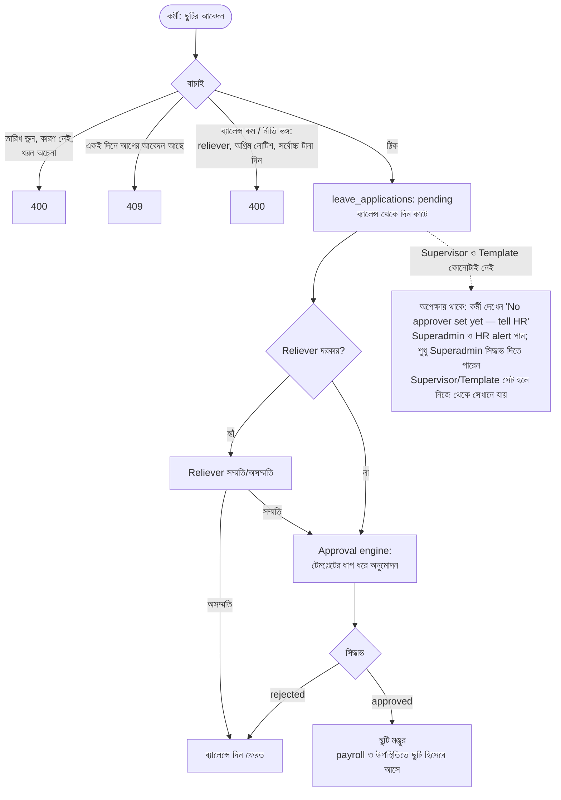

- ব্যালেন্স: ছুটির বছর শুরুতে নীতি (workflow) অনুযায়ী বসে; বছর শেষে rollover job চলে (`LeaveRoutes.ts`, ৬ ঘণ্টা পরপর পরীক্ষা)।
- কত দিন কাটবে: প্রতিটি Leave Type-এর নীতিতে HR ঠিক করেন (Leave Manage → Leave Policies → "Weekends & holidays inside the leave", `leave_category_policies.count_off_days`)। **Count them** (আগের মতো, default) হলে শুরু থেকে শেষ পর্যন্ত সব দিন কাটে। **Don't count them** হলে শুধু কর্মীর কাজের দিন কাটে: তাঁর শাখা-দলের Holiday Calendar, তার ওপর Duty Roster, অর্থাৎ payroll যে ক্যালেন্ডারে কাজের দিন গোনে (`leaveDayCount.ts`)। সংখ্যাটা সবসময় server গোনে। ফর্ম `GET /api/leave-applications/day-count` থেকে সেটা দেখায়, আর শুধু ছুটির দিনে পড়া আবেদন ফিরিয়ে দেওয়া হয়। Data Import-এ Days ঘর ফাঁকা থাকলেও একই নিয়মে গোনা হয়। বেতন দুই নিয়মেই এক: ছুটির ভেতরের সাপ্তাহিক বা সরকারি ছুটি কখনো বিনা বেতনে গোনা হয় না।
- কার leave balance থাকে: প্রত্যেক Admin / User, আর যে **Superadmin-এর Employee রেকর্ড আছে** তিনিও (কোম্পানির নিজের Superadmin অন্যদের মতোই ছুটি নেন; Employee রেকর্ড ছাড়া system-owner Superadmin আগের মতো বাইরে)। Default balance (Leave Balance Workflows) প্রথমবার দরকার হলেই বসে; আগে কারও হাতে-বসানো custom category balance থাকলে তাঁর Casual / Sick কখনো বসত না (০ দেখাত) — এখন বসে, custom-টা বদলায় না (`LeaveRoutes.ts` `LEAVE_PEOPLE`, `ensureDefaultLeaveBalances`)। একই নিয়মে Employee রেকর্ড-থাকা Superadmin আরও যেখানে আসেন: HR Analytics-এর headcount, Notice-এর recipients (আগে শুধু User), Document Vault-এর মানুষ, Grievance-এর মানুষ, Performance আর Exit Offboarding-এর কর্মী বাছাই, Claims / Conveyance / Disbursement / Attendance / Report-এর কর্মী filter (আগে Admin-রাও বাদ পড়তেন)। Leave Manage-এর তালিকায় নাম / Employee ID / পদবি দিয়ে খোঁজা, Department আর "Casual + Sick = 0 / Has balance left" filter, আর ০ হলে নামের নিচে কেন ০ (login blocked, Employee রেকর্ড inactive, কোনো Workflow নেই, বা ব্যবহার হয়ে গেছে)।
- অনুমোদনকারী ঠিক করে **Approval Template** (`approval_templates`/`_steps`/`_step_approvers`)। কর্মীর সুপারভাইজার বা নির্দিষ্ট ব্যক্তি/ভূমিকা হতে পারে।

---

## ৭. Approval engine (সব অনুমোদনের সাধারণ ইঞ্জিন)

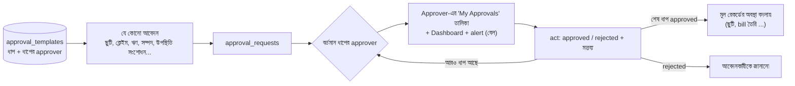

**কে প্রথম অনুমোদন দেন:** কর্মীর Direct Supervisor (না থাকলে Department Supervisor) ধাপ ১, তারপর Template-এর layer। Supervisor নিজে আবেদন করলে সরাসরি Template-এর layer-এ যায় (টেস্ট `test-logs/2026-10-25/07-supervisor-chain.log`, ৩৬/৩৬)।
**Supervisor ও Template দুটোই না থাকলে:** আবেদন "approver নেই" অবস্থায় অপেক্ষা করে (`approval_requests.awaiting_approver = 1`)। কর্মী alert পান এবং নিজের পেজে "No approver set yet — tell HR" দেখেন। Superadmin ও Approvals মডিউলের Admin alert পান। শুধু Superadmin সিদ্ধান্ত দিতে পারেন: আবেদনটা তাঁর "My Approvals"-এ "No approver set" চিহ্নসহ আসে, Admin Panel → Approvals-এও থাকে। Supervisor বা Template সেট হলে আবেদন নিজে থেকে সেখানে সরে যায়: কেউ Approvals তালিকা খুললে, নইলে প্রতি ১০ মিনিটে (`rehomeAwaitingApprovals`)। টেস্ট: `test-logs/2026-10-25/09-no-approver-after-fix.log`।
**Template কাকে লাগবে:** Admin Panel → Approvals → Templates → "Assign to Employees" ট্যাবে প্রতিটি কর্মীর জন্য আলাদা Template বাছা যায়। Department, Designation, User ও Template দিয়ে (একাধিক বেছে, টাইপ করে খুঁজে) তালিকা ছোট করে, একটি Template বেছে **Assign** চাপলে ছোট করা সব কর্মীকে একসাথে সেট হয় (`PUT /api/template-assignments/bulk`, একজনের জন্য `PUT /api/template-assignments`; দুটোতেই Approvals মডিউলের Edit/Add layer লাগে)।
**Ad-hoc approver (মাঝখানে আরেকজনকে যোগ):** যে Layer-এ আবেদনটা অপেক্ষা করছে তার approver Approve Application-এ **Add approver** চেপে একজনকে বেছে কারণ লিখে পাঠাতে পারেন (Module Access-এর switch **Approvals — add an ad-hoc approver**, `users.can_add_adhoc_approver`, শুরুতে বন্ধ; Superadmin সবসময়)। তখন আবেদনটা শুধু সেই মানুষের কাছে যায় (`approval_requests.adhoc_approver_id`), তিনি alert পান আর কার্ডে দেখেন কে কেন চেয়েছেন। তিনি **Approve** করলে আবেদন একই Layer-এ আগের approver-এর কাছে ফিরে আসে (Layer এগোয় না, alert যায়); **Reject** করলে পুরো আবেদন বাতিল। আবেদনকারী নিজে বা নিজেকে বাছা যায় না, একসাথে একজনই। Trail-এ `adhoc_added` আর `adhoc: true`-সহ approve থাকে। API: `GET /api/my-approvals/adhoc-candidates`, `POST /api/my-approvals/:id/adhoc`।

ফাইল: `ApprovalRoutes.ts` (তালিকা ও act: `GET /api/my-approvals`, `POST /api/my-approvals/:id/act`), `Alerts.ts` (notification)।

---

## ৮. উপস্থিতি: তিন উৎস, একটি হিসাব

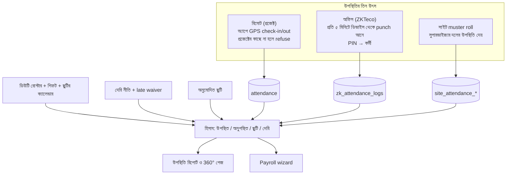

- রোস্টারে "Off" বা শিফট দিলে ওই কর্মীর ওই দিনের ছুটি/কর্মদিবস ও দেরির সময় বদলে যায় (`RosterRoutes.ts`)।
- ভুল উপস্থিতি: কর্মী **সংশোধন আবেদন** দেয় → Approval। In Time ওই দিনের; Out Time In Time-এর আগে দিলে সেটা night shift ধরে পরদিন সকালের সময় হিসেবে যায় (ফর্মে "Next day" লেখা দেখায়)। অন্য তারিখের সময় বা In-এর আগের Out সার্ভার নেয় না।
- ZK ডিভাইসের PIN কর্মীর সাথে না জুড়লে punch কারো নামে যায় না (Unlinked PINs তালিকা)।

---

## ৯. Payroll workflow (HR → HR Director → MD (কাগজে) → HR correction → Accounts → Audit ঐচ্ছিক)

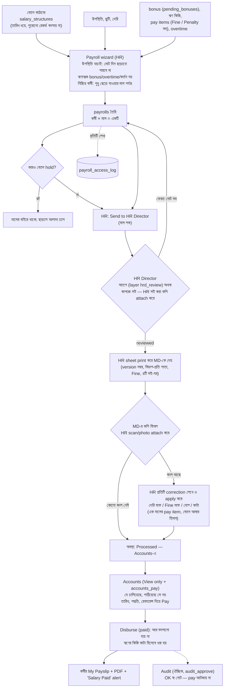

**ধাপগুলো (Payroll → Approval):** `payroll_batches.status` = draft → hrd_review → md_review → (corrections) → approved → paid; ফেরত দিলে returned।
- **HR Director:** layer `hrd_review` থাকলে অ্যাপেই "Reviewed — send to MD" (যে মাস পাঠিয়েছে বা কোনো বেতন চালিয়েছে/বদলেছে সে নয়), বা Return to HR। কাগজে দেখলে HR তাঁর সই করা কপি attach করে "HR Director signed on paper" দেয় — কপি ছাড়া হয় না।
- **MD (অ্যাপ ব্যবহার করেন না):** HR "Print sheet (PDF)" থেকে MD-র কপি বের করে (প্রতি print-এ নতুন version, পাতায় ছাপা — পুরোনো কপি চেনা যায়; বিভাগ-প্রতি পাতা, Fine কলাম, MD-র জন্য ফাঁকা Remarks, Prepared / Checked / Approved / Received সই-ঘর)। কপি ফিরলে scan/photo attach করে "MD's copy came back": বদল না থাকলে সোজা Accounts-এ, থাকলে Corrections।
- **Corrections:** প্রতিটি বদল আলাদা লেখা হয় (কর্মী, ধরন, টাকা, MD কী লিখেছেন, পাতা)। Apply করলে সেই মাসের জন্য একটি pay item বসে ("Late cut waived (MD)", "Fine waived (MD)", "Added (MD)", "Deducted (MD)") আর run-এর gross / কর্তন / net আবার হিসাব হয় (net ঋণাত্মক হলে হয় না; দেরি মাফ দেরি-কর্তনের বেশি নয়, Fine মাফ Fine-এর বেশি নয়)। "Not done" কারণসহ; মুছলে apply করা বদলও ফিরে যায়। সব শেষ হলে "Send to Accounts" (খোলা থাকলে হয় না)। টেবিল `payroll_corrections`।
- **কপিগুলো:** `payroll_review_files` (stage hrd / md), ফাইল থাকে `PAYROLL_FILES_DIR` ফোল্ডারে (ডিফল্ট `uploads/payroll`), ডাটাবেসে শুধু path।
- **Fine / Penalty:** Allowance & Adjustment-এ "Fine / Penalty" বাছলে কর্তনের pay item, `employee_pay_items.category = 'fine'`; Salary sheet ও print-এ আলাদা Fine কলাম।
- **Audit:** টাকা দেওয়ার পরে, ঐচ্ছিক — "Checked — OK" বা নোট; HR ও Accounts জানতে পারে। কখনো pay আটকায় না।
- **একক বেতন (hold থেকে ছাড়া):** HR Director (`hrd_review`, পুরোনো সেটআপে `audit_approve`) approve করেন, Accounts pay — মাস Accounts-এ পৌঁছানোর পরে।

**হিসাব:** net = মোট আয় (বেসিক + ভাতা + overtime + bonus) − কর − PF − ঋণ কিস্তি − অনুপস্থিতি/দেরি কর্তন − অন্য কর্তন। কর ও PF **হাতে/কাঠামোতে দেওয়া** (আয়কর স্ল্যাবের স্বয়ংক্রিয় হিসাব নেই)।
**কে কোন layer পায়:** HR = "Payroll" (`read`, বানানো, বদলানো, print, কপি attach ও correction)। HR Director = "HR Director review" (`hrd_review`, ডিফল্টে বন্ধ)। Accounts = "View only" (`payroll_view`) + Accounts Pay। Audit = "View only" + "Audit (after payment)" (`audit_approve`)। View only সব পেজ ও রিপোর্ট দেখে, কিছু বদলাতে পারে না। নিয়মগুলো Superadmin-এর জন্য খাটে না।
**Payslip পাঠানো (Payroll → Payslips):** একজনকে (সারির Email/PDF), কয়েকজনকে (টিক দিয়ে বা নাম/ID/বিভাগ খুঁজে বেছে "Email Selected" / "PDF of Selected"), অথবা কাউকে না বাছলে সবাইকে। Email পাঠানোর আগে কতজনকে যাবে তা জিজ্ঞেস করে। প্রত্যেকে নিজের payslip PDF পান (`POST /api/payroll/:id/email`, Payroll module ও "Payroll" layer লাগে)।
**Run Payroll-এ খোঁজা ও বাছা:** Attendance & Leave, Adjustments আর Preview & Calculate — তিন ধাপেই নাম / Employee ID / পদ / বিভাগ লিখে খোঁজা আর বিভাগ বাছাই (লিখে খোঁজা যায়)। Attendance & Leave-এ "Select all / Unselect all" (খোঁজা থাকলে "Select shown / Unselect shown") আর মাথার checkbox শুধু দেখানো কর্মীদের বদলায়; তাই খুঁজে খুঁজে কয়েকজনকে বাছা যায়। খোঁজা শুধু দেখানো বদলায় — হিসাব ও submit সব বাছা কর্মীর হয়, Preview-এর মোট পুরো run-এর।
**দেরি মাফ (Late waiver):** Run Payroll → Attendance & Leave-এ Late সংখ্যায় চাপলে প্রতিটি দেরির দিন আসে; কোনো দিন **Waive** করতে **কারণ লেখা বাধ্যতামূলক** (৩ অক্ষরের কম হলে server 400), সাথে চাইলে একটা ফাইল (ছবি, PDF, Word, Excel; ৫ MB পর্যন্ত — `late_waivers.attachment_*`)। মাফ করা দিনে কারণ আর ফাইলের লিংক দেখায় (`GET /api/payroll/late-waivers/:id/attachment`, Payroll module); Un-waive করলে দিনটা আবার গোনা হয়।
**Approval-এ Salary sheet:** Payroll → Approval-এ মাসের প্রতিটি কর্মীর বেতন স্ক্রিনেই দেখা যায় — দিন (Working / Present / Absent / Leave / LWP), Late, Gross, অনুপস্থিতি/দেরি কর্তন, অন্য কর্তন, Net, আগের মাসের Net-এর তুলনায় % বদল, কোথায় পাবে (Bank/MFS), Status। খোঁজা, বিভাগ বাছাই, "Net changed 10%+ / New this month / On hold / Absent-late cut" ফিল্টার, মোট সারি, সারিতে চাপলে পুরো ভাঙন, যা দেখাচ্ছে তার Excel। Layer `approval_sheet` (Payroll-এর ভেতরে; সাধারণ দেখা, তাই layer সেভ না থাকলে ডিফল্টে থাকে; Audit/Accounts-এর layer সেভ করা থাকলে এটা টিক দিতে হয়) — `GET /api/payroll/approval/:month/salary-sheet`।

**Approval-এ Top Sheet:** Payroll → Approval-এ Accounts-এর কাগজের Top Sheet-এর মতো — মাসের বেতন **Branch / site অনুযায়ী** এক সারিতে (চাইলে Department অনুযায়ী): Actual Salary (Basic + Allowance, কাটা ছাড়া), Salary after deduction (Absent / LWP / Late কাটার পরে), Allowance (Overtime + Bonus + Allowance-এর লাইন), Arrear (Arrear adjustment), Gross Salary, Other Deduction (Other + Recovery + কাটার লাইন), Advance, TDS, Loan, Employee Contribution (PF), Net Salary, আর কীভাবে দেওয়া হলো — By EBL Card / By Cash / By Bank (কর্মীর Payment ভাগ থেকে; যে Bank account-এর নাম বা ব্যাংকের নামে "Card" আছে সেটা Card; ভাগ না থাকলে run-এর Payment method; MFS থাকলে আলাদা column)। Head Office প্রথমে, তারপর A–Z; নিচে TOTAL আর **Prepared / Authorized / Approved By** — মাসটা যিনি পাঠিয়েছেন (HR), review করেছেন (HR Director; আগের মাসে Audit) আর Pay (Accounts) করেছেন, নাম ও তারিখসহ। সাইটের নামে চাপলে সেই সাইটের নিজের sheet: প্রতি কর্মী (নাম, পদ, ID, যোগদানের তারিখ, Working Day, Present…Net Payable, Bank / Card / Cash, Remarks) আর নিচে "Salary Payable / Less: Advance & Deduction / Total withdraw / From Bank / From EBL Card / From Cash / Total Withdraw From Cash and Bank" (কাগজের sheet-এর মতো শেষেরটা Cash + Bank)। Hold-এ থাকা বেতন এ মাসে দেওয়া হয় না, তাই sheet-এ নেই (আলাদা লেখা থাকে)। Excel: প্রথম sheet Top Sheet, তারপর প্রতি সাইটের আলাদা sheet; PDF একইভাবে (প্রতি সাইট নতুন পাতায়); Email-এ PDF। Layer `top_sheet` (সাধারণ দেখা, তাই layer সেভ না থাকলে ডিফল্টে; সেভ করা থাকলে টিক দিতে হয়) — `GET /api/payroll/approval/:month/top-sheet?by=branch|department`।

**লোন / Salary Advance: টাকা দেওয়া আর কিস্তির পরিকল্পনা** (`LoanPlan.ts`, পুরো বিবরণ `docs/loans-payout-and-repayment.md`): অনুমোদিত লোন (approval chain-এর শেষ Approve, Payroll-এর Approve, বা HR-এর "New Loan / Advance") আগে **"Waiting for payment"** (`employee_advances.disbursement_status = 'pending'`) — এই অবস্থায় বেতন থেকে কিছু কাটা হয় না, আর Exit-এর পাওনা বা লোন রিপোর্টে বকেয়া ধরা হয় না। Accounts (Payroll layer **Accounts Pay**) Payroll → Loans & Advances → **To Pay** থেকে টাকা দিয়ে **Mark as paid** দেন: তারিখ, Cash / Bank transfer / bKash-Nagad / Cheque / Other, Bank-MFS-Cheque হলে reference বাধ্যতামূলক, আর কোন বেতন মাস থেকে কিস্তি (ডিফল্ট টাকা দেওয়ার পরের মাস, বা কর্মীর চাওয়া মাস — আবেদনের সময় কর্মী এ মাস থেকে ১২ মাসের মধ্যে একটা মাস চাইতে পারেন, `advance_requests.preferred_start_month`)। একসাথে দুবার চাপলেও একবারই হয়। কর্মী ও Accounts দুজনেই Alert পান ("Loan Ready to Pay" → To Pay, "Loan Paid to You" → My Loan / Advance)। **কিস্তির পরিকল্পনা** (Plan, Payroll module): শুরুর মাস; সমান কিস্তি / একবারে পুরোটা / মাস ধরে আলাদা পরিমাণ (মোট বাকির সমান হতে হবে); কোন মাসে কাটা হবে না (skip); কোন মাসে বাকি সব কেটে আগেই শোধ (settle)। প্রতিটা বেতন হিসাব (preview, bulk, একজনের, edit) একটাই নিয়ম `installmentFor()` ব্যবহার করে; বেতন Paid হলে সেই মাসের কাটা টাকা পরিকল্পনা অনুযায়ী লোনে জমা হয়, আর পরিকল্পনা পরে বদলালেও কাটা টাকা পুরোটাই কোনো লোনে জমা হয় (`settlePaidPayroll`)। বেতনের বাইরে নগদ / ব্যাংকে ফেরত দিলে Accounts **Repaid** দেন (Accounts Pay; বাকির বেশি নয়, একসাথে দুবার চাপলে একবারই গোনা)। প্রতিটা ধাপ `loan_events`-এ (কে, কবে, কত, কীভাবে) — Payroll-এর Plan popup-এ আর কর্মীর My Loan / Advance-এ History হিসেবে দেখায়; কর্মী আগামী মাসগুলোর কিস্তিও দেখেন। এই পরিবর্তনের আগের লোনগুলো "paid out" ধরা হয়, আগের মতোই প্রতি মাসে কাটে। টাকা দেওয়া লোন আর মোছা যায় না (Completed করতে হয়)।

**Advance আর Loan আলাদা:** `employee_advances.kind` (`advance` / `loan`) — কর্মীর Loan / Salary Advance request থেকে আসা সারি তার ধরন নেয়, HR-এর "New Loan / Advance"-এ Type বাছা যায় (আগের হাতে লেখা সারি Advance)। প্রতি payroll run-এ কিস্তির মোট আগের মতো `advance_deduction`-এ, তার Loan অংশ `payrolls.loan_deduction`-এ (Generate, Run Payroll ও Edit-এর সময় লেখা হয়); Top Sheet-এ Advance = মোট − Loan, তাই এই পরিবর্তনের আগের মাসগুলোতে সবটা Advance-এ দেখায়।
**Approval-এ Month comparison:** এই মাস বনাম আগের মাস (বা বাছা যেকোনো মাস) — মোট Net ও কর্মীর সংখ্যা, পার্থক্য ও %; **কেন মোট বদলাল** (আগের মাসের Net → নতুন কর্মী + → চলে যাওয়া/বেতন হয়নি − → বাকিদের Basic, Allowances, Overtime, Bonus, Extra pay, অনুপস্থিতি/LWP/দেরি কর্তন, Tax, PF, Loan, অন্য কর্তনের বদল → এই মাসের Net; যোগফল সবসময় মেলে); department পাশাপাশি (দুই মাসের Net, পার্থক্য, New/Left/Changed); প্রতি কর্মী — নতুন হলে যোগদানের তারিখ, চলে গেলে Exit request-এর ধরন, শেষ কর্মদিবস ও কারণ (না থাকলে Inactive / এই মাসে বেতন হয়নি), বদলালে প্রতিটি অংশ আগে → পরে ও তার কারণ (কত দিন absent, কত ঘণ্টা OT, কতবার late)। Excel-এ তিন শিট। Layer `month_compare` (সাধারণ দেখা, ডিফল্টে থাকে) — `GET /api/payroll/approval/:month/compare?vs=`।
**কর্মীর বেতন অ্যাকাউন্ট বদল:** যোগ/বদল/মোছা `employee_change_log`-এ (পুরনো → নতুন, কে) থাকে, কর্মী "Salary account changed" alert পায়।
ফাইল: `PayrollRoutes.ts`, `PayrollApprovalRoutes.ts`, `PayrollItemsRoutes.ts`, `PayslipRoutes.ts`।

---

## ১০. Bill Claim → Disbursement

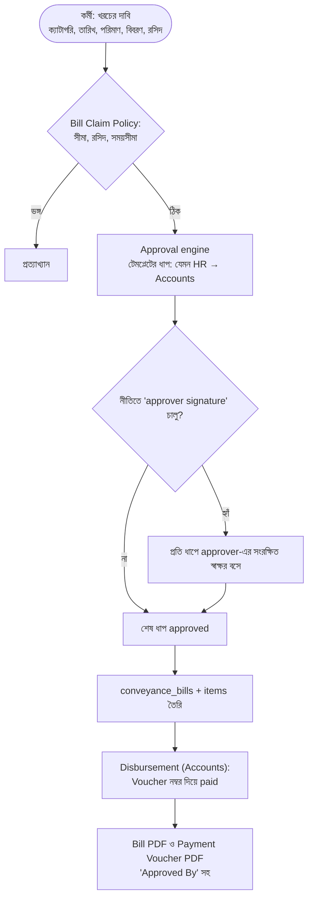

**Conveyance Disburser (Pay Out) layer:** টেমপ্লেটের শেষ ধাপ এই ধরনের হলে, আগের সব layer approve করার পর claim-টা এখনও Bill হয়নি, কিন্তু Admin Panel → **Disbursement**-এ উপরে "Claims waiting to be paid out" অংশে **Pending** হিসেবে দেখায় (`GET /api/disbursement/awaiting-claims`, Disbursement module লাগে)। সেই layer-এর লোক (বা Superadmin) এখান থেকে বা Approve Application থেকে Voucher দিয়ে **Disburse** করেন — claim approved হয়, নিজের Bill পায় ও paid হয় (`POST /api/my-approvals/:id/act`)। Disbursement module-এর অন্যরা দেখেন কার অপেক্ষায় আছে, কিন্তু Disburse করতে পারেন না।

**Check In/Out** আলাদা: কর্মী কোথাও গেলে GPS-সহ ক্লেইম, একই Approval engine (`MovementClaimRoutes.ts`)। Admin Panel → Check In/Out-এর তালিকায় কোনো সারিতে (ফোনে card-এর "Map") চাপলে map খোলে — Check In আর Check Out কোথায় হয়েছিল, মাঝের রেখা ও দূরত্ব (`ClaimLocationMap.tsx`, সেই liquid-glass popup যা My Claims-এও খোলে; নতুন কোনো API বা অনুমতি নয়, তালিকা যে `GET /api/claims` থেকে আসে তাতেই অবস্থান আছে)।
**নতুন Bill Claim ফর্ম (ফোন ও web):** প্রতিটি bill-এর ক্যাটাগরি, তারিখ, পরিমাণ আর নোট। bill-এর তারিখ দিয়ে যাচাই হয়: claim-এর From–To-এর ভেতরে কিনা, Policy-র পেছনের সীমা (কত দিন আগের খরচ চাওয়া যায়), "এক তারিখ এক claim-এ" (চালু থাকলে, একই তারিখ আরেক claim-এ থাকলে আটকায়), আর ক্যাটাগরির মাসিক সীমা (bill-এর মাস ধরে); রিপোর্টেও খরচের দিন এটাই। প্রথম **Transport** bill-এর কার্ডের ভেতরেই "Check In/Out for Bill N" — সেখানে From–To-এর check-in/out টিক দিয়ে প্রতিটার টাকা লেখা হয়, যোগফলই ওই bill-এর পরিমাণ (bill-এর নিজের ঘর বন্ধ থাকে)। আগে এই তালিকা সব bill-এর নিচে আলাদা থাকত, তাই পরে যোগ করা Bill 2 তার আগে বসে যেত; এখন check-in/out তার bill-এর সাথেই থাকে। দ্বিতীয় কোনো Transport bill-এ লেখা থাকে তার check-in/out কোন bill-এ যায়।
ফাইল: `BillClaimRoutes.ts`, `BillClaimPolicy.ts`।

---

## ১১. ই-স্বাক্ষর (Document Vault)

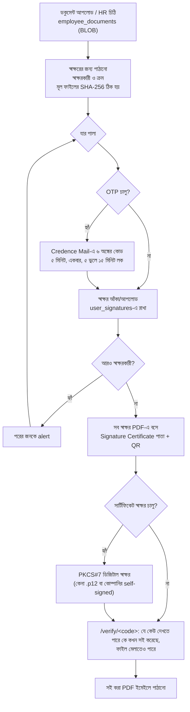

ফাইল: `DocumentVaultRoutes.ts`, `ESignRoutes.ts`, `ESignCertificate.ts`। Adobe Reader-এ "valid" দেখাতে লাইসেন্সপ্রাপ্ত CA-র সার্টিফিকেট দরকার (self-signed-এ "validity unknown")।

---

## ১২. PEPM: প্রকল্পের MPR চক্র

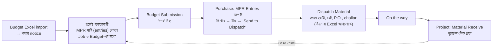

অনুমতি: Reports মডিউলের layer `dispatch_material`, `dispatch_all` (দুটোই 🔒)। Receive-এর সুইচ `can_receive_material`। ফাইল: `EntriesRoutes.ts`, `MprDispatchRoutes.ts`, `BudgetImportRoutes.ts`।

**Job Edit অনুমোদন:** Final Submit হয়ে যাওয়া Job-এ `can_job_edit` থাকা ব্যবহারকারী নতুন Job, Add MPR বা Delete MPR চাইলে সেটা সরাসরি হয় না, `job_edit_requests`-এ জমা থাকে। PEPM Manage → MPR Edit Log → Job Edit Approvals থেকে Approve/Reject (মডিউল `editlog`)। Details-এ দেখায় কী বদলাবে: মোছার সারির সব তথ্য (dispatch/receive হয়ে থাকলে সতর্কতা), যোগ হওয়া সারির Budget Qty আগে → পরে, আর Job-এর সব MPR সারি, বদলটা জায়গামতো চিহ্নিত (`GET /api/job-edits/:id/context`, একই `editlog` gate)। কয়েকটা অনুরোধ টিক দিয়ে একসাথে Approve/Reject করা যায় (প্রতিটা একই `POST /api/job-edits/:id/act` দিয়ে যায়; যেটা আর approve করা যায় না সেটা জানানো হয়, বাকিগুলো হয়ে যায়)।

---

## PEPM: Delivery Date-এর নোটিশ — Material conditions

Admin Panel → PEPM Manage → Data Import → **Condition Set**-এ দুটো tab: **New Job Entry & Job Edit rules** (আগের মতো Global / Project / Budget) আর নতুন **Material conditions** (`src/components/MaterialConditionsPanel.tsx`, `MaterialConditionsRoutes.ts`)। অনুমতি Condition Set-এর মতোই: Admin + `imports` module (UI ও API দুই জায়গাতেই)।

- **New condition:** নাম (যেমন "Sand"), Budget import-এর **Description of Material** থেকে লিখে খুঁজে tick দিয়ে material বাছা (unit, কয়টা Budget-এ আছে, আগে কোনো condition-এ থাকলে সেটা দেখায়), minimum days' notice, কোথায় খাটবে (New Job Entry / Add MPR, Job Edit) আর Admins too। চালু/বন্ধ, Edit, Delete (`confirmDialog`)।
- **এক material, এক condition:** অন্য condition-এ বাছলে সেখানে চলে যায়; material ফাঁকা হয়ে যাওয়া condition মুছে যায়। নাম মেলানো হয় ছোট-বড় হাতের অক্ষর ও ফাঁকা জায়গা বাদ দিয়ে (`material_key`)।
- **Auto-group materials:** কোনো condition-এ নেই এমন material-এর নামের শব্দ দেখে দল প্রস্তাব করে (Tiles & stone finishing, Stone chips, Sand, Cement, MS Rod / steel, Bricks & blocks, Pipes & fittings, Sanitary, Electrical, Paint & chemicals, Glass & aluminium, Wood & board; বাকিগুলোর প্রথম শব্দ মিললে সেটাও এক দল)। নাম, material, দিন বদলে **Create** / **Create all**। নতুন Budget import-এর material কোনো condition-এর মতো দেখালে "N new material(s) look like Sand — Add to Sand" দেখায় — নিজে থেকে কিছু যোগ করে না।
- **কোন নিয়ম খাটে:** একটা item-এর Delivery Date-এর জন্য Global / Project / Budget নিয়ম আর তার material-এর condition — যেটায় **বেশি দিন** লাগে সেটাই (`deliveryDateConditions.ts` `leadTimeProblem` / `materialRules`)। Server-এ যাচাই: New Job Entry, Add MPR, Job Edit (`EntriesRoutes.ts`), আর ফেরত নেওয়া entry-র নতুন Delivery Date (`MprDispatchRoutes.ts`)। Date picker-এ প্রতিটা item-এর জন্য আগের তারিখগুলো বন্ধ থাকে (`useDeliveryLeadTime` `earliestFor`, `GET /api/delivery-date-conditions/effective`-এর `materials`)। ভুল তারিখে বার্তা: "Kitchen Granite" needs at least 10 day(s) notice (Tiles & stone finishing) — the earliest allowed date is …।
- টেবিল: `delivery_material_conditions`, `delivery_material_condition_items` (company group অনুযায়ী আলাদা, `companyScope.ts` GROUP_TABLES)।

## Dashboard-এর উপরের অংশ (কম্পিউটারে)

"Welcome back!"-এর বদলে (`DashboardGreeting.tsx`): ক্যালেন্ডারের পাতায় আজকের তারিখ, সময় অনুযায়ী শুভেচ্ছা, একটাই সার্চ বক্স (Ctrl K) — Pages (sidebar-এর নিজের মেনু, তাই যার যে পেজ খোলার অনুমতি নেই তা আসে না; `src/lib/navRegistry.ts`), People (Employee Directory, যা সবাই আগে থেকেই দেখে) আর "Waiting for you" (নিজের Approve Application তালিকা)। পাশে Check in (My Attendance কার্ডে নিয়ে যায়, check-in থাকলে Check out), + মেনুতে দ্রুত কাজ (Apply leave, New MPR entry, Book a ride, Conveyance claim, Request to HR — যার যেটা আছে)। নিচে আজকের চিপ: check-in হয়েছে কিনা ও কখন (`GET /api/attendance/today-summary` — শুধু নিজের সময়), কয়টা অনুমোদন অপেক্ষায়, কয়টা কাজের শেষ দিন আজ বা পেরিয়েছে।

## Monthly Attendance Report → Department Summary

Admin Panel → Monthly Attendance Report-এর তৃতীয় ট্যাব **Department Summary** (Attendance Reports module-এর layer `dept_summary`; সাধারণ পড়া, তাই layer না রাখা অ্যাকাউন্ট ডিফল্টে পায়; Superadmin সবসময়)।

- **One day:** বাছা দিনে প্রতি department-এ কতজন Present, Absent, Leave, Delay, Extreme Delay। **Whole month:** মাসের প্রতিটি দিন যোগ করে (person-days), আজ পর্যন্ত।
- Present / Absent / Leave আসে Monthly report-এর একই হিসাব থেকে (`computeMonthlyReport`: Weekend/Holiday, Duty Roster, approved leave, joining date); Delay / Extreme Delay payroll-এর late policy থেকে (`computeLateDatesByEmployee`, salary month অনুযায়ী)। Delay-এর দিনও Present-এ গোনা। Attendance % = (Present + Leave) ÷ working days। শুধু Active কর্মী।
- Filter: Departments (একাধিক), Project। Department সীমা থাকা Admin শুধু নিজের department দেখেন।
- যেকোনো সংখ্যায় চাপলে কারা — দিনে কে কখন ঢুকেছে বা কোন ছুটি, মাসে কার কত দিন। PDF (department টেবিল) ও Excel (Summary + People শিট)।
- API: `GET /api/attendance/report/department-summary?mode=day&date=` বা `mode=month&year=&month=` (`PayrollRoutes.ts`)।

## Monthly Attendance Report → Custom Report (Attendance Report Builder)

Admin Panel → Monthly Attendance Report-এর চতুর্থ ট্যাব **Custom Report** (Attendance Reports module-এর layer `custom_report`; একই হাজিরার ডাটা পড়া, তাই layer না রাখা অ্যাকাউন্ট ডিফল্টে পায়; layer বাছা থাকলে টিক না দিলে পায় না; Superadmin সবসময়)। HR-এর যেকোনো প্রশ্ন — "৯:০৫-এর পরে কে এসেছে", "৬টার আগে কে বের হয়েছে", "এ মাসে ৩ বারের বেশি দেরি কার", "check-out দেয়নি কারা", "৮ ঘণ্টার কম কাজ" — কলাম ধরে শর্ত দিয়ে।

- **প্রতিটি সারি = এক কর্মীর এক দিন** (`attendanceCustomRows`, `PayrollRoutes.ts`): তারিখ, বার, নাম, Employee ID, পদ, Department, Status (Present / Absent / Leave / Holiday / Weekend / Off), In, Out, কাজের ঘণ্টা, Late (On time / Delay / Extreme), কত মিনিট দেরি, কত মিনিট আগে বের, overtime মিনিট, check-out নেই, Shift ও তার শুরু-শেষ, Source (Remote / Office), Project, ছুটির ধরন, Holiday। Present / Absent / Leave আসে `computeMonthlyReport` থেকে, Delay / Extreme payroll-এর late policy থেকে (`computeLateDatesByEmployee`), শিফট Duty Roster থেকে; roster-এ শিফট না থাকলে late policy-র শুরু আর "Office ends" (ডিফল্ট ১৮:০০)। Roster-এর Off day / Weekend / Holiday-তে কাজ করলে দেরি বা আগে বের ধরা হয় না, পুরো কাজের সময় overtime।
- **শর্ত:** যেকোনো কলাম + অপারেটর (আগে / পরে / মধ্যে, =, ≥, <, এর মধ্যে, আছে / নেই…); সব শর্ত মিলবে (all) বা যেকোনো একটা (any)।
- **দেখাবে:** বিস্তারিত (প্রতিদিন) বা সারাংশ — কর্মী / Department / পদ / দিন / বার অনুযায়ী ভাগ; প্রতিটি দলে কর্মী, দিন, Present, Absent, Leave, Late, Extreme, check-out নেই, আগে বের, overtime দিন ও ঘণ্টা, গড় In / Out / ঘণ্টা, Attendance %। "শুধু যেখানে" (যেমন Late ≥ ৩) আর বেশি থেকে কম সাজানো।
- এক ক্লিকের তৈরি প্রশ্ন (chip), Period (আজ, গতকাল, এ সপ্তাহ, এ মাস, গত মাস, নিজের তারিখ — সর্বোচ্চ ৯২ দিন), Departments (একাধিক), Employee (`SearchSelect` — নাম · ID · পদ · Department), কলাম বাছাই, PDF ও Excel।
- Department সীমা থাকা Admin শুধু নিজের department-এর সারি পান (অন্য department চাইলেও খালি), কর্মী বাছাইয়ের তালিকাতেও শুধু তাঁরা।
- API: `POST /api/attendance/report/custom`, `GET /api/attendance/report/custom/people` (`PayrollRoutes.ts`, `requireAdmin` + layer `custom_report`)।
- **AI Assistant:** একই প্রশ্ন লিখে বা বলে করা যায় — "আজ ৯:০৫-এর পরে কে কে এসেছে", "২৮ অক্টোবর ৬টার আগে কে বের হয়েছে", "এ মাসে ৩ বারের বেশি late কারা", "গত মাসে check out দেয়নি কারা", "এ সপ্তাহে ৮ ঘণ্টার কম কাজ", "অক্টোবরের late department wise", "Finance department-এর absent"। Local bot নিজে সময় (বের হওয়ার ১–৮টা মানে সন্ধ্যা), তারিখ / সপ্তাহ / মাস, শর্ত আর ভাগ বোঝে (`parseAttendanceQuestion`), টুল `attendance_custom_report` একই API ডাকে প্রশ্নকারীর token দিয়ে — তাই layer না থাকলে "অনুমতি নেই", department সীমা থাকলে শুধু সেই department। উত্তরের সাথে PDF / Excel।

## Management Dashboard (পুরো কোম্পানি, এক মাস)

Admin Panel → **Management Dashboard** (মডিউল `management_dashboard`; Module Access-এ যাকে দেওয়া হয় সে-ই দেখে, Superadmin সবসময়)। একটা read-only API (`GET /api/management-dashboard?month=YYYY-MM&departments=…`, `ManagementDashboardRoutes.ts`) চালু টেবিলগুলো থেকে হিসাব করে, নিজের কোনো টেবিল নেই। মাস আর Department (একাধিক) বাছা যায়, সব সংখ্যা আগের মাসের সাথে তুলনাসহ:

- **উপরের ৬টা সংখ্যা:** Headcount (সক্রিয় কর্মী), Attendance (Monthly Attendance report-এর একই হিসাব — office punch + remote + site + approved leave, roster ও late policy মেনে), Salary cost (Payroll-এর net, মাস run না হলে "Not run yet"), আজ ছুটিতে, অনুমোদনের অপেক্ষায় (৩+ দিন আটকে), Targets (task-এর weight ধরে অগ্রগতি)।
- **কার্ড:** যোগদান/প্রস্থান (৬ মাস; প্রস্থান = বাতিল নয় এমন exit-এর last working day), department-ভিত্তিক হাজিরা, মাসের খরচ (donut: বেতন, লোন/অগ্রিম, disbursed conveyance, মোবাইল বিল), অনুমোদন কত দ্রুত (ধরন অনুযায়ী অপেক্ষায় আর গড় দিন), PEPM প্রজেক্টে এ মাসের MPR মূল্য ও পথে/পৌঁছানো মাল, department-ভিত্তিক টার্গেট, Workforce, Recruitment pipeline, গাড়ি ও সম্পদ।
- **Needs attention:** নিয়ম দিয়ে তৈরি — ৩+ দিন আটকে থাকা অনুমোদন, ১০%+ দেরিতে আসা department, আগের মাসের চেয়ে ৩ pt-এর বেশি হাজিরা কমা, deadline পেরোনো টার্গেট, ৫%-এর বেশি বেতন বৃদ্ধি, চলমান resignation, খোলা grievance।
- যেকোনো কার্ড বা সারিতে চাপলে ডান থেকে বিস্তারিত প্যানেল খোলে (department বা ব্যক্তি অনুযায়ী ভাঙা), সেখান থেকে Excel-এ export।
- **মূল পাতায় যাওয়া:** প্রতিটি বিস্তারিত প্যানেলে, আর Workforce, Recruitment pipeline ও Fleet and assets কার্ডে, যে পাতা থেকে সংখ্যাগুলো আসে তার "Open … ↗" বোতাম আছে। চাপলে সেই পাতা **নতুন tab-এ** খোলে। Headcount খোলে Employees, Attendance খোলে Monthly Attendance Report / Office Attendance, Salary খোলে Payroll, On leave খোলে Leave Applications, Approvals খোলে Approvals, Targets খোলে Target Reports, Money out খোলে Payroll / Disbursement / Bill Claim, Projects খোলে MPR / PEPM Reports, আর Recruitment ও Vehicle / Asset Management। বোতাম শুধু সেই পাতার জন্য দেখায় যেটা ওই account খুলতে পারে (মেনুর একই যাচাই, `AdminPanel` `pageLink`)। Dashboard দেখার অনুমতি থাকলেও অন্য পাতার অনুমতি আপনা থেকে আসে না। মোবাইল অ্যাপে নতুন tab নেই, তাই সেখানে পাতাটা একই জায়গায় খোলে।

## HR Data Import: কে Excel থেকে ডাটা ঢোকাতে পারে

Admin Panel → **HR Data Import** নিজস্ব মডিউল (`data_import`)। Employees, Leave বা Attendance মডিউল থাকা মানে শুধু দেখা/কাজ করা — Excel থেকে ঢোকানো নয়।

- Module Access → HR Data Import চালু করে প্রতিটি ধরনের জন্য আলাদা টিক: Import Employee Details, Leave, Check In/Out, Bill Claims, Remote Attendance, Office Attendance। সব শুরুতে বন্ধ।
- একটা ধরন দেখা ও import করা যায় তখনই যখন ডাটার নিজের মডিউল **এবং** সেই টিক দুটোই আছে (`GET /api/data-import/kinds`, `POST /api/data-import/:kind` — না থাকলে 403)।
- বেতন (Salary Setup bulk upload) আগের মতো Payroll layer `salary_bulk_upload` দিয়ে।
- যাঁরা আগে শুধু মডিউল থাকায় import করতেন, তাঁদের নতুন টিক দিতে হবে।
- Employee Details-এ Blood Group মিলিয়ে নেওয়া হয় (`b +ve` → B+, `AB(-)` → AB-); `Not Defined`-এর মতো অন্য কিছু ফাঁকা রাখা হয়, ফলাফলে লেখা থাকে। Gender, NID, Marital Status ইত্যাদি কলামের মাপের বেশি লম্বা হলে কেটে রাখা হয়, যাতে preview পাস করা লাইন Import-এ ডাটাবেস error না দেয়।

- **মোছা employee আবার import:** Employee ID-ই কর্মীর Login ID। employee record মুছে login (user) রেখে দিলে সেই ID দিয়ে আবার import করলে আগে প্রতিটা সারি আটকাত ("already the Login ID of …")। এখন নতুন employee-র Employee ID যদি এমন কোনো login-এর Login ID (username / email) হয় যার কোনো employee record নেই, আর নাম মোটামুটি মেলে (Md. / Mohammad / Mst.-এর মতো শব্দ বাদে অন্তত একটা শব্দ এক), তাহলে employee তৈরি হয়ে সেই login-এর সাথেই যুক্ত হয় (`all_employees.user_id`)। Preview-তে লেখা থাকে "linked to the existing login of …"। নাম একদম না মিললে সারিটা কারণসহ আটকায়, যাতে ভুল মানুষের login-এ যুক্ত না হয়। একটা login একবারই যুক্ত হয়; Login ID / Password কলাম তখন উপেক্ষা হয়। আগেই import হয়ে গেছে কিন্তু login-এ যুক্ত নয় (`user_id` ফাঁকা) এমন employee-ও আবার import করলে একই নিয়মে সেই login-এ যুক্ত হয় ("Login linked")। যার কোনো পুরনো login নেই, Login ID / Password কলাম দিলে তার নতুন login তৈরি হয়। **Edit Employee-এ import করা মান:** Department / Branch-এর নাম Admin Panel → Departments / Branches-এ হুবহু (অক্ষর-সংখ্যা, ছোট-বড় হাতের পার্থক্য বাদে) থাকলে form নিজেই সেটা বেছে নেয়; না থাকলে নিচে হলুদে "On file: … — not in …" দেখায়, আর Save করলে সেই লেখা থেকে যায় (আগে মুছে যেত)। Job Status / Job Base-এর মতো তালিকার বাইরের মান (যেমন PiHR-এর Job Base "Project" / "Head Office") তালিকায় যোগ হয়ে দেখায়। শুধু সাধারণ (`user`) login, এই group-এর — Admin বা Superadmin-এর login import দিয়ে কখনো কোনো employee record-এ যুক্ত হয় না (আগের মতো "already the Login ID of …" বলে আটকায়); দরকারে Users থেকে হাতে করতে হয়।

## ১৩. যোগাযোগ: Notice, Chat, Mail, Alerts

| ব্যবস্থা | কীভাবে চলে |
|---|---|
| **Notice** | Admin HTML লেখে → সার্ভার `NoticeSafety.ts` দিয়ে পরিষ্কার করে → টার্গেট (সবাই বা নির্দিষ্ট ব্যক্তি, `notice_targets`) → লগইনের পর popup ও Notice board |
| **Chat** | Socket.IO; রুম, ব্যক্তিগত মেসেজ; edit (১৫ মিনিট), unsend, forward, pin, reaction; ফাইল ডাটাবেসে। Module Access-এর সুইচে চালু। Chat তালিকায় ও মানুষ বাছার ঘরে (New Chat / Group / Community / Add Members) **Department** filter — একাধিক department বাছা যায় (`/api/chat/directory`-র department থেকে); Group-এ "Select all shown" দিয়ে বাছা department-এর সবাইকে একসাথে নেওয়া যায়। **Group / Community info (WhatsApp-এর মতো):** group photo (JPG/PNG/WebP, ৬৪০px-এ ছোট করে, `chat_rooms.avatar_data`), নাম বদল, description (১০০০ অক্ষর), কে ও কবে বানিয়েছে; Group settings (শুধু admin): "Only admins can edit group info" (শুরুতে চালু) ও "Only admins can send messages" (চালু থাকলে member শুধু পড়ে ও react করে, server-ও আটকায় — REST, socket, forward)। প্রত্যেকে নিজের জন্য: **Mute notifications** (৮ ঘণ্টা / ১ সপ্তাহ / সবসময়, `chat_room_settings`; mute থাকলে push যায় না, bell-এর সংখ্যায় গোনা হয় না, তালিকায় 🔕 আর ধূসর সংখ্যা), **Starred messages** (message menu → Star, `chat_starred_messages`; chat-এর info-তে এই chat-এর, তালিকার ⭐ বোতামে সব chat-এর; tap করলে message-এ যায়), **Search** (chat header-এর 🔍, লেখা ও ফাইলের নাম), **Clear chat** (নিজের জন্য সব message লুকায়, starred গুলো থাকে; অন্যরা আগের মতো দেখে)। **Reply / Forward:** message চেপে ধরলে (ফোন) বা ⌄ / right-click (কম্পিউটার) menu-তে; তাছাড়া ফোনে message ডানে টানলে Reply (WhatsApp-এর মতো), আর কম্পিউটারে message-এর পাশে mouse নিলে Reply ও Forward বোতাম — direct ও group দুই chat-এ। "Only admins can send" group-এ member-এর জন্য Reply খোলে না। **System note:** group বানানো, কাউকে যোগ / বাদ, বেরিয়ে যাওয়া, admin বানানো / সরানো, নাম / ছবি / description / setting বদল, link দিয়ে যোগ দেওয়া — chat-এর মাঝে ছোট লেখা (`message_type = 'system'`), unread বা push নয়, menu নেই। **@mention:** group mute করা থাকলেও যাঁকে @ করা হয়েছে তিনি notification পান। **Links ট্যাব:** Media-র পাশে chat-এ পাঠানো সব link। **Disappearing messages:** বন্ধ / ২৪ ঘণ্টা / ৭ দিন / ৯০ দিন — **চালু করতে** নিজের Module Access-এ **Disappearing messages** switch লাগে (`users.can_use_disappearing`, শুরুতে সবার বন্ধ; Superadmin সবসময়), কারণ সেই message ও ফাইল চিরতরে মুছে যায়; switch ছাড়া অপশনটা দেখায় না, server-ও আটকায় (403)। **বন্ধ করা** সবসময় যায়। তার ওপর direct chat-এ দুজনের যেকেউ, group-এ যিনি info বদলাতে পারেন; নতুন message-এ `expires_at` বসে, সময় পেরোলে কারো কাছে দেখায় না, আর background job (প্রতি ৫ মিনিট, এক worker) message ও ফাইল মুছে ফেলে। **Invite link (শুধু group admin):** `…/chat?invite=CODE` — Share / Copy / Reset (পুরোনোটা আর কাজ করে না) / Turn off; Chat আছে এমন যে কেউ link খুললে বা "Join with a link"-এ paste করলে group-এর নাম, সদস্য-সংখ্যা ও description দেখে যোগ দেন (`/api/chat/invite/:code`, `/join`)। |
| **Credence Mail** | নিজস্ব মেইল ক্লায়েন্ট; IMAP/SMTP দিয়ে মেইল সার্ভারের সাথে; পাসওয়ার্ড AES-256-GCM-এ এনক্রিপ্ট; গ্রুপ, ফিল্টার, টেমপ্লেট, নির্ধারিত পাঠানো। Mail খুললেই read: list আর Inbox-এর unread সংখ্যা সাথে সাথে বদলায়, server আগে নিজের ডাটাবেসে লেখে আর মেইল সার্ভারকে (`\Seen` / `\Flagged`) পরে, পেছনে জানায়; ১০ মিনিট পর্যন্ত sync সেই মেইলের read/star মেইল সার্ভারের পুরনো অবস্থা দিয়ে উল্টে দেয় না (`mail_messages.flags_changed_at`)। List-এর উপরে **Unread** বোতাম: শুধু না-পড়া মেইল (যেকোনো folder, `GET /api/mail/messages?unread=1`) |
| **Alerts (বেল)** | সার্ভারে `createAlert()`; অ্যাপে পুশ (Firebase), ওয়েবে Web Push। বেলের popup-এর "Clear all" ও মুছুন শুধু popup থেকে সরায় (`alerts.hidden_in_bell`, `POST /api/alerts/bell-clear`, `/:id/bell-hide`); Alerts পেজে (বেলের "View all") কোনো alert কখনো মোছা যায় না — Clear all বা মুছুন নেই, server-এ DELETE route-ও নেই; সব alert ৫০টা করে পাতায় (Prev / Next, ২৫–২০০ প্রতি পাতা; `GET /api/alerts?page=&page_size=&show=all|unread|read`), All / Unread / Read ট্যাব সংখ্যাসহ, আর প্রতিটা alert-এ Read ↔ Unread বোতাম (`POST /api/alerts/:id/read`, `/:id/unread`)। মানচিত্র (Leaflet) নিজের stacking layer-এ থাকে, তাই popup সবসময় মানচিত্রের উপরে খোলে |
| **AI Assistant** | কর্মীর প্রশ্ন → স্থানীয় নিয়মে উত্তর; Gemini চালু থাকলে প্রশ্ন ও ফল Google-এ যায়। সব ডাটা **প্রশ্নকারীর নিজের token দিয়ে** অ্যাপের নিজের API থেকে আনে, তাই যা দেখার অধিকার নেই তা দেখায় না; নিজে কিছু লেখে না। **রিপোর্ট:** Attendance Report Builder (শর্ত দিয়ে যেকোনো হাজিরার প্রশ্ন — `attendance_custom_report`, layer `custom_report`), Reports & Insights-এর ১৫টা (হাজিরা, remote check-in, movement / bill claim, category, conveyance bill, disbursement, ছুটির আবেদন, ধরন অনুযায়ী ছুটি, asset register / handover / requisition, ride history, vehicle utilization — `company_report`), Department Summary, Payroll Salary sheet ও Month comparison, HR Operations-এর Employee Reports (salary register, loan, training, document, nominee, শিক্ষা, অভিজ্ঞতা, blood group directory…), Mobile Bill, Employee Tracking (এখন কে, Stay Report), Duty Roster, Break, PEPM (MPR entries, Budget submission, Dispatch), Management Dashboard, Grievance, আর লগ (Payroll activity, entry edit, office punch)। প্রতিটা আসে সেই রিপোর্টের **নিজের API** থেকে প্রশ্নকারীর token দিয়ে, তাই পাতার মতোই module, layer, Department / Tracking সীমা ও কোম্পানি যাচাই হয়; যেখানে API পাতার চেয়ে ঢিলা (PEPM entries — admin role সব পায়), সেখানে Assistant আগে পাতার নিয়ম (Reports module + Read layer, server-এর `hasModuleLayer`) যাচাই করে। সময়কাল ("গত মাস", "এ বছর", "অক্টোবর", "আজ") local bot নিজে বোঝে; **হাজিরার প্রশ্নে মাস:** নিজের হাজিরা ও নিজের দেরির দিন সবসময় **বেতনের মাসে** (Payroll → Salary month setting, `salary_month_settings`; My Attendance যেমন) — "এই মাস", "গত মাস", "অক্টোবর" মানে সেই বেতনের মাস (যেমন ২৬ তারিখ শুরু হলে নভেম্বর = ২৬ অক্টোবর – ২৫ নভেম্বর, আজ পর্যন্ত)। HR-এর রিপোর্টে (অন্যের হাজিরা `employee_attendance`, Attendance Report Builder) আগের মতো **ক্যালেন্ডার মাস**, Monthly Attendance Report-এর মতো; প্রশ্নে "salary month / বেতনের মাস" (বা "গত salary month") বললে তবেই Payroll থেকে সেই বেতনের মাসের তারিখ — দুই ক্যালেন্ডার মাস জুড়লে দুটো মাসের রিপোর্ট থেকে শুধু ওই দিনগুলো গোনা হয়। উত্তরে "বেতনের মাস" ও তারিখ লেখা থাকে; Gemini-কেও এই নিয়ম আর তারিখ জানানো হয়। Login কোনো Employee record-এ যুক্ত না থাকলে (যেমন Superadmin) "নিজের" প্রশ্নের উত্তরে বলে নিজের তথ্য নেই — Employees দেখার অধিকার থাকলে নিজেই কীভাবে যুক্ত করবেন (Employees → Link Existing), না থাকলে HR-কে বলতে; আর হাজিরা রিপোর্টের অধিকার থাকলে সেই মাসের পুরো কোম্পানির হাজিরা (Department অনুযায়ী) দেখায়। উত্তরে অন্য লিপির অক্ষর (Gemini কখনো "의" ঢুকিয়ে দেয়) বাদ যায়। দিন, সপ্তাহ, বছর আগের মতো; Gemini যেটা দিয়ে উত্তর দেয় (রিপোর্টের নাম সহ) তা শিখে রাখে। **ফর্ম পূরণ (খসড়া কার্ড):** "ছুটি চাই…" → ছুটির আবেদন, "কাল ১০টায় অফিস থেকে গুলশান যাব গাড়ি লাগবে" → Book a Ride (`prepare_ride_booking`), "গতকাল চেক ইন দিতে ভুলে গেছি ৯:১০-এ এসেছি" → Timesheet-এর Correct Attendance (`prepare_attendance_correction`, শুধু যাঁর Remote Attendance + Timesheet চালু), "ব্যাংকে যাচ্ছি movement check in করো" / "পৌঁছে গেছি check out" → Check In/Out (`prepare_movement_claim`, শুধু যাঁর Check In/Out চালু; খোলা claim থাকলে তার Check Out কার্ড — বোতাম চাপার মুহূর্তের লোকেশন ও সময় নেয়, `/api/claims/check-in`, `/api/claims/:id/check-out`)। Assistant শুধু কার্ড পূরণ করে; কর্মী দেখে নিজে বোতাম চাপলে পাতার মতোই একই API-তে (`/api/leave-applications`, `/api/vehicles/requisitions`, `/api/attendance/corrections`) তাঁর নিজের token দিয়ে যায়, সব যাচাই সেখানে। Gemini থাকলে Gemini বোঝে; না থাকলে local bot নিজের parser দিয়ে (তারিখ, সময়, কোথা থেকে / কোথায়, ইন / আউট) একই কার্ড বানায়, আর Gemini যেসব কথায় এগুলো দিয়েছে তা `assistant_learned`-এ শিখে রাখে। **Voice** (Module Access → "AI Assistant — voice", `users.can_use_assistant_voice`, শুরুতে বন্ধ; Gemini লাগে): 🎤 চেপে বলা প্রশ্ন ১৬ kHz WAV হয়ে `POST /api/assistant/transcribe`-এ যায়, Gemini লিখে দেয়, তারপর লেখা প্রশ্নের মতোই উত্তর; বলা প্রশ্নের উত্তর নিজে পড়ে শোনায়, প্রতিটি উত্তরে "শুনুন" বোতাম — ডিভাইসের নিজের কণ্ঠ, না থাকলে Gemini-র কণ্ঠ (`POST /api/assistant/speak`); Assistant-এর উপরে 🔊 বোতামে প্রত্যেকে নিজের কণ্ঠ বাছেন — ফোনের নিজের কণ্ঠ (স্বয়ংক্রিয়, বা ফোনে একাধিক বাংলা কণ্ঠ থাকলে তার একটি) অথবা Gemini-র ১৫টা কণ্ঠের একটি (নারী / পুরুষ, যেমন মিষ্টি ও প্রাণবন্ত — Aoede), প্রতিটি চেপে আগে শুনে দেখা যায়; বাছাই ওই ডিভাইসে মনে থাকে, server শুধু তালিকার নাম নেয় (`TTS_VOICES`, অন্যথায় `GEMINI_TTS_VOICE`) — উত্তর বাক্যে ভাগ হয়ে যায়, ছোট প্রথম অংশ তৈরি হলেই বাজা শুরু, বাকিগুলো বাজতে বাজতে তৈরি হয়; একবার তৈরি অংশ ব্রাউজারে আর ১০ মিনিট সার্ভারে মনে থাকে, তাই আবার শুনলে সঙ্গে সঙ্গে বাজে। রেকর্ড কোথাও জমা থাকে না, এক মিনিট পর্যন্ত। **Email (রিপোর্ট পাঠানো):** Assistant-এর উত্তরের Email বোতাম (যাঁর "Email reports" চালু) খোলে **Credence Mail-এর নিজের New message window** (`openMailCompose`, `src/components/mail/ComposeLauncher.tsx` — Mail → Write-এর একই `MailCompose`): প্রশ্নকারীর নিজের mailbox, তাঁর default **signature**, template, Cc / Bcc, আর রিপোর্টের PDF আগে থেকেই সংযুক্ত; Send করলে `/api/mail/send` দিয়ে তাঁর নিজের ঠিকানা থেকে যায়, কপি Mail → Sent-এ; বন্ধ করলে Drafts-এ থাকে। Mail চালু না থাকলে বা mailbox যুক্ত না থাকলে window খোলে না, কী করতে হবে বলে দেয় — server-এর `.env` SMTP account-এ কখনো যায় না। অন্য পাতার রিপোর্ট Email আগের মতো server-এর SMTP থেকে (`/api/reports/email`, যেটা `via: "own"` দিলে প্রেরকের mailbox দিয়েও পাঠাতে পারে)। |

---

## ১৪. Background jobs (একটি worker-এ)

| কাজ | কত পরপর | ফাইল |
|---|---|---|
| ZKTeco ডিভাইস থেকে punch আনা | ৫ মিনিট | `zkSync.ts` (node-cron) |
| অপেক্ষমাণ approval নতুন approver-এ সরানো | ১০ মিনিট | `server.ts` |
| HR/সাইট/টাস্ক/টার্গেট রিমাইন্ডার | ৩০–৬০ মিনিট | `HrRemindersRoutes.ts`, `TaskRoutes.ts`, `TargetRoutes.ts`, `SiteAttendanceRoutes.ts` |
| ছুটির বছর rollover পরীক্ষা | ৬ ঘণ্টা | `LeaveRoutes.ts` |
| Onboarding মেয়াদ শেষ | ১ ঘণ্টা | `OnboardingSelfServiceRoutes.ts` |
| Mail: নির্ধারিত পাঠানো / ফোল্ডার watch / পুরোনো blob পরিষ্কার | ১ মিনিট / ১ মিনিট / ৬ ঘণ্টা | `MailRoutes.ts` |
| Vehicle ride মেয়াদ | ১ মিনিট | `VehicleManagementRoutes.ts` |
| নির্ধারিত HR রিপোর্ট | ১০ মিনিট | `HrOpsReportsRoutes.ts` |

---

## ১৫. ডিপ্লয়মেন্ট

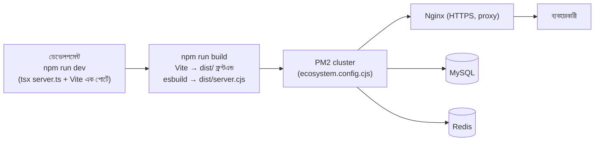

Node ≥ ২২। `.env`-এর মূল চাবি: `DB_*`, `JWT_SECRET`, `ADMIN_EMAIL/PASSWORD`, `CORS_ORIGINS`, `MAIL_ENCRYPTION_KEY`, `REDIS_URL`, `GEMINI_API_KEY` বা একাধিক key `GEMINI_API_KEYS="key1,key2"` (ঐচ্ছিক — একটার সীমা শেষ হলে সেটা বিশ্রামে যায় আর পরেরটা একই প্রশ্নেই উত্তর দেয়; chat, কথা লেখা ও পড়া সবখানে; সব শেষ হলে local bot), `ESIGN_CERT_*` (ঐচ্ছিক)।

Chat-এর attachment (voice, ছবি, video, document) ডাটাবেসে নয়, `.env`-এর `CHAT_ATTACHMENT_DIR` folder-এ ফাইল হিসেবে থাকে (না দিলে app folder-এর `uploads/chat`); ভেতরে `voice/`, `image/`, `video/`, `document/`, বছর ও মাস অনুযায়ী। কোনো এক ধরন অন্য জায়গায় রাখতে `CHAT_VOICE_DIR` / `CHAT_IMAGE_DIR` / `CHAT_VIDEO_DIR` / `CHAT_DOCUMENT_DIR`। server-কে folder-এ লিখতে দিতে হবে, আর **ব্যাকআপে ডাটাবেসের সাথে এই folder-ও** নিতে হবে। PM2-এর সব worker একই folder দেখবে (একই মেশিন বা shared disk)।

---

## Book a Ride: ফোনের প্রথম পাতা

ফোনে (APK বা ছোট পর্দা) পেজের নাম header-এ logo-র জায়গায় বসে, পেজের ভেতরের শিরোনাম, tab আর "1 Route — 2 Ride details" সারি থাকে না; ফোনের Back প্রথমে খোলা তালিকা থেকে booking-এ, তারপর Book a Ride থেকে বের করে। Ride Status, Approved by Me, My Trips, Direct Book (যার যেটা আছে) একটা **My rides** বোতামের ভেতরে, পাশে খোলা ride-এর সংখ্যা। Pickup আর destination একটা card-এ (সবুজ বিন্দু → বেগুনি চৌকো); নিচে chip: Home / Work (save করা জায়গা, switch থাকলে), Projects (মানচিত্রে সব প্রজেক্ট), Map; Recent-এর ৩টা, বাকিগুলো "See all recent"-এ। লেখার সময় একটাই তালিকা: জায়গার প্রস্তাব, মিলে যাওয়া প্রজেক্ট, "Use … as typed" আর "Choose on map"। কম্পিউটারের পেজে মানচিত্রের বাঁ-উপরে **Projects** বোতাম: location দেওয়া সব প্রজেক্ট নামসহ pin হয়ে মানচিত্রে আসে, পাশে খোঁজার ঘরসহ তালিকা (`/api/vehicles/places/projects`); pin বা তালিকায় চাপলে প্রজেক্টের নামেই যেটা সক্রিয় (pickup বা destination) সেটা বসে। Zoom বোতাম ডান-নিচে।

## Book a Ride: pickup / destination মানচিত্রে বাছাই

মানচিত্র পুরো পর্দা জুড়ে, মাঝখানে স্থির pin ("This is your pickup point")। মানচিত্র থামলে pin-এর নিচের ঠিকানা আসে (`/api/vehicles/places/reverse`), আর নিচের প্যানেলে প্রস্তাব: ৫ কিমির মধ্যে সবচেয়ে কাছের অফিস / প্রজেক্ট সাইট (Projects-এর location, দূরত্বসহ — `/api/vehicles/places/nearby`), নিজের save করা জায়গা, আগে ব্যবহার করা গন্তব্য। খোঁজার icon চাপলে খোঁজার ঘর মানচিত্রের উপরে বসে (পেছনটা ঝাপসা হয় না), ফল নিচের প্যানেলে নম্বরসহ আসে আর মানচিত্রে প্রতিটার নম্বর দেওয়া চিহ্ন বসে; pin প্রথম ফলে চলে যায়, যে ফলে চাপা হয় সেটাই বাছাই হয়। Pin-এর ডগা ঠিক মানচিত্রের কেন্দ্রে, তাই যেখানে pin সেখানকার জায়গাই যায়; **Projects** বোতামও মানচিত্রের উপরেই খোলে (ঝাপসা নয়): location দেওয়া সব প্রজেক্ট মানচিত্রে নিজের pin আর নামসহ দেখায়, সবগুলো একসাথে পর্দায় আঁটে, নিচে তালিকা (কাছেরটা আগে, দূরত্বসহ — `/api/vehicles/places/projects`); নাম বা এলাকা লিখলে মানচিত্র আর তালিকা দুটোই ছোট হয়; pin বা তালিকায় চাপলে সেটা বাছাই, Back চাপলে মানচিত্র আগের জায়গায় ফেরে; "Add missing place" pin-এর জায়গার নিজের দেওয়া নাম বসায়। Bookmark দিয়ে জায়গাটা Home / Work / Other হিসেবে ড্রাইভারের জন্য নোটসহ save হয় (`ride_saved_places`, একজনের নিজের, Home ও Work একটাই করে, সর্বোচ্চ ৩০টা) — এটা Self Service switch **Book a Ride — saved places** (`users.can_save_ride_places`, শুরুতে বন্ধ); না থাকলে বোতাম লুকানো আর API 403। Save করা জায়গা বাছলে ride-এ ঠিকানার সাথে ড্রাইভারের নোটও যায়।

## ১৬. যা এই workflow-তে ধরা নেই

আসল ফোন অ্যাপের ভেতরের প্রবাহ (GPS, ক্যামেরা), প্রতিটি ছোট রিপোর্ট ও পেজ, মডিউলভিত্তিক সব এজ-কেস। বিস্তারিত দেখতে `docs/CredenceHR-Code-Guide-for-Laravel-Developers-BN.md` ও সংশ্লিষ্ট `*Routes.ts` ফাইলের শুরুর মন্তব্য পড়ুন (প্রতিটি ফাইলে প্রবাহ লেখা আছে)।

---

## Android app: ফোনের Back বোতাম

ফোনের Back প্রথমে সবচেয়ে উপরের খোলা popup / sheet / ধাপ বন্ধ করে (`backButtonStack.ts`, প্রতিটা popup `useBackButtonClose` দিয়ে নিজেকে রাখে)। কিছু খোলা না থাকলে পুরো পাতা এক ধাপ পেছায় (`App.tsx`): Chat / Alerts / Profile / যেকোনো Self Service পাতা → যেখান থেকে খোলা হয়েছিল (Dashboard); Admin Panel-এর কোনো পাতা → Admin Dashboard → User Dashboard। শুধু User Dashboard-এ "Press back again to exit", ২ সেকেন্ডের মধ্যে আবার চাপলে app বন্ধ।

## Timesheet → Correct Attendance: কে কখন জানতে পারে

কর্মী সংশোধনের আবেদন দিলে Approval Template / Supervisor-এর প্রথম ধাপের approver alert আর ফোনে push পান — "Attendance Correction Awaiting Your Approval" (click করলে Approve Application)। এক ধাপ approve হলে পরের ধাপের approver-ও একইভাবে জানেন (`ApprovalRoutes.ts` notifyNextStepApprovers)। শেষে approve বা reject হলে কর্মী নিজে alert পান, reject-এর কারণসহ; click করলে Timesheet খোলে (`server.ts` finalizeAttendanceCorrection / rejectAttendanceCorrection)।

## Vehicle Management → Inventory → Drivers

Inventory-তে দুটো ভাগ: Vehicles আর Drivers। Driver যোগ হয় শুধু Employees থেকে (নাম · Employee ID · পদ · বিভাগ লিখে খোঁজা); নাম, মোবাইল, বিভাগ Employee record থেকে আসে, এখানে রাখা হয় শুধু License নম্বর, ধরন, মেয়াদ, সাধারণ গাড়ি আর Active / Inactive (`vehicle_drivers`, `VehicleManagementRoutes.ts`)। Login নেই এমন কর্মীকে driver করা যায় না (live map-এ অবস্থান লাগে)। তালিকায় কেউ থাকলে ride-এ গাড়ি দেওয়ার সময় (Assign, Approve & Assign, Direct Book, Direct Assign) শুধু Active driver বাছা যায় — কে ফাঁকা, কার ride booked বা চলছে, কার License শেষ পাশে লেখা থাকে (`GET /api/vehicles/driver-picker`); License শেষ হলে server নেয় না। তালিকা খালি থাকলে আগের মতো যেকোনো অ্যাকাউন্ট। কেউ নিজে গাড়ি চালিয়ে নিতে চাইলে তাঁকে আগে Drivers-এ License সহ যোগ করতে হয় — তারপর তাঁর নিজের ride-এ তাঁকেই driver বাছা যায়; booking-এ আলাদা "নিজে চালাব" বিকল্প নেই। License শেষের ৩০ দিন আগে (বা শেষ হলে) Vehicle Management-এর লোকজন আর Superadmin একবার alert পান। তালিকা দেখা Vehicle Management module-এ; যোগ / বদল / বাদ "Manage drivers" layer-এ।

**Vehicles: Edit / Delete (Module Access → Vehicle Management → "Edit / delete vehicles", `manage_vehicles`, শুরুতে বন্ধ):** তালিকার প্রতিটা গাড়িতে Edit (Vehicle No. — আলাদা থাকতে হয়, Model, Type, Status: available / maintenance / **retired**) আর Delete। Ride-এ থাকা বা ride দেওয়া গাড়ির status হাতে বদলানো যায় না। যে গাড়ির ride-এর ইতিহাস আছে সেটা মোছা যায় না — Retired করতে বলে (ইতিহাস থাকে, ride-এ আর দেখায় না); ইতিহাস না থাকলে মুছে যায়। API: `PUT` / `DELETE /api/vehicles/:id` (layer ছাড়া 403), `GET /api/vehicles/my-access`। গাড়ি যোগ করা আগের মতোই।

**Drivers — নিজে থেকে আর একাধিক গাড়ি:** যে active কর্মীর পদে (designation) "Driver" আছে (Driver, Senior Driver…), তিনি নিজে থেকেই Drivers তালিকায় আসেন ("Auto — designation"); login না থাকলে "No login — can't be picked for a ride"। হাতে সরালে আর নিজে থেকে ফেরেন না (`vehicle_driver_skips`), হাতে আবার যোগ করলে ফেরেন। একজন driver-এর **একাধিক usual vehicle** (`vehicle_driver_vehicles`; পুরনো `usual_vehicle_id` একবার কপি হয়ে প্রথমটা হিসেবে থাকে) — ride-এ driver বাছার সময় সেই গাড়িগুলোর যেকোনোটায় তিনি "usual driver" হিসেবে উপরে আসেন।

## আরও কিছু notification

- **নতুন ফোন (Device Access):** Superadmin approve করলে অ্যাকাউন্টটা "New phone approved" পায়, ফিরিয়ে দিলে "New phone not approved" (`DeviceRoutes.ts`)।
- **Device Access-এর তালিকা:** ওপরে **Phone change requests** — অপেক্ষার অনুরোধ আগে (যেটা আগে এসেছে সেটা ওপরে, Move to this phone / Allow one more / Turn away), তার নিচে সিদ্ধান্ত হয়ে যাওয়াগুলো ক্রমিক নম্বরসহ, নতুনটা আগে (Moved / Allowed one more / Turned away / Allowed (limit raised), কখন আর কে)। প্রতিটা অনুরোধ আলাদা সারি (`user_device_requests`), তাই একই ফোন আবার চাইলে আগেরটা মুছে যায় না। প্রতিটা অ্যাকাউন্ট আর অনুরোধে Employee ID, **Dept** আর **Location** (কর্মীর branch / work station) দেখায়, খোঁজাও যায় এগুলো দিয়ে।
- **Asset ফেরত চাওয়া:** নিচে "Asset: কার হাতে দেওয়া, ফেরত কীভাবে যায়" দেখুন।
- **E-sign বাতিল:** HR সই নেওয়া বাতিল করলে যাঁর সইয়ের অপেক্ষায় ছিল তিনি "Signature no longer needed" পান (`ESignRoutes.ts`)।

## Asset: কার হাতে দেওয়া, ফেরত কীভাবে যায়

- **দেওয়া (Fulfill & Hand Over):** store keeper ফর্মে লেখেন কার হাতে দিলেন — কর্মী নিজে, নাকি তাঁর হয়ে অন্য কেউ (Employee হলে নাম · ID · পদ · বিভাগ লিখে খুঁজে; বাইরের কেউ হলে নাম আর মোবাইল দুটোই লাগে), কবে (ভবিষ্যতের সময় নেয় না) আর অবস্থা। Asset কর্মীর নামেই থাকে; কর্মী alert-এ জানেন কার হাতে দেওয়া হলো, আর আগের মতো Accept & Acknowledge করেন। Fulfill আর Approve & Fulfill দুই পথেই একই (`asset_assignments.handed_to_*`, `handed_over_at`)।
- **ফেরত পাঠানো:** কর্মী My Asset → Return / Replace-এ কারণ (Not needed / Replace — faulty / Leaving / Other), নিজের চোখে অবস্থা (Good / Damaged / Lost) আর "কীভাবে store-এ পৌঁছাবে" (নিজে আনবেন, নাকি কারও মাধ্যমে — Employee বা নাম + মোবাইল) দেন। Damaged / Lost / Other হলে note লাগে। একই item-এ দ্বিতীয়বার ফেরত পাঠানো যায় না। ফেরত যায় **যিনি দিয়েছিলেন সেই store keeper-এর কাছে**: তিনি "Asset coming back to you" alert পান; Asset Management-এর লোকজন আর Superadmin "Asset return requested" পান। দুটো alert-ই click করলে My Asset → Returns to receive খোলে।
- **গ্রহণ (Receive):** My Asset-এ "Returns to receive" ট্যাব শুধু তখনই দেখায় যখন কিছু ফেরত আসছে — store keeper নিজের দেওয়া item দেখেন, Asset Management সবগুলো (Admin Panel → Asset Management → Returns to receive-এও)। Receive-এ কার কাছ থেকে পেলেন (আগে থেকে ভরা) আর অবস্থা মিলিয়ে দেন: Good → stock-এ (available), Damaged → Maintenance, Lost → disposed। কর্মী "Return received" alert পান, item তাঁর নাম থেকে সরে যায়। store keeper না থাকলে বা তাঁর অ্যাকাউন্ট বন্ধ হলে Asset Management গ্রহণ করে।
- **ইতিহাস:** প্রতিটা item-এ History — দেওয়া (কে, কার হাতে, কার হয়ে), Acknowledge, ফেরত পাঠানো (কার মাধ্যমে, কারণ), গ্রহণ (কে, কার কাছ থেকে, অবস্থা), নতুনটা উপরে (`GET /api/assets/:id/timeline`)। Asset Management সব দেখে; কর্মী নিজের অংশ; যে store keeper দিয়েছিলেন তিনিও।

## Admin Dashboard: Coming up — next 60 days

HR Operations → Dashboard-এর "Coming up — next 60 days" (probation ও চুক্তি শেষ, ডকুমেন্টের মেয়াদ, অবসর, increment; ৩০ দিন আগের মেয়াদোত্তীর্ণ থেকে ৬০ দিন সামনে, পাশে Confirm / Extend / Renew / Increment বোতাম) Admin Dashboard-এও দেখায় — শুধু যাঁদের HR Operations আর তার "Reminders — receive & view" layer আছে। এটা দেখালে ছোট "HR Alerts" (৩০ দিন) বক্সটা আর আলাদা করে দেখায় না; layer না থাকলে আগের মতো HR Alerts থাকে।

## Profile → My Service Book

কর্মীর নিজের Service Book (নিজের Employee 360, শুধু দেখা যায়) এখন **Profile** পাতায়। Desktop-এ উপরে বড় ছবিসহ header (ক্যামেরা বোতামে Personal Data খুলে ছবি বদল), বাঁ দিকে মেনু (My Service Book, Contact & Account, Personal Data, My Asset, Appearance, Notifications, Fingerprint, Change Password / Username, Feedback, Logout), ডানে যেটা বাছা — শুরুতে My Service Book। ফোনে দুটো ট্যাব: আগে Settings (খুললে এটাই দেখায়), তারপর Service Book। শুধু যাঁদের Module Access-এ "My Service Book" (`users.can_view_service_book`, ডিফল্টে বন্ধ) চালু, তাঁরাই দেখেন; Superadmin সবসময় দেখেন, তবে তাঁর লগইন কোনো Employee record-এর সাথে যুক্ত না থাকলে Service Book ট্যাবই দেখায় না — "contact HR" বার্তাও না (`/api/auth/me`-এর `has_employee`); server-এ `/api/hr-ops/my/p360` আগের মতোই এই সুইচ যাচাই করে। My Letters & Service Record-এ আর Service Book ট্যাব নেই — সেখানে সবার জন্য Service Record। Assistant-এর "My Service Book খুলুন" বোতাম সরাসরি Profile-এর Service Book খোলে।

**Service Book-এর status (On Probation / Confirmed / Contract):** HR-এর Service Details (grade, probation) থেকে আসে। সেটা না থাকলে Employee record যা বলে তাই — Job Status, Employment Category বা Job Base-এ "Probation", "Contract", "Permanent / Confirmed / Regular" লেখা থাকলে সেই status, Inactive হলে Separated; কিছু না বললে কোনো status দেখায় না (`hrServiceStatus.ts`)। আগে Job Base "Permanent" না হলেই "On Probation" দেখাত, তাই Job Base-এ Head Office / Project লেখা সবাই probation-এ দেখাত।

**Service Book-এর Supervisor:** কর্মীর নিজের supervisor (HR Operations → Transfer / Supervisor, `employee_supervisors`) থাকলে সেটা; না থাকলে তাঁর Department-এর Supervisor (Departments পাতা, `departments.supervisor_user_id` — approval-এর "Supervisor is 1st layer"-ও এটাই), পাশে "(Department)" লেখা। Department-এর Supervisor নিজেই হলে ফাঁকা। এটা শুধু দেখানো — HR-এর action-এ (transfer ইত্যাদি) "আগের supervisor" হিসেবে শুধু নিজের supervisor ধরা হয়।

**App-এর theme (Profile → Settings → Appearance):** default theme এখন **Orange** — CredenceHR-এর brand কমলা (#F47920, app icon আর launch screen-এর রং) পুরো app-এ: ফোনের header ও welcome banner, desktop-এর sidebar, বোতাম, link, Leave Summary card, নিচের বার, Welcome slides, Tutorials (`src/lib/backgroundTheme.ts` `orange`, `<html data-ui="orange">`; index.css Tailwind-এর violet / purple / fuchsia রং কমলায় বদলে দেয়, blue / indigo আর সবুজ / হলুদ / লাল status রং যেমন ছিল)। আগের theme-গুলো বাছাই হিসেবে থাকে: **Apple Glow (Violet)** (আগের default), **Classic**, **Minimal Mono**। যিনি আগে নিজে কোনো theme বেছেছিলেন তাঁর সেটাই থাকে; যিনি কখনো বাছেননি তিনি Orange পান। পছন্দটা ডিভাইসে থাকে (localStorage `mpr_bg_theme_v2`)।

**Android-এর নিচের navigation bar (নতুন APK):** অ্যাপ আর ফোনের নিচের navigation bar-এর (৩ বোতাম বা gesture-এর দাগ) পেছনে আঁকে না। WebView ঠিক তার উপরে শেষ হয় (`MainActivity` insets listener, margin), bar-এর পেছনের ফালিটা সাদা আর তাতে গাঢ় বোতাম। আগে popup / sheet-এর নিচের বোতাম (যেমন Profile photo approvals-এর Approve) আর অনেক পাতার শেষ অংশ ঐ bar-এর নিচে চাপা পড়ত, কারণ প্রতিটা popup-কে নিজে জায়গা ছাড়তে হতো আর অনেকগুলো তা ছাড়ত না। এখন page-কে `--native-safe-area-inset-bottom` 0 জানানো হয়। পুরনো APK-এর জন্য footer ছাড়া Mail-ধাঁচের popup (`MailPopup`) নিজেই সেই জায়গা ছাড়ে।

**ফোনের পাতার header-এর রং (Profile → Settings → Appearance):** ফোনে (APK, iPhone Home Screen, মোবাইল ব্রাউজার) Timesheet, Check In/Out, Leave, My Tasks, My Targets, Approve Application, Documents to Sign, My Duty Roster, Break Time, Bill Claim, My Loan / Advance, My Payslip, My Asset, My Mobile SIM, SIM & ID Card, Book a Ride, My Letters & Service Record, Credence Mail, Alerts, Employee Directory, Grievance & Disciplinary ও My Resignation-এর header-এ রঙিন bar নেই; বাঁয়ে গোল সাদা Back (ফোনের Back-এর মতোই এক ধাপ পেছনে), মাঝে শিরোনাম, ডানে একটি গোল বোতাম — Timesheet-এ Alerts, বাকিগুলোয় ⋮ (Home — সরাসরি Dashboard-এ, Alerts, Chat, Profile, Menu; অপঠিত থাকলে লাল ফোঁটা; Employee Directory-তে নিচে স্ক্রল করলে ⋮-এর পাশে গোল Search বোতামও আসে), পেছনে নরম আলো শুধু উপরে, যা নিচে নামতে নামতে পাতার সাদাটে সমতল রঙে মিশে যায় (এই পাতাগুলোয় থিমের background gradient নিচে দেখায় না), স্ক্রল করলে কাচের মতো ঝাপসা। আলোর রং কর্মী নিজে বাছেন — Violet & pink, Warm orange বা Sky blue; না বাছলে থিমের রং (Classic → Sky blue, Apple Glow → Violet, Orange → Warm orange)। পছন্দটা এই ডিভাইসেই থাকে (localStorage `mpr_header_glow`, `<html data-glow>`), server-এ কিছু যায় না। Desktop আগের মতোই।

**ফোনের Self Service তালিকার card (`src/components/SelfCard.tsx`):** উপরের সব পাতায় তালিকার প্রতিটি জিনিস (দিন, claim, ছুটি, task, target, আবেদন, payslip, asset, SIM, letter, alert, grievance…) Employee Directory-র card-এর মতো — হালকা রঙিন gradient, গোল কোণ, বাঁয়ে গোল আইকন/আদ্যক্ষর, নাম আর এক লাইনের বিবরণ, নিচে ছোট chip, ডানে গোল বোতাম। রং অবস্থা অনুযায়ী: সবুজ = হয়ে গেছে / On time / Paid, হলুদ = অপেক্ষায় / Delay / চলছে, গোলাপি = Absent / Rejected / Overdue, বেগুনি-নীল-আকাশি = অবস্থা নেই এমন সাধারণ তালিকা; Weekend / Holiday / বন্ধ জিনিস হালকা। শুধু phone-এ; desktop-এর তালিকা আগের মতোই।

**Employee Directory-র person card (`EmployeeDirectory.tsx` `EmployeeContactCard`):** কারো নামে চাপলে liquid-glass card — ফোনে নিচ থেকে ওঠা sheet, computer-এ দুই কলাম। ছবির কোণে Active / Inactive বিন্দু, ID-তে চাপলে copy; Call, Email আর Chat বোতাম (Chat শুধু যখন নিজের ও তাঁর দুজনেরই Chat চালু: `POST /api/chat/rooms` direct, তারপর `credence:open-chat-room` event-এ App Chat সেই কথোপকথনে খোলে)। Mobile / Phone ঘরে কয়েকটা নম্বর একসাথে থাকলে (কমা, slash, এমনকি কিছু ছাড়াই জোড়া লাগানো ১১ অঙ্কের নম্বর) প্রতিটা আলাদা লাইনে, একই নম্বর একবার, `01896-055404` রূপে, পাশে Copy ও Call (`src/lib/phoneNumbers.ts`)। Directory-র card / তালিকাতেও প্রথম নম্বরটাই এভাবে দেখায়।

**নতুন profile ছবি — Superadmin-এর অনুমোদন:** Personal Data-য় নতুন ছবি দিলে সেটা সাথে সাথে বসে না — `profile_photo_requests`-এ "অপেক্ষায়" থাকে, পুরনো ছবিই সবখানে দেখায়; Personal Data-য় নতুন ছবিসহ "New photo waiting for approval" আর **Cancel request**। আবার নতুন ছবি দিলে অপেক্ষার ছবিটাই বদলে যায় (একটাই অনুরোধ)। সব Superadmin alert পান ("New Profile Photo to Approve"), Admin Panel → Users → **Photo approvals** (অপেক্ষার সংখ্যাসহ; alert চাপলেও খোলে): পুরনো আর নতুন ছবি পাশাপাশি, **Approve** করলে নতুন ছবি বসে, **Reject** করলে কারণ লিখতে হয় আর পুরনো ছবি থাকে; দুই ক্ষেত্রেই কর্মী alert পান, Reject-এর কারণ Personal Data-য় দেখায়। সিদ্ধান্তের পর অনুরোধের ছবির কপি মুছে যায়। Superadmin-এর নিজের ছবি আর onboarding চলাকালীন joiner-এর ছবি (HR পুরো onboarding দেখে) সরাসরি বসে। **ছবির নিয়ম (৩ ধাপ, `PhotoRulesSheet.tsx`, লেখা English):** যাঁর ছবিতে অনুমোদন লাগে (`photo_needs_approval`), তাঁর ক্যামেরা বোতাম আর Personal Data-র নীল badge "New photo shows after Superadmin approval · Photo rules" আগে খোলে liquid-glass নির্দেশনা — ১) What a good photo looks like (ধূসর পাসপোর্ট-ধাঁচের নারী ও পুরুষ reference, ✓ Good, আর ৪টা নিয়ম), ২) These will be rejected (সাদা পেছনে ছেলে / মেয়ের কার্টুন, ওপরে লাল ✕: Sunglasses / mask / cap, Group / someone else, Blurry / dark, Flowers / nature / logo, Filters / stickers, Too far away — চাপলে কারণ; আর Text / frame, Old photo), ৩) Confirm and pick ("This is a clear, recent photo of me" সুইচ চালু করলে তবেই **Take photo** — সামনের ক্যামেরা — বা **Gallery**)। Superadmin Reject-এ একই নিয়মের তালিকা থেকে এক চাপে কারণ বসান (`PHOTO_REJECT_REASONS`), তাই কর্মী যে নিয়ম দেখেছেন সেই লেখাতেই কারণ পান। API: `POST /api/profile/photo` (→ `pending`), `GET/DELETE /api/profile/photo/pending`, `GET /api/profile/photo-requests`, `GET …/:id/image`, `POST …/:id/approve|reject` (`profileRoutes.ts`)।

## Employee Tracking: কে কাকে দেখবে

Admin Panel → Users → Module Access → Employee Tracking টিক দিলে নিচে "Who they can see on Employee Tracking" খোলে: বিভাগের checklist আর "Add an employee" (নাম · Employee ID · পদ · বিভাগ লিখে খোঁজা)। কিছু বাছা না থাকলে ওই অ্যাকাউন্ট সবাইকে দেখে; বাছা থাকলে শুধু টিক দেওয়া বিভাগের কর্মী আর আলাদা করে যোগ করা কর্মীরা (`PUT /api/users/:id/tracking-scope`, `TrackingScope.ts`)। এই সীমা live map, Currently Tracked / Not Tracked, notice পাঠানো, Notice Report, path history, Stay Report ও Live Follow-এ সার্ভারেই বসে। বিভাগের নাম বদলালে সীমাও সাথে বদলায়।

**Employee Tracking পাতা (Live):** পুরো চওড়া ধূসর map, তার উপর ভাসমান "Right now" কার্ড — Under tracking now / Not tracked / On the move, আর গত ৩০ মিনিটের প্রতি মিনিটের location update-এর bar chart (`GET /api/tracking/status`-এর `updates_per_minute`, শুধু ওই অ্যাকাউন্টের Tracking সীমার মানুষের ping গোনা হয়)। নিচে চারটা কার্ড: Under tracking (বিভাগ অনুযায়ী), Not tracked (বিভাগ অনুযায়ী, Send notice — শুধু যাঁর Notices module আছে, Notice Report), Employees by place (গত ২০ মিনিটের location, ~১০০ মিটারের মধ্যে এক জায়গা, ঠিকানা Nominatim থেকে), Phone status (battery ১৫%-এর নিচে, GPS বন্ধ, battery saver, "While using the app", অনুমতি সরানো, অ্যাপ বন্ধ…), আর Reporting now তালিকা (map-এ দেখাও, path, Live Follow)। প্রতিটা কার্ড ছোট (minimize) করা যায়, "Collapse all cards / Expand all" আছে; কোনটা ছোট তা ওই ব্রাউজারে মনে থাকে। নতুন কোনো অনুমতি নেই — সবই আগের `tracking` module + Read layer আর Tracking সীমার ভিতরে।

**তালিকা থেকে একজনের অবস্থান:** Dashboard-এর "Currently Under Tracking" / "Currently Not Tracked" কার্ড (ফোনে Employee Tracking tile) আর Employee Tracking পাতার বিভাগভিত্তিক তালিকায় যার একবারও location এসেছে, তার সারিতে চাপলে map popup খোলে (`TrackingPersonMap.tsx`, liquid-glass): সর্বশেষ অবস্থান (`GET /api/tracking/latest?user_id=`, accuracy-র বৃত্ত), আজকের পরিষ্কার পথ (`/api/tracking/history`, `cleanPath`), ঠিকানা, কত মিনিট আগে ("Live" ২০ মিনিটের মধ্যে হলে), battery, fake GPS হলে সতর্কতা; খোলা থাকলে প্রতি ৩০ সেকেন্ডে নতুন করে আনে। "Google Maps" আর "Full path & live follow" — শেষেরটা Employee Tracking পাতায় ঐ কর্মীর পুরো পথ খোলে (Live Follow সেখান থেকেই)। নতুন অনুমতি নেই: একই `tracking` module + Read layer + Tracking সীমা।

**"Under tracking now" আর সবুজ বিন্দু একই নিয়মে:** গত ২০ মিনিটে যার location এসেছে, সে সবসময় Under tracking-এ গোনা হয় — map ও Reporting now-এর সবুজ বিন্দুর মতোই। আগে এমন কেউ বাদ পড়ত, যদি তার account-এ Employee Tracking switch বন্ধ থাকত (যেমন Superadmin, যার ping সবসময় যায়), বা ফোনের শেষ heartbeat অন্য কিছু বলত। তাতে সবুজ ৪–৫ জন থাকলেও সংখ্যা ১ দেখাত। যে login account location পাঠাচ্ছে কিন্তু কোনো active employee-র সাথে যুক্ত নয় (`all_employees.user_id`), সে-ও এখন গোনা হয়, বিভাগ "No employee record" নামে। শুধু যে সবাইকে দেখতে পারে, তার জন্য — Tracking সীমা থাকলে এমন account দেখায় না। নতুন location না থাকলে আগের মতোই ফোনের heartbeat দিয়ে বিচার হয় (দাঁড়িয়ে থাকা, GPS বন্ধ, অনুমতি নেই…)।

**Map থেকে Live:** map-এ কারো ছবিতে চাপলে ছোট card খোলে (নাম, কত আগে, battery) আর দুটো বোতাম — **● Live** (সেই মানুষের Live Follow popup খোলে) ও **Path** (তাঁর চলার পথ)। নাম লেখা হিসেবেই বসে, HTML হিসেবে নয়। **Live all** (map-এর ডান কোণে): map-এ যাঁরা দেখা যাচ্ছেন (খোঁজা থাকলে শুধু তাঁরা, সর্বোচ্চ ১০০ জন) সবার ফোন একসাথে live হয় (`POST /api/tracking/live/watch-many`, ৪৫ সেকেন্ড পরপর নবায়ন; বন্ধ করলে বা পাতা ছাড়লে `unwatch-many`)। প্রতিটা নতুন অবস্থান socket-এ আসে, ২ সেকেন্ড পরপর একসাথে map-এ বসে; বোতামে কত সময় বাকি দেখায়, ১৫ মিনিট পর নিজে বন্ধ হয় — live অবস্থায় ফোনের battery বেশি খরচ হয়। দুটোই Live Follow-এর মতো শুধু `tracking` module-এর **live** layer থাকলে (UI-তে না থাকলে বোতাম দেখায় না, server-ও আটকায়), আর শুধু ওই অ্যাকাউন্টের Tracking সীমার মানুষ (সীমার বাইরের id চুপচাপ বাদ যায়)।

## একই ফোনে account বদল

Log out করে অন্য account-এ ঢুকলে header, drawer ও Profile-এর ছবি নতুন account-এর আসে: `useProfilePhoto` token বদলালে আগের ছবি সাথে সাথে মুছে দেয় আর browser cache ছাড়া আনে; সার্ভার নিজের ছবির উত্তর `no-store` পাঠায়। নতুন account-এর ছবি না থাকলে নামের আদ্যক্ষর দেখায়।

## Android app update

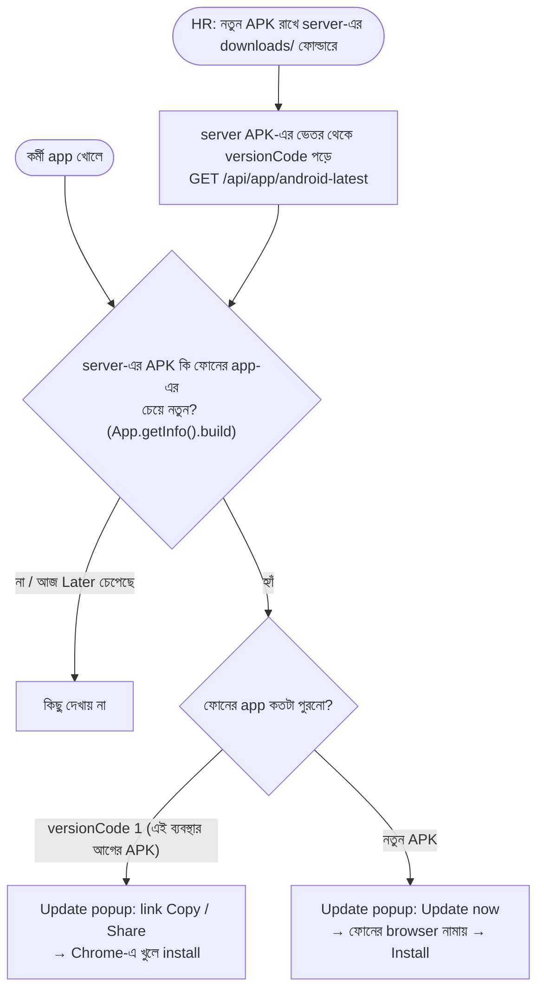

- প্রতিটা build-এর versionCode আগেরটার চেয়ে বড় (২০২৬-এর ১ জানুয়ারি থেকে কত মিনিট, `android/app/build.gradle`)। GitHub আর Android Studio দুই জায়গাতেই এক নিয়ম।
- পর্দাগুলো server থেকে আসে, তাই এই popup-এর আগে বানানো পুরনো APK-তেও popup দেখায় (`src/components/AppUpdatePrompt.tsx`)। শুধু এক চাপে নামানোটা নতুন APK-তে হয় (`MainActivity.java`-র DownloadListener)।
- "Later" চাপলে ওই version-এর জন্য এক দিন আর দেখায় না। Popup সব app ব্যবহারকারীর জন্য, কোনো অনুমতির দরকার নেই, কারণ APK নিজেই লগইন পাতায় সবার জন্য খোলা।
- **iPhone:** App Store ছাড়া iPhone-এ app দেওয়া যায় না (Apple-এর সই লাগে)। তাই iPhone/iPad-এ login পাতা Safari-র "Add to Home Screen"-এর তিন ধাপ দেখায় (`AddToHomeScreen.tsx`), আর একই web app আইকন থেকে পুরো পর্দায় খোলে (`manifest.webmanifest`)। Home Screen থেকে খুললে APK বা iPhone কোনো বোতামই দেখায় না। Phone-এর width-এ web header-ও app-এর মতো purple (আগে সাদা ছিল, status bar-ও সাদা দেখাত)। iPhone-এ notification আসে Web Push দিয়ে (iOS 16.4+, শুধু Home Screen থেকে খোলা app-এ); Apple-এর push সার্ভার VAPID-এর `sub`-এ `example.com` নেয় না, তাই `WEB_PUSH_CONTACT` না থাকলে সাইটের নিজের ঠিকানা যায়।
- **ফাইল নামানো (PDF / Excel) app-এ:** APK আর iPhone app-এর WebView ব্রাউজারের মতো ফাইল নামায় না, তাই সব Excel (`saveWorkbookCrossPlatform`) আর PDF (`savePdfCrossPlatform`, `src/lib/saveFile.ts`) app-এ ফাইলটা ফোনে রেখে Share sheet খোলে (Save to Files / Downloads, Drive, WhatsApp…); ব্রাউজার আর Home Screen web app-এ সাধারণ download।
- **AI Assistant-এর কণ্ঠ iPhone-এ:** iPhone শুধু আঙুলের চাপে শব্দ বাজাতে দেয়, আর Bangla device voice নেই বলে উত্তর আসে server থেকে কয়েক সেকেন্ড পরে। তাই 🎤 আর "শুনুন" চাপার মুহূর্তেই একটা নীরব শব্দ বাজিয়ে একটাই audio player চালু রাখা হয় (`unlockAudio`, `src/lib/assistantVoice.ts`), পরের সব অংশ সেটাতেই বাজে।

## Approval Chain → Templates: Request Type হারিয়ে যেত না আর

আগে প্রতিবার server চালু হওয়ার সময় `approval_templates` / `employee_template_assignments`-এর `request_type` ENUM প্রথমে পুরনো ছোট তালিকায় (conveyance, leave, timesheet, asset) নামিয়ে তারপর বড় করা হতো। যে MySQL / MariaDB-এ sql_mode strict নয় (অনেক shared hosting), সেখানে ছোট করার ধাপেই Vehicle Requisition, Mobile Limit Request আর Loan / Advance-এর template ও assignment-এর type খালি ('') হয়ে যেত — save হতো, কিন্তু restart-এর পর তালিকা থেকে উধাও। একই কারণে `vehicle_requisitions.status`-এর 'assigned' / 'expired' ride-ও খালি হয়ে যেত। এখন `enumWiden.ts` (`widenEnum`) কলামের বর্তমান তালিকা পড়ে শুধু যা নেই তা যোগ করে, কখনো কোনো মান বাদ দেয় না। চালু হওয়ার সময় আগে খালি হয়ে যাওয়া template-এর type ফিরিয়ে আনা হয় (যে approval request-এ ব্যবহার হয়েছে, অন্য assignment, Vehicle Maintainer layer, শেষে নাম দেখে); না বোঝা গেলে log-এ লেখা থাকে, Templates থেকে আবার set করতে হয়। খালি ride status `expired_at` থাকলে 'expired', না হলে 'assigned' হয়।

## Server চালু হলে কী বদলায় না

server চালু হওয়ার সময়ের এককালীন কাজগুলো এখন একবারই চলে; কোনটা হয়ে গেছে তা `startup_migrations`-এ লেখা থাকে (`startupOnce.ts`)। আগে প্রতি restart-এ: শুধু Head office-এর জন্য দেওয়া holiday / weekend Project site-এর calendar-এও কপি হয়ে যেত; কোনো Request Type-এর সব template মুছে দিলে পুরনো Approval Chain থেকে "Migrated Global Chain" template আবার তৈরি হতো; আর Superadmin-এর নিজে বদলানো password ও নাম `.env`-এরটায় ফিরে যেত। এখন Holiday-এর কপি একবারই হয় (Project site calendar খালি থাকলে), template migration একবারই (কোনো template না থাকলে), আর `.env`-এর `ADMIN_PASSWORD` / `ADMIN_NAME` বসে শুধু যখন `.env`-এ সেগুলো বদলানো হয়েছে — তাই password ভুলে গেলে `.env` বদলে restart করলে আগের মতোই নতুনটা বসে। Role সবসময় superadmin রাখা হয়।

## Vehicle Management → Ride Requests: approver এখান থেকেই সিদ্ধান্ত দেন

Admin Panel → Vehicle Management → **Ride Requests** board-এ যে request **এই account-এর approval-এর অপেক্ষায়** (তার নিজের queue, `GET /api/my-approvals`), তার card-এ "Waiting on you" অংশ: Remarks, **Approve**, **Reject** (Remarks লাগে, নিশ্চিত করতে বলে)। শেষ Layer হলে **Approve & assign vehicle** — vehicle আর driver বেছে **Approve & confirm ride** চাপলে approval শেষ আর ride confirm একসাথে (`PUT /api/vehicles/requisitions/:id/approve-and-assign`); শুধু approve করতে **Approve only** (তারপর আগের মতো Assign Vehicle & Driver)। শেষ Layer "Vehicle Maintainer" হলে শুধু Assign Vehicle & Driver (assign-ই approval)। অন্যের অপেক্ষায় থাকা request আগের মতো শুধু অবস্থা দেখায়। Server আগের মতোই যাচাই করে request সত্যিই এই account-এর অপেক্ষায় কিনা (`performApprovalAction`, approve-and-assign) — নতুন কোনো অনুমতি নেই (`VehicleManagementAdmin.tsx`)।

## Book a Ride: start না হওয়া ride বাতিল ও বন্ধ

- **Cancel:** ride শুরু হওয়ার আগ পর্যন্ত বাতিল করা যায়। Pending — rider নিজে। Approved কিন্তু গাড়ি দেওয়া হয়নি — rider, যিনি শেষ approve করেছেন, বা Vehicle Management / Vehicle Maintainer; যাঁরা গাড়ি দিতেন তাঁরা জানেন যে আর গাড়ি লাগবে না। গাড়ি ও driver দেওয়া কিন্তু Start Ride হয়নি — rider, driver, যিনি গাড়ি দিয়েছেন বা Vehicle Management; গাড়িটা সঙ্গে সঙ্গে ছাড়া পায় (নতুন booking-এ বাছা যায়), rider / driver জানেন। Book a Ride → Ride Status-এ "Cancel Request", Approved by Me / My Trips-এ আর Admin Panel → Vehicle Management → Ride Requests-এ "Cancel Ride"। শুরু হয়ে যাওয়া ride বাতিল হয় না (Complete করতে হয়)।
- **কেউ start না করলে:** গাড়ি দেওয়া ride-এর শুরুর সময় এলে driver ও যিনি দিয়েছেন একবার reminder পান। পরিকল্পিত শেষ সময় (শুরু + আনুমানিক ঘণ্টা) পেরিয়ে Ride deadline-এর grace time-ও চলে গেলে ride নিজে থেকে "expired" হয়ে বন্ধ হয়, গাড়ি ছাড়া পায়, আর rider ("দরকার হলে আবার book করুন"), driver ও যিনি দিয়েছেন — সবাই "Ride Closed — Never Started" alert পান (`VehicleManagementRoutes.ts` expireOverdueRides)। আগে এমন ride চিরকাল গাড়ি আটকে রাখত।
- **Est. Duration:** Book a Ride, Direct Book আর Emergency Requisition-এ সময় বাছা যায় 15 / 30 / 45 মিনিট, 1 ঘণ্টা থেকে 6 ঘণ্টা, Half day (4 ঘণ্টা), Full day (8 ঘণ্টা), বা Custom (যত মিনিট বা ঘণ্টা) — `DurationPicker.tsx`। রাখা হয় ঘণ্টায় (`estimated_duration_hours`), দেখানো হয় "45 min", "1 hr 30 min", "Half day (4 hrs)" (`src/lib/rideDuration.ts`)। server নেয় ৫ মিনিট থেকে ২৪০ ঘণ্টা (১০ দিন)।
- **Approve Application-এ ride:** Vehicle Requisition-এর card-এ route-এর নিচে কবে (তারিখ · সময় · Est. duration) আর Purpose দেখায় (`/api/my-approvals`-এর `vehicle_requisition_details`)। Vehicle Maintainer layer-এর "Assign Vehicle & Driver"-এর driver তালিকা অন্য সব Assign form-এর মতোই Inventory → Drivers থেকে আসে (কে ফাঁকা, কার License শেষ পাশে লেখা)।

## অপেক্ষায় থাকা অনুমোদন: Supervisor বা approver বদলালে

Leave, Conveyance, Mobile Limit, Loan / Advance, Timesheet, Asset ও Vehicle — Approval Engine-এর সব আবেদন এখন যাঁর কাছে থাকার কথা তাঁর কাছেই যায়, জমা দেওয়ার পরে কিছু বদলালেও (`server.ts` reconcilePendingApprovals, `approvalReconcile.ts`)। Supervisor / Department Supervisor বদল, কাউকে block বা inactive করা (Job Status Resigned / Terminated সহ), কর্মী transfer, Template বদল — যেকোনোটা save হলেই মিলিয়ে নেওয়া হয়, আর প্রতি ২ মিনিটে একবার এমনিও।

- **Supervisor-এর ধাপে অপেক্ষায়:** কর্মীর এখনকার active Supervisor-এর কাছে চলে যায়; তিনি "Approval waiting on you" পান, কর্মী জানেন কার কাছে গেল। আগের Supervisor যা approve করে ফেলেছেন তা যেমন ছিল থাকে। কোনো active Supervisor না থাকলে Template-এর প্রথম Layer-এ যায়; Template-ও না থাকলে "No approver set" — Superadmin alert পান ও নিজে সিদ্ধান্ত দিতে পারেন, আর Supervisor বসানো হলেই নিজে থেকে তাঁর কাছে চলে যায়। Emergency Requisition-এ হাতে বাছা approver Supervisor বদলেও থাকেন, শুধু inactive হলে সরে।
- **Template Layer-এ অপেক্ষায়:** Layer-এর লোক প্রতিবার Template থেকে পড়া হয়, block / inactive কাউকে approver ধরা হয় না। Layer-এ একজনও active না থাকলে Superadmin একবার alert পান ("Approval stuck — nobody active on the Layer"), Approve Application-এ "Layer N has nobody active — you decide as Superadmin" দেখে সিদ্ধান্ত দিতে পারেন। Layer-এ কাউকে যোগ করলে (বা কেউ আবার active হলে) তিনি alert পান আর আবেদন তাঁর Approve Application-এ আসে। চালু Layer-এ নতুন কাউকে যোগ করলেও তিনি জানতে পারেন কোন আবেদন সেখানে অপেক্ষা করছে।
- **Ad-hoc approver** inactive হলে আবেদন Layer-এ ফিরে আসে।
- **নতুন আবেদন** কখনো block / inactive Supervisor-এর কাছে যায় না।

## Remote Attendance: একাধিক check-in project, তারিখসহ

Admin Panel → Users → Module Access → **Allowed projects for check-in**-এ একজনের জন্য এখন একাধিক project দেওয়া যায়, প্রতিটার নিজের From / To তারিখ (ফাঁকা = সীমা নেই) — `AttendanceProjects.ts`, টেবিল `user_attendance_projects`।

- **Any project** (তালিকা খালি) = আগের মতো যেকোনো project-এ check-in। **Only these projects** = শুধু তালিকার যেসব project-এর তারিখের মধ্যে আজকের দিন পড়ে। তালিকা আছে কিন্তু আজ কোনোটা চালু নেই → check-in হয় না।
- Chip-এ চাপলে From / To popup খোলে; মেয়াদ শেষ হওয়া project ধূসর, শীঘ্রই শেষ হবে এমনটা হলুদ দেখায়। একসাথে অনেকজনকে: Users → বাছাই → **Check-in projects…** (Add / Remove / Make it the list)।
- **ফোনে check-in / check-out:** My Attendance কার্ডে project বাছার ঘর নেই। একটাই চালু project থাকলে সেটাই। একাধিক থাকলে In বা Out-এর Set Now চাপলে GPS দিয়ে যে project-এর radius-এর ভেতরে আছেন সেটা নিজে বাছা হয়; In আর Out আলাদা project-এ দেওয়া যায়।
- **নিজের project-এর বাইরে থেকে হাজিরা (approval সহ):** নিজের কোনো check-in project-এর radius-এর ভেতরে থাকলে আগের মতোই সাধারণ In / Out, সাথে সাথে হাজিরা। বাইরে থাকলে (অন্য কারো project-এ, বা কোনো project-এর এলাকাতেই না) আর আটকায় না: map-এ হলুদ সতর্কবার্তা, **কারণ লেখা বাধ্যতামূলক**, বোতাম "Send for approval"। তখন `attendance`-এ কিছু লেখা হয় না — `attendance_corrections`-এ একটা অনুরোধ হয় (`offsite_in` / `offsite_out`, কোথায় দেওয়া: অক্ষাংশ, দ্রাঘিমাংশ, দূরত্ব, জায়গার নাম; remarks-এ "[Off-site In: …] কারণ"), যা Timesheet → Correct Attendance-এর **একই approval chain** দিয়ে যায় (Conveyance claim-এর মতো: প্রথমে কর্মীর Supervisor, তারপর তাঁর Timesheet Approval Template-এর layer; Supervisor বা Template কোনোটাই না থাকলে "এখনো কোনো approver নেই" হয়ে অপেক্ষা করে — Superadmin সিদ্ধান্ত দিতে পারেন, আর Supervisor / Template বসালে অনুরোধ নিজে থেকে তাঁর কাছে চলে যায়; **কখনো নিজে থেকে approve হয় না**)। Approver-রা Approve Application / Pending Approvals-এ দেখেন, alert-এ "Off-site Attendance Awaiting Your Approval"। শেষ layer approve করলে `finalizeAttendanceCorrection` সেই সময় ও জায়গা `attendance`-এ লেখে — তখন থেকে হাজিরা হিসেবে গোনা হয় (report, বেতন, দেরি); reject হলে দিনটা আগের মতো থাকে। অপেক্ষার সময় কার্ডে In / Out-এর নিচে "Waiting for approval"; সেদিন আর In দেওয়া যায় না, আর নিজের project-এ এসে Out দিলে সেটা একই অনুরোধে যুক্ত হয় (`POST /api/attendance/check-in` / `check-out`-এ `offsite: true`, `AttendanceRoutes.ts` `offsitePunch`; `GET /api/attendance/day-status`-এর `pending_offsite`)।
- **কার্ডে কী দেখায় (`GET /api/attendance/day-status`):** In Time = দিনের প্রথম In, যেখানেই দেওয়া হোক, নিচে "at <project>" বা "Office device · <মেশিন>"। Out Time = In-এর পরের **দিনের শেষ punch**: যেকোনো project-এর Remote Check Out বা office মেশিনের (ZKTeco) punch, যেটা সবচেয়ে পরে, নিচে তার জায়গা। Dashboard-এর "Checked in at …" chip-ও একই হিসাব (`today-summary`)।
- **দিনে একটাই In:** এক project-এ In দেওয়ার পর অন্য project-এ আবার In দেওয়া যায় না ("You've already checked in today at …")। অন্য project-এ দেওয়া Out সেদিনের In-এর সারিতেই বসে, আর কোথায় দেওয়া হলো তা `attendance.check_out_project_id`-এ থাকে (Timesheet-এ `check_out_project_name`)। মেশিনে আগে Out থাকলেও পরে Remote Out দেওয়া যায় — শেষেরটাই দিনের Out।
- **Correct Attendance:** সেই দিনে যে project চালু ছিল শুধু সেগুলো বাছা যায়; একটাই থাকলে সেটা বসে যায়। server-ও একই যাচাই করে (অন্য project দিলে 403)। Data Import-এ project ফাঁকা থাকলে সেই দিনের একমাত্র চালু project ধরা হয়।
- পুরনো একক `users.attendance_project_id` প্রথম চালুতে একবার তালিকায় কপি হয়; এরপর তালিকায় ঠিক একটা project থাকলে সেটাই ওই ঘরে থাকে (পুরনো রিপোর্টের জন্য)।
- বদলাতে লাগে Users module + `edit_add` layer; সব বদল আগের মতো `user_access_audit`-এ।

- **অনুমোদিত off-site In / Out কার্ডে:** অনুমোদনের সময় আসল জায়গা `attendance.check_in_place` / `check_out_place`-এ লেখা হয় ("Outside every project area · 9.9 km from …"), আর My Attendance কার্ডে দেখায় "Off-site · …" — কাছের project-এর নাম নয়। off-site Out অনুমোদন হলে আগের অন্য project-এর `check_out_project_id` সরে যায়। পরে সাধারণ In / Out দিলে (বা সাধারণ Correct Attendance) সেই জায়গা মুছে যায়।

## হাজিরা: সব জায়গায় একই হিসাব

My Attendance card, Timesheet, Monthly / Daily Attendance Report (Department Summary, Custom Report, Admin Dashboard ও Assistant-সহ, যারা `computeMonthlyReport` থেকে নেয়) আর Payroll একই নিয়মে দিন গোনে:

- **GPS + অফিস মেশিন একই দিনে:** In = দুটোর মধ্যে আগেরটা, Out = সেই In-এর পরের **শেষ punch** (GPS Check Out বা মেশিনের যেকোনো punch)। আগে report ও Timesheet GPS-এর সারি থাকলে মেশিন দেখত না; এখন card-এর মতো (`dayPicture`)। Timesheet-এ সেদিন "Office Attendance" নামে একটা বাড়তি সারি আসে যা শুধু আগের In / পরের punch দেয়।
- **Site / Team Attendance (supervisor-এর team sheet):** নিশ্চিত (confirmed) Present / Late এন্ট্রি = সেদিন Present (আগমনের সময় In), Leave এন্ট্রি = Leave — কিছু না থাকলে, আর Weekend / Holiday-তে নয়; payroll যেভাবে গোনে। Report-এ উৎস "Team", Timesheet-এ "Team Attendance"। শুধু যাঁদের login আছে তাঁরা Monthly report-এ আসেন (আগের মতো); login-হীন site কর্মী Site Attendance, Employee 360 আর Payroll-এ।
- **Team-এর member নিজেও check in দিলে:** Site Attendance → Settings-এ "Use members' own check-in" (`site_attendance_settings.use_app_checkin`, শুরুতে চালু) চালু থাকলে supervisor-এর শিটে সেই member-এর পাশে নিজের check-in-এর সময় দেখায় ("App check-in 08:55", office device-এ দিলে "Device punch 09:32–18:05")। উৎস: সেদিনের Remote Attendance (`attendance`, তাঁর login) আর ZK punch (`zk_attendance_logs`, তাঁর Device PIN), দুটোর সবচেয়ে আগের In আর সবচেয়ে পরের Out। নতুন শিট খুললে তাঁরা আগে থেকেই mark করা থাকেন: shift / Late Policy-র grace-এর মধ্যে এলে P, পরে এলে L (আগমনের সময়সহ)। Supervisor শুধু দেখে Submit করেন; "Mark the rest present" এঁদের নিজের check-in দিয়েই mark করে। Supervisor A / LV দিলে লাল লেখা "— but marked Absent" আর "Use it" বোতাম দেখায়। জমার সময় server নিজে মিলিয়ে দেখে: আগমনের সময় নিজের check-in-এর সমান হলে entry-তে `from_app = 1` (phone-এর পাঠানো কিছু নয়)। HR-এর Today-তে "Checked in themselves" সংখ্যা, প্রতি team-এ কতজন, আর "Checked in, but marked Absent / Leave: …"; Register-এ সেই ঘরে সবুজ বিন্দু (Excel-এ `P*`)। গোনার নিয়ম আগের মতোই, নিজের check-in থাকলে সেটাই আগে (`SiteAttendanceRoutes.ts` `ownCheckIns`)।
- **Timesheet-এর calendar** (`GET /api/attendance/my-calendar`): কর্মীর নিজের Weekend / Holiday (Head Office বা Project site) তাঁর Duty Roster মিলিয়ে — roster-এর Off day ছুটি (Absent নয়), Holiday-তে shift থাকলে কাজের দিন; যোগদানের আগের দিন দেখায় না; team sheet-এর Leave দেখায় "Leave (team sheet)"।
- **বেতন বন্ধ হওয়া মাস:** যে বেতন-মাসে কর্মীর payroll **Processed বা Paid**, সেই মাসের কোনো দিনের Timesheet সংশোধন (আর বাইরে থেকে দেওয়া হাজিরা) নেওয়া হয় না, আর আগে থেকে অপেক্ষায় থাকা সংশোধন approve করা যায় না (কিছু লেখার আগেই আটকায়, তাই অনুরোধ অর্ধেক approve হয়ে থাকে না; reject করা যায়) — `PayrollRoutes.ts` `closedPayMonthFor`। বেতন-মাস ধরা হয় Payroll-এর salary month setting অনুযায়ী।

## Office Attendance: একাধিক ZKTeco মেশিন

Office Attendance → **Machines** popup-এ প্রতিটা মেশিন: নাম, office / branch / site, সংযোগ, PIN-এর ধরন, অবস্থা (Online / Quiet / Offline / Not heard from yet), শেষ কবে শোনা গেছে আর আজকের punch সংখ্যা (`zkMachines.ts`, `ZkMachinesModal.tsx`)।

- **Same network (LAN / VPN):** আগের মতো server নিজে মেশিন থেকে punch টেনে আনে (IP:port, `zkSync.ts`)।
- **Over the internet (Cloud push / ADMS):** দূরের সাইটের মেশিন নিজে punch পাঠায় — মেশিনে Menu → Comm. → Cloud Server Setting-এ server-এর ঠিকানা দিলে `/iclock/cdata`-তে আসে। VPN লাগে না। শুধু register করা, চালু, মিলে যাওয়া Serial number-এর মেশিনের punch নেওয়া হয় (আর "Only from this internet address" দেওয়া থাকলে শুধু সেই IP থেকে)।
- **PIN numbers:** *Same as the office* = punch যায় Employee-এর Device PIN-এর মালিকের কাছে (আগের মতো)। *Its own numbers* = এই মেশিনের PIN 15 অন্য কেউ হতে পারে; প্রতিটা PIN Unlinked PINs-এ আলাদা করে link করতে হয় (`zk_device_pins`)। link না হওয়া পর্যন্ত punch `M<machine>-<pin>` নামে জমা থাকে, link করলেই সেই কর্মীর হাজিরায় চলে যায়; মেশিন-ভিত্তিক PIN তালিকা আর unlink Machines popup-এ।
- **Offline alert:** সকাল ৭টা–রাত ৯টার মধ্যে কোনো চালু মেশিন এক ঘণ্টা কিছু না পাঠালে Superadmin ও Office Attendance module-এর লোকেরা একবার alert পান; মেশিন আবার শোনা গেলে alert আবার চালু হয়। Alert-এ চাপলে Admin Panel → Office Attendance খোলে, Machines popup খোলা অবস্থায় (alert type `zk_machine`; আগে Team Attendance-এ নিয়ে যেত)।
- মেশিন যোগ / বদল / মোছা Office Attendance module-এর (আগের মতো); PIN link / unlink "Link Device PINs" layer-এর।
- **নতুন Employee-র Device PIN = Employee ID:** Employees ফর্মে, HR Data Import-এ (নতুন সারি) বা Onboarding approve-এ নতুন Employee তৈরির সময় Device PIN ফাঁকা থাকলে Employee ID-ই PIN হয় — ZKT মেশিনে কর্মীকে এই ID দিয়েই enroll করা হয়। ওই PIN আগে থেকে অন্য কারও হলে: ফর্ম save আটকায় ও কার PIN বলে; Import সারি PIN ফাঁকা রেখে কারণ লেখে; Onboarding approve PIN ফাঁকা রাখে। App মেশিনে কোনো user পাঠায় না — মেশিনে enroll আলাদা।

## App খুললে কী লোড হয়

App (APK / iPhone / ব্রাউজার) খুললে শুধু Dashboard-এর কার্ডের ডাটা আসে। Check In/Out (তালিকাসহ), Bill Claim, Leave Application, Timesheet, Employee Directory, Notice Board-এর code আর ডাটা আসে সেই পাতা প্রথমবার খুললে; এরপর পাতাটা রেখে দেওয়া হয়, ফিরে এলে সঙ্গে সঙ্গে দেখায় (`UserPanel.tsx` seen)। PEPM-এর Budget / MPR No / entries আসে Budget, Jobs, Entries বা Job Edit খুললে। ফোনে শুধু ফোনের Dashboard আর ডেস্কটপে শুধু ডেস্কটপেরটা বসে (`src/lib/useMdUp.ts`) — আগে দুটোই বসে দুবার ডাটা আনত। Pending Approvals-এ গাড়ি ও driver-এর তালিকা আসে শুধু গাড়ি বসানোর মতো আবেদন থাকলে।

## Chat attachment: ফাইল folder-এ, ডাটাবেসে শুধু path

- **পাঠানো:** voice, ছবি, video বা document পাঠালে server ফাইলটা chat folder-এ লেখে (`chatFiles.ts`) — `voice/2026/11/<এলোমেলো নাম>.webm`-এর মতো; `chat_messages.attachment_path`-এ শুধু এই path থাকে। ফাইলের নাম কখনো পাঠানো নামে হয় না (পাঠানো নাম শুধু দেখানোর জন্য `attachment_filename`-এ)।
- **আকার:** একটা ফাইল সর্বোচ্চ ৫০ MB। app ফাইলটা সরাসরি পাঠায় (base64 নয়), তাই বড় video-ও ফোনের memory-তে দ্বিগুণ হয় না; পুরনো app-এর base64 পাঠানোও চলে (২৫ MB JSON সীমার মধ্যে)। Nginx-এ `client_max_body_size 55m` লাগবে (`deploy/nginx.conf.example`), না হলে বড় ফাইল server-এ পৌঁছায় না।
- **খোলা:** আগের মতো `/api/chat/messages/:id/attachment` — শুধু সেই chat-এর সদস্য পান; folder-টা ওয়েবে খোলা নয়। ফাইল পুরোটা memory-তে না তুলে সরাসরি পাঠানো হয়, video টেনে দেখার জন্য Range-ও চলে।
- **Forward:** কপি একই ফাইল দেখায়, নতুন কপি হয় না। **Delete for everyone:** ফাইলটা মুছে যায়, যদি না কোনো forward করা কপি তখনো সেটা দেখায়।
- **পুরনো attachment:** আগে ডাটাবেসে রাখা ফাইল server চালুর সময় পেছনে নিজে থেকে folder-এ চলে যায় আর ডাটাবেস থেকে মুছে যায় (একাধিক worker থাকলেও একজনই করে)। folder-এ লেখা না গেলে সেটা ডাটাবেসেই থাকে আর আগের মতো খোলে।

## Remote Attendance: Out Time আবার দেওয়া (Update Out Time)

ভুল করে আগেই Out Time দিয়ে ফেললে একই দিনে আবার দেওয়া যায় — শুধু যাঁর Module Access-এ **Remote Attendance — update Out Time** টিক দেওয়া (শুরুতে বন্ধ; Superadmin সবসময়)। কার্ডের Out Time-এর নিচে **Set again** → নিশ্চিত করার popup → আগের মতো GPS ও মানচিত্রে Confirm (project-এর এলাকার মধ্যে থাকতে হয়)। নতুন সময় আগেরটার জায়গায় বসে; প্রথম Out Time `attendance.check_out_first_at`-এ আর কতবার বদলানো হলো `check_out_update_count`-এ থাকে, কার্ডে "first was …" দেখায়। আগের Out Time-এর অনুমোদন মুছে নতুন সময় আবার অনুমোদনে যায়। Office device (ZKTeco)-এর দেওয়া Out Time এভাবে বদলায় না, আর Check In আগের মতো দিনে একবার (`AttendanceRoutes.ts` check-out)।

## পাশের menu: নতুন tab-এ খোলা

ব্রাউজারে পাশের menu-র প্রতিটা পাতা এখন আসল link (`/self/…`, `/admin/…`, Dashboard `/`), তাই right-click → "Open link in new tab", Ctrl / Cmd + click বা মাঝের বোতামে নতুন tab-এ খোলে; সাধারণ click আগের মতো একই tab-এ খোলে (`GlobalSidebar.tsx` navLinkProps)। নতুন tab-এ পাতাটা খোলে শুধু যদি সেই account-এর অনুমতি থাকে (আগের মতো address থেকে খোলার নিয়ম)। যেসব পাতার নিজস্ব address নেই (Leave Application, Check In/Out ও Conveyance-এর নিজের পাতা, PEPM-এর Entry / Jobs) সেগুলো আগের মতো বোতাম। ফোনের app-এ কিছু বদলায়নি।

## Notice: লেখা, কাকে, কখন, কে পড়েছে

Admin Panel → **Notices** → **New notice** — চার ধাপের একটা পাতা (প্রতিটা ধাপের নিচে ছোট করে লেখা কী বাছা হয়েছে; Review-এ কিছু বাকি থাকলে "Fix it" সেই ধাপে নিয়ে যায়)। ডান পাশের Live preview-তে কর্মীরা যা দেখবেন হুবহু তা-ই — Popup (`NoticePopup.tsx`-এর `NoticeSheet`), Opened (`NoticeDetail.tsx`-এর `NoticeArticle`), Board (`NoticeBoard.tsx`-এর `BoardCard`); ফোনে Preview বাটনে popup (`notice/NoticeComposer.tsx`)।

1. **Write:** template (Holiday, Meeting, Policy update, Urgent, Congratulations, Maintenance), Title, আর Word-এর মতো editor — Bold, Heading, list, checklist, রং, highlight, link, table, emoji; Enter-এ নতুন লাইন, বাংলা / English; Word, Google Docs বা WhatsApp থেকে paste করলে format থাকে (`notice/NoticeEditor.tsx`, browser-এর নিজের editing, আলাদা library নেই)। ছবি টেনে আনা, paste বা বাছা যায় (PNG, JPG, WebP, GIF; বড় ছবি নিজে ছোট হয়, ৫ MB পর্যন্ত), cover ছবি, আর PDF / Word / Excel / PowerPoint / text সংযুক্তি (২০ MB পর্যন্ত)। ঐচ্ছিক Lottie animation আগের মতো। নতুন notice শেষ না করে বন্ধ করলে এই browser-এ থাকে, পরে "Continue it"।
2. **Who gets it:** Everyone, Choose groups (Department ও / বা Branch, সাথে কাউকে যোগ), বা Specific people (Admin-সহ যে কাউকে, নাম · Employee ID · পদ · Department লিখে খোঁজা); যেকোনোটায় কাউকে "Leave out"। কতজন পাবেন সাথে সাথে দেখায়। Group-এর notice প্রতিবার Employee-র বর্তমান Department / Branch দেখে — নতুন কেউ যোগ হলে তিনিও পান।
**People who join later** (Who gets it ধাপে, Everyone / Groups-এর জন্য): **Only people here now** (default) — notice যখন বের হয় (`announced_at`) তার পরে যাঁর account খোলা হয়েছে বা যোগদানের তারিখ পরে (এক দিনের ছাড়সহ), তিনি এটা Board / popup / Dashboard-এ পান না, read report-এও গোনা হন না; **New joiners get it too** — পরে যোগ দেওয়া মানুষও পান (policy, নিয়মের মতো স্থায়ী notice-এর জন্য)। নাম ধরে বাছা মানুষ (Specific people, "Also these people") সবসময় পান। এই বদলের আগের সব notice "Only people here now" — যেটা নতুনদেরও দেখানো দরকার, Edit করে বদলাতে হয় (`notices.new_joiners`)।
**Animation library:** Write ধাপের "Animation"-এ আগে থেকে রাখা Lottie animation-এর তালিকা (চলমান ছোট ছবিসহ) — একটায় চাপলে notice-এ বসে, "None" দিলে সরে; চাইলে আগের মতো JSON paste বা link। Library-তে **Import .json** — একসাথে অনেকগুলো ফাইল বেছে বা টেনে এনে, প্রতিটার নাম ঠিক করে "Add all" (ভুল / ৩ MB-র বেশি ফাইল কারণসহ তালিকায় থেকে যায়, বাকিগুলো ওঠে) — ও মোছা শুধু Notices-এর 🔒 layer "Animation library (add / remove)" (`notice_animations`) যাঁর; বেছে নিতে Notices module-ই যথেষ্ট। Notice animation-টার নিজের কপি রাখে, তাই library থেকে মুছলেও আগের notice বদলায় না (`notice_animations`, `notice/AnimationLibrary.tsx`)।
3. **When & how:** Normal (শুধু Notice Board ও Dashboard), Important (login-এর পর popup — আগের সব notice এটাই), Urgent ("I have read this" না চাপা পর্যন্ত popup আসে)। Publish now / later আর Take down after (Dhaka সময়) — server প্রতি মিনিটে দেখে নিজে প্রকাশ করে ও সরায়। Pin on top, "I have read this", push (চালু থাকে), email (শুধু `notice_email` layer থাকলে দেখায়), আর পরদিন যাঁরা পড়েননি তাঁদের মনে করিয়ে দেওয়া (একবার)।
4. **Review & publish:** কোথায় কী যাবে তার সারাংশ, "See it as a popup", তারপর Publish now / Schedule / Save as draft।

তালিকায় প্রতিটা notice-এর অবস্থা (Live, Scheduled, Taken down, Paused, Draft), কাকে গেছে, কতজন খুলেছেন / পড়েছেন; Make a copy, Edit, Pause, Delete (ছবি ও ফাইলও মোছে)। **Who read it** (শুধু `notice_read_report` layer): কে খুলেছেন, কে "I have read this" দিয়েছেন, কে এখনো না — নাম ও Department অনুযায়ী, খোঁজা, Excel, আর "Send again to unread" (push)।

কর্মীর দিকে: popup একটা bottom sheet — ছবি থাকলে ছবি আর তার ওপর Important / Pinned, না থাকলে priority-র রঙে বড় আইকন; কে পাঠিয়েছেন, কবে, কত মিনিটের পড়া; লম্বা লেখা বা সংযুক্তি থাকলে "Read full" পুরো notice খোলে; কয়টা notice বাকি তা ফোঁটায় ("1 of 3"); "I have read this" না হয় "Got it"; Urgent-এ "Remind me later" শুধু এবারের মতো সরায়। Notice Board: খোঁজা, All / Unread / Urgent / Pinned / Has files, না-পড়া Urgent সবার ওপরে লাল কার্ডে (সেখানেই "I have read this"), তারপর Pinned, তারপর Latest (ছবি থাকলে বড় কার্ড, না থাকলে ছোট সারি, না-পড়ায় বেগুনি ফোঁটা)। চাপলে পুরো notice (`notice/NoticeDetail.tsx`): ওপরে ছবি ও শিরোনাম, লেখা, সংযুক্তি কার্ডে, নিচে বাটন। Popup দেখা বা Board-এ notice খোলা "opened" হিসেবে ধরা হয় (`notice_reads`) — শুধু Board-এ আসা আর নয়। কে পাঠিয়েছেন তা `/api/notices/active` ও `/board`-এ `from_name`। আগের সাধারণ লেখায় দেওয়া line break এখন ঠিক দেখায়।

**দেখা notice পরে কোথায়:** Notice Board-এ — কর্মীকে পাঠানো সব notice সেখানে থাকে। খোলা যায় বাঁদিকের মেনু → Self Service → Others → **Notice Board** (desktop ও ফোনের মেনু, সবার জন্য), ফোনের More (⊞) → Notice Board, আর desktop Dashboard-এর Notice Board কার্ড থেকে।

ছবি ও ফাইল থাকে `.env`-এর `NOTICE_FILES_DIR` folder-এ (না দিলে `uploads/notices`), database-এ শুধু path (`notice_files`); notice মুছলে বা ফাইল সরালে ফাইলও মোছে, ২ দিনের বেশি পুরনো ব্যবহার-না-হওয়া upload নিজে মোছে (`noticeFiles.ts`, `NoticeRoutes.ts`)।

## Chat call: "Connecting…"-এ আটকে না থাকা

সার্ভারে TURN (coturn VM, Windows NAT, `.env`, APK) কীভাবে বসানো হয়েছে, তার পুরো বিবরণ [docs/Call-Setup-TURN.md](../Call-Setup-TURN.md)-এ আছে।

Chat-এর audio / video call phone-to-phone (WebRTC); server শুধু call-টা পৌঁছে দেয় (Socket.IO, `CallRoutes.ts`)। মোবাইল microphone শুধু https-এ দেয়, তাই https চালুর পরেই আসল সংযোগ চেষ্টা শুরু হয়। দুই ফোন একে অপরকে খুঁজে পেতে Google-এর STUN সবসময় থাকে; মোবাইল data (carrier-grade NAT) বা কড়া office firewall-এ তা যথেষ্ট নয় — তখন **TURN relay** লাগে: `.env`-এ `CLOUDFLARE_TURN_KEY_ID` + `CLOUDFLARE_TURN_API_TOKEN` (Cloudflare Calls TURN) বা নিজের coturn-এর `TURN_URLS` / `TURN_USERNAME` / `TURN_CREDENTIAL`। TURN না থাকলে server চালুর সময় সতর্কবার্তা দেয়। Call ধরার পরে ২৫ সেকেন্ডে সংযোগ না হলে (বা ICE failed হলে) call নিজে বন্ধ হয় আর কারণ দেখায় — TURN না থাকলে "Ask IT to set up the call relay (TURN)" (`CallLayer.tsx`)।

**কলের বোতাম আর শব্দ কোথায় বাজে:** কল চলার সময় নিচে নাম লেখা বোতামগুলো থাকে: **Mute**, **Earpiece / Speaker** (শুধু Android অ্যাপে), video কলে **Camera**, আর **End**। কলের পর্দা `document.body`-তে আঁকা হয়, তাই অন্য কোনো পাতা বা popup এটা ঢাকতে পারে না। ফোনের নিচের navigation bar-এর জন্য জায়গাও রাখা থাকে। Android অ্যাপে কল শুরু হলে `CallAudioPlugin.java` (`src/lib/callAudio.ts`) ফোনকে "কলে আছে" অবস্থায় নেয়: audio কল বাজে কানের speaker-এ (earpiece), video কল loudspeaker-এ। Speaker বোতাম দিয়ে বদলানো যায়। কানে ধরলে পর্দা বন্ধ হয় (proximity sensor), যাতে গালে লেগে বোতাম না চাপে। headset বা Bluetooth লাগানো থাকলে earpiece-এর বদলে সেটাতেই বাজে। কল শেষ হলে সব আগের অবস্থায় ফেরে। ওয়েবসাইটে (browser) কোথায় বাজবে তা browser ঠিক করে, তাই সেখানে Speaker বোতাম থাকে না। এর জন্য নতুন APK লাগবে; পুরনো APK-তে বোতামটা দেখা যায় না, বাকি সব আগের মতো চলে।

**Video কলে ক্যামেরা বদল:** **Flip** বোতাম সামনের ↔ পেছনের ক্যামেরা বদলায়। পুরনো ক্যামেরা আগে ছেড়ে নতুনটা খোলে (অনেক ফোন দুটো একসাথে খুলতে পারে না), আর নতুন ছবি কলে `RTCRtpSender.replaceTrack` দিয়ে বসে, কল নতুন করে জোড়া লাগে না। নিজের ছোট ছবি শুধু সামনের ক্যামেরায় আয়নার মতো উল্টো দেখায়। একটাই ক্যামেরা থাকলে সেটাই ফিরে আসে, আর "This phone has only one camera." দেখায়।

**অ্যাপ বন্ধ থাকলেও কল আসে (Android):** কল শুরু হলে server callee-র Android ফোনগুলোতে একটা high-priority push ("call_incoming", Firebase) পাঠায় — অ্যাপ খোলা থাকুক বা না থাকুক। অ্যাপ পর্দায় না থাকলে ফোন নিজের Incoming call পর্দা দেখায় (`IncomingCall.java`): lock screen-এর উপরে (Android 14+-এ "full screen" অনুমতি থাকলে, নইলে উপরে notification হয়ে), ফোনের ringtone বারবার বাজে, vibration হয়, ৪৫ সেকেন্ড পর্যন্ত। **Accept** অ্যাপ খোলে; socket সংযুক্ত হলে server বাজতে থাকা কলটা আবার জানায় (`announce`, page নিজেও `call:announce` চায়) আর page সেটা সাথে সাথে ধরে (`CallAudioPlugin.takePendingCall`)। **Decline** অ্যাপ না খুলেই `POST /api/calls/push-decline`-এ সেই কলের এককালীন চাবি পাঠায়। কল শেষ হলে, অন্য ফোনে ধরলে বা কেউ না ধরলে "call_cancel" push সেই পর্দা সরিয়ে দেয়। Callee-র কোনো সংযোগ নেই আর push-ও যায়নি (Firebase নেই, ফোনে token নেই) — তখনই আগের মতো "isn't online — they'll see a missed call"। নতুন APK লাগবে; কিছু ফোনে (Xiaomi, Oppo, Vivo…) CredenceHR-এর battery setting "No restrictions" না করলে push দেরিতে আসতে পারে।

**ফোনের নিজের ringtone ও full-screen কল-পর্দা (নতুন APK):** push এলে `IncomingCall.show` একটা phoneCall foreground service চালু করে (`IncomingCallService.java`)। সেটা ফোনের Sound settings-এ যে ringtone বসানো আছে সেটাই বারবার বাজায়, ring volume-এ, আর vibrate করে (`CallRinger.java`)। ফোন Silent হলে বাজে না, Vibrate হলে শুধু কাঁপে, Do Not Disturb চালু থাকলে কিছুই হয় না। শব্দটা notification channel-এর না, অ্যাপ নিজে বাজায় — তাই যেসব ফোন (Xiaomi, Oppo, Vivo) নতুন channel নিঃশব্দ করে দেয়, সেখানেও বাজে। এর call notification-এ (Answer / Decline) full-screen intent থাকে, যা আলাদা কল-পর্দা খোলে (`IncomingCallActivity.java`): lock screen-এর উপরে, screen জ্বালিয়ে, নাম, "Audio call · CredenceHR", Decline / Accept। Volume বোতাম চাপলে শুধু শব্দ থামে। ফোন ব্যবহার করার সময় Android নিজে শুধু উপরে notification দেখায়; "Display over other apps" অনুমতি দেওয়া থাকলে তখনও পুরো পর্দা খোলে। Service চালু করতে না দিলে আগের মতো সাধারণ বাজতে থাকা notification দেখায়।
- **অ্যাপ খোলা থাকলেও** Android অ্যাপে কল এলে page-এর beep-এর বদলে ফোনের ringtone বাজে (`CallAudioPlugin.startRinging`)। Website ও পুরনো APK-এ আগের beep-ই থাকে।
- অ্যাপ background-এ থাকলেও page-এর সংযোগ খোলা থাকতে পারে। তখন page কল পেলেও ফোনের কল-পর্দা সরায় না (`cancelIncoming` `ringingHere`, শুধু অ্যাপ পর্দায় থাকলে সরায়)। আগে এখানেই পর্দা চলে যেত, আর কল নিঃশব্দে বাজত। বাজার সময় অ্যাপ খুললে page নিজেই কলটা দেখায় ও বাজায় (`ringHandover`)।
- **iPhone / iPad (Home Screen app):** অ্যাপ বন্ধ থাকলে Apple কোনো web app-কে ringtone বাজাতে, লম্বা vibrate করতে বা call screen দেখাতে দেয় না। তাই কল বাজার সময় callee-র Apple subscription-গুলোতে (`*.push.apple.com` — iPhone / iPad Home Screen app, Mac Safari) প্রতি ৫ সেকেন্ডে একটা "📞 X · Incoming audio call · tap to answer" notification যায় (`WebPushService` `webRing`, TTL ৩০ s, urgency high)। `public/sw.js` প্রতিটাকে নতুন notification হিসেবে দেখায় আর আগেরটা সরিয়ে দেয়, তাই প্রতিবার ফোনের notification শব্দ ও vibration হয় — কল বাজার মতো। ধরলে, শেষ হলে বা ৪৫ সেকেন্ড পরে থামে; কলের chat-লাইনের push (Missed call / সময়) এলে শেষ notification-টাও সরে। Tap করলে সেই chat খোলে, আর অ্যাপ পর্দায় ফিরলেই page `call:announce` চায়, তাই কলটা সেখানে বাজে (group-এ "Join" bar)। অ্যাপ পর্দায় থাকলে page নিজেই বাজায়, notification তখন নিঃশব্দ। এমন subscription-এ পৌঁছালে caller-কে আর "isn't online" বলা হয় না। Group call-এও একইভাবে যায়, কেউ ঢুকলে বা Decline করলে তার notification থামে। Chat → Calls-এ iPhone Home Screen app-এ notification বন্ধ থাকলে হলুদ সারিতে "Turn on"। Silent / Focus mode-এ iPhone শব্দ করে না।
- **Chat → Calls → "Calls on this phone"** (Android অ্যাপ, Calls অনুমতি আছে এমন account; কিছু বন্ধ থাকলে Calls তালিকার উপরে হলুদ সারি, আর সপ্তাহে একবার নিজে থেকে জিজ্ঞেস করে, `CallSetupCard.tsx`): Notifications, Full-screen call screen (Android 14+), Battery not restricted, আর ঐচ্ছিক Display over other apps — প্রতিটার পাশে "Turn on" চাপলে ফোনের Settings-এর সেই পাতা খোলে। ফিরে এলে টিক নিজে থেকে বদলে যায়।

**কলের মাঝে অ্যাপ থেকে বের হলেও কল চলে (Android):** কল চলার সময় (`CallAudioPlugin.start` থেকে `stop` পর্যন্ত) একটা foreground service চলে (`CallService.java`, type microphone, ভিডিও কলে camera-ও)। notification-এ লেখা থাকে "Call in progress — tap to return", আর থাকে **Hang up** বোতাম। এটা না থাকলে Home চাপলে বা স্ক্রিন বন্ধ হলে Android 11+ কয়েক সেকেন্ডে অ্যাপ থামিয়ে দেয় আর মাইক বন্ধ করে, সংযোগ চুপ হয়ে যায়, আর কল কেটে যায়। notification-এ চাপলে আবার কলে ফেরা যায়। Hang up চাপলে page কল শেষ করে (`callHangup` → CallLayer `hangUp` / GroupCallLayer `leave`)। কল শেষ হলে service নিজে বন্ধ হয়। নতুন APK লাগবে।

**কল ছোট করা (WhatsApp-এর মতো):** কলের পর্দার উপরে বাঁ কোণে Minimize বোতাম আছে। চাপলে কলটা একটা ছোট ভাসমান জানালা হয়ে যায়: ভিডিও কলে অন্যজনের ভিডিও আর সময়, অডিও কলে ছবি, নাম আর সময়। জানালাটা টেনে যেকোনো পাশে রাখা যায়, ছাড়লে কাছের কিনারায় বসে যায়। পেছনের অ্যাপ স্বাভাবিকভাবে ব্যবহার করা যায়। জানালায় চাপলে কল আবার পুরো পর্দায় আসে, লাল বোতামে কল শেষ হয় (`CallLayer.tsx`)। বাজতে থাকা কল সবসময় পুরো পর্দায় দেখায়। Android অ্যাপে ভিডিও কলের মাঝে Home চাপলে ফোনের নিজের picture-in-picture জানালায় শুধু ভিডিও দেখায় (`MainActivity.onUserLeaveHint`, `CallAudioPlugin` "pictureInPicture")। কল শেষ হলে সেই জানালা নিজে বন্ধ হয়। picture-in-picture-এর জন্য নতুন APK লাগবে।

**Group call (audio / video):** Group বা Community chat-এর উপরে 📞 / 🎥 বোতাম (একই Calls অনুমতি; "Only admins can send messages" group-এ শুধু admin শুরু করতে পারেন)। শুরু করলে chat-এ "📞 X started a group … call" (সাধারণ chat push যায়) আর group-এর যাঁদের Calls আছে তাঁদের app-এ ring card (Join / Decline, ৪৫ সেকেন্ড)। Call চললে chat-এর উপরে সবুজ "Group call on · N joined · Join" bar, পরে যে কেউ ঢুকতে পারেন। প্রত্যেকে প্রত্যেকের সাথে সরাসরি যুক্ত (mesh WebRTC, `GroupCallRoutes.ts` শুধু signaling, `GroupCallLayer.tsx`), তাই একসাথে **সর্বোচ্চ ৮ জন**; video ছোট (৪৮০×৩৬০, ১৫ fps) রাখা হয় যাতে ফোনের data ও battery কম যায়। একই TURN relay (`/api/calls/ice-servers`)। বোতাম: Mute, Speaker (Android অ্যাপ), Camera, Flip, Leave। সবাই বেরিয়ে গেলে ২০ সেকেন্ড পরে call শেষ হয়, chat-এ "📞 Group … call ended · সময়"। কেউ ১-জন-১-জন call-এ থাকলে group call-এ ঢুকতে পারেন না, উল্টোটাও। অ্যাপ বন্ধ থাকলে group-এর সদস্যদের Android ফোনেও একই "call_incoming" push যায় (`group: "1"`)। ফোনের ringtone বাজে, কল-পর্দায় "Group audio call · <group>" দেখায়। Accept করলে অ্যাপ খুলে সরাসরি call-এ ঢোকে (`GroupCallLayer` `takePendingGroupCall`)। কেউ ঢুকলে বা অন্য ফোনে Decline করলে তার বাকি ফোনে, আর call শেষ হলে সবার ফোনে "call_cancel" যায়।

**নেট চলে গেলে কল কাটে না:** Wi-Fi ↔ mobile data বদল বা অল্প সময়ের network gap-এ কলের পর্দায় "Reconnecting…" দেখায়। Server কলটা `RECONNECT_MS` (৩০ সেকেন্ড) ধরে রাখে (`CallRoutes.ts`); socket ফিরে এলে `call:rejoin` দিয়ে সেই দিকের নতুন socket বসে, আর অন্য দিক `call:peer-away` / `call:peer-back` পায়। Media বন্ধ হলে caller ICE restart করে নতুন network-এ পথ খোঁজে (callee শুধু caller-কে বলে, যাতে দুই দিক একসাথে offer না দেয়)। ৩০ সেকেন্ডে socket না ফিরলে বা ৪০ সেকেন্ডে media না ফিরলে কল "Call dropped" হয়ে শেষ হয়। `call:rejoin` শুধু সেই কলের নিজের দিকের account-ই করতে পারে।

**নেট না থাকলে অ্যাপ reload হয় না:** নেট না থাকার সময় কোনো পাতা খুললে তার কোড-ফাইল নামতে পারে না। আগে অ্যাপ এটাকে নতুন version ধরে reload দিত, ফলে Android অ্যাপ "Can't reach the server" পাতায় চলে যেত, আর নেট ফিরলে পুরো অ্যাপ নতুন করে খুলত (চলতি কল, লেখা message হারাত)। এখন আগে দেখা হয় server সাড়া দেয় কিনা (`src/lib/chunkReload.ts`)। না দিলে পাতা অপেক্ষা করে ("No internet"), নেট ফিরলে নিজে খোলে। server সাড়া দিলে আর ফাইলটা না থাকলে তবেই নতুন version ধরে একবার reload হয়।

**New Chat / Group-এ লোক খোঁজা (মোবাইল):** লোক বাছার popup (liquid-glass) keyboard খুললে তার উপরে উঠে যায়, আর তালিকা বাকি জায়গায় scroll হয় (`useKeyboardInset`)। আগে তালিকা keyboard-এর নিচে ঢাকা পড়ত।

## MySQL বন্ধ হয়ে গেলে সার্ভার

- চলার মাঝে MySQL বন্ধ হলে বা restart নিলে ("Server shutdown in progress", ECONNREFUSED, ECONNRESET) সার্ভার আর বন্ধ হয়ে যায় না। ওই সময়ের request গুলো error পায়, লগে মিনিটে একবার "MySQL is not answering" লেখা হয়। MySQL আবার চালু হলে কিছু না করেই সব আগের মতো চলে।
- চালু হওয়ার সময় MySQL না পেলে সার্ভার প্রায় ৩০ সেকেন্ড অপেক্ষা করে, তারপর আগের মতো in-memory preview store-এ চলে।
- `DB_REQUIRED=true` (লাইভ সার্ভারে দিন) থাকলে সার্ভার MySQL না পাওয়া পর্যন্ত অপেক্ষা করে। in-memory store-এ কখনো যায় না, কারণ সেখানে অ্যাপ খালি দেখায় আর করা কাজ restart-এ হারিয়ে যায়।

## মোবাইল অ্যাপের আলাদা অনুমতি (Web / App)

Admin Panel → Users → Module Access-এ প্রতিটা module আর Self Service switch-এর পাশে দুটো switch থাকে: **Web** (ওয়েবসাইট) আর **App** (মোবাইল APK)। উপরে **Mobile App (APK) access** নামে একটা মূল switch আছে (`AppAccess.ts`, `ModuleAccessPage.tsx`)।

- **মূল switch বন্ধ থাকলে** অ্যাপে login হয় না (`APP_ACCESS_OFF`)। আগে থেকে login থাকা অ্যাপ পরের request-এই "The mobile app was turned off…" বলে বের হয়ে যায়। ওয়েবসাইট আগের মতোই চলে। আঙুলের ছাপ দিয়ে login-ও একই নিয়ম মানে (`finishLogin`)।
- **App switch**: অ্যাপ সবসময় Web-এর চেয়ে কম বা সমান পায়, কখনো বেশি না। Web বন্ধ থাকলে App switch ঝাপসা থাকে। module-এর ভেতরের layer (Read, Edit…) দুই জায়গাতেই একই।
- যতক্ষণ কোনো App switch আলাদা করে বদলানো হয়নি, অ্যাপ ঠিক ওয়েবসাইটের মতোই পায় (`app_access_custom = 0`)। একটা App switch বদলালে তখন থেকে অ্যাপের নিজের তালিকা থাকে (`user_app_access`), আর নতুন Web অনুমতি অ্যাপে নিজে থেকে যায় না। **Copy Web → App** চাপলে আবার "ওয়েবসাইটের মতোই" অবস্থায় ফেরে।
- পুরনো অ্যাকাউন্ট: অ্যাপ চালু, ওয়েবসাইটের মতোই (কেউ আটকায়নি)। নতুন অ্যাকাউন্ট: অ্যাপ বন্ধ, Module Access থেকে চালু করতে হয়। নতুন কর্মীর অস্থায়ী onboarding login এর বাইরে: সেটা অ্যাপে আগের মতোই চলে, কারণ ওটা দিয়ে শুধু My Onboarding খোলে।
- কারা বদলাতে পারে: Module Access যিনি দিতে পারেন (Superadmin, বা অনুমতি পাওয়া Admin শুধু User-এর জন্য)। Superadmin ও system owner-এর অ্যাপ কখনো সীমিত হয় না। প্রতিটা বদল `user_access_audit`-এ (`app-access`) থাকে।
- সার্ভারে কীভাবে মানা হয়: অ্যাপের token-এ `cl: "app"` থাকে। এমন request-এ `queryDB` নিজে থেকে ওই অ্যাকাউন্টের নিজের `admin_module_permissions` সারি থেকে অ্যাপে না-থাকা module বাদ দেয়, আর `users`-এর নিজের সারিতে অ্যাপে না-থাকা `can_*` switch 0 করে দেয় (`maskRowsForApp`)। তাই `requireModule`, `requireModuleLayer`, প্রতিটা Self Service check, আর অ্যাপ যে user object পায় (login, `/api/auth/me`), সবাই অ্যাপের ছোট অনুমতিই দেখে, আর অ্যাপের menu-ও সেভাবে লুকায়। Chat, Calls, Mail-এর ৩০ সেকেন্ডের access cache অ্যাপের request-এ ব্যবহার হয় না।
- সীমা: ফোনের browser দিয়ে ওয়েবসাইট খুললে সেটা Web হিসেবেই গণ্য হয়; শুধু APK আলাদা চেনা যায়।

## Employee Tracking: path পরিষ্কার রাখা ও Fake GPS ধরা

**Map-এর path (`src/lib/trackPath.ts` `cleanPath`):** জমা থাকা কোনো point মোছা হয় না; শুধু route-এ কোনটা আঁকা হবে তা বাছা হয়।
- **Rough** — ফোনের নিজের accuracy ±১০০ m-এর চেয়ে খারাপ (GPS না পেয়ে Wi-Fi / mobile tower-এর আন্দাজ, যা map-এ লম্বা সোজা লাফ আঁকত)।
- **Jump** — একটা মাত্র point লাইনের বাইরে: যেতে-আসতে ঘণ্টায় ১২০ km-এর বেশি লাগত, অথবা ২৫০ m+ দূরে অথচ আগের ও পরের point কাছাকাছি (১০ মিনিটের মধ্যে out-and-back)। সত্যিকারের যাত্রা একদিকে চলে বা কয়েকটা point রাখে, তাই থাকে।
- **Fake GPS** — ফোন বলেছে fix mock-location app থেকে (`location_pings.is_mock`); সবসময় লাল "!" চিহ্নে দেখায়, route-এ যায় না।
- উপরে "21 points · Show 3 rough · 1 fake GPS"; "Show … rough" চাপলে বাদ পড়াগুলো ধূসর দেখায়। Point-এ চাপলে "Accuracy: ± N m" আর সেই মাপের হালকা বৃত্ত। Report-এর table / PDF-এ সেই সারিতে Rough / Jump / Fake GPS লেখা। Live board-এ শেষ fix fake হলে ছবির ring লাল আর popup-এ সতর্কবার্তা। Stay Report fake GPS point-কে থাকা হিসেবে গোনে না।

**APK-এ (DutyTrackingService / LiveTrackingService, নতুন APK লাগে):** প্রতিটা fix-এ Android-এর `isMock()` দেখে `mock: true` পাঠায় (`MockLocation.java`); web watcher-ও (`backgroundTracking.ts`) plugin-এর `simulated` পাঠায়। পুরনো cached অবস্থান নতুন হিসেবে নেয় না (`setMaxUpdateAgeMillis`); চলার সময় প্রথম fix-এ একটু অপেক্ষা করে GPS-মানের fix নেয় (`setWaitForAccurateLocation`)। Battery বাঁচাতে বসে থাকার (idle) সময় আগের মতোই কম-শক্তির Balanced mode — আর সেখানে আগের অবস্থান থেকে নিজের ভুলের (±) সীমার মধ্যে থাকা rough fix-কে নড়াচড়া ধরে না (Wi-Fi drift): তাতে পুরো GPS অকারণে জাগে না, লাফও আঁকা হয় না।

**Remote Attendance Check In / Out-এ Fake GPS (নতুন APK লাগে):** Android অ্যাপে Check In / Out চাপলে অবস্থান নেওয়া হয় APK-এর নিজের `LocationAccess.getCurrentFix` দিয়ে (`src/lib/attendanceFix.ts`), যা অবস্থানের সাথে বলে fix-টা mock-location app থেকে এসেছে কিনা। Fake হলে map-ই খোলে না, "Fake GPS is on…" বার্তা দেখায়; map খোলা অবস্থায় "Use current location" চাপলেও একই। সার্ভারও (`POST /api/attendance/check-in` / `check-out`, off-site সহ) `mock: true` পেলে কিছুই রেকর্ড করে না — approval-এর জন্যও না — 400 ফেরত দেয় আর চেষ্টাটা `attendance_mock_attempts`-এ রাখে (কে, In না Out, অবস্থান, accuracy, project)। Web browser আর পুরনো APK এটা জানাতে পারে না; সেখানে আগের মতোই চলে।

## Employee Tracking: অ্যাপ বন্ধ থাকলেও location যায়

আগে প্রতিদিনের location পাঠানো হতো পাতার (WebView) timer দিয়ে। অ্যাপ background-এ গেলে Android সেই timer থামিয়ে দেয়, আর Recent apps থেকে সরালে পাতাটাই বন্ধ হয়ে যায়, তাই tracking বন্ধ হয়ে যেত। এখন নতুন APK-তে কাজটা করে Android-এর নিজের service, `DutyTrackingService.java`:

- এটা একটা foreground service ("Employee Tracking active" notification দেখায়)। নিজেই GPS fix জমায় আর `POST /api/tracking/ping`-এ পাঠায়: চলাফেরার সময় প্রতি ৩ মিনিটে, ১৫ মিনিট এক জায়গায় থাকলে প্রতি ১০ মিনিটে, পুরো পথের সব point একসাথে। প্রতি ২ মিনিটে ফোনের অবস্থা (Location on, অনুমতি, battery) যায় `/api/tracking/state`-এ।
- অ্যাপ background-এ থাকলে বা Recent apps থেকে সরালেও চলে। Android service বন্ধ করে দিলে নিজে আবার চালু হয় (`START_STICKY`)। ফোন restart বা অ্যাপ update হলে `BootReceiver` আবার চালু করে।
- সার্ভার "live" বললে (Live Follow, ride) `LiveTrackingService` চালু হয়, আগের মতোই।
- থামে logout হলে, tracking-এর অনুমতি তুলে নিলে (পাতা `clearTrackingSession` ডাকে), বা সার্ভার sign-in না মানলে (401/403)।
- প্রথমবার একবার জিজ্ঞেস করা হয় CredenceHR-কে battery optimisation থেকে বাদ দিতে। অনেক ফোন (Xiaomi, Oppo, Vivo, Samsung) নইলে background অ্যাপ বন্ধ করে দেয়।
- **Battery optimisation চালু থাকলেও** তিনভাবে চলতে থাকে:
  1. ফোন ঘুমিয়ে (Doze) থাকলে service-এর timer থেমে যায়, কিন্তু GPS fix এলে ফোন জাগে। তাই fix আসার সঙ্গে সঙ্গেই পাঠানো হয়, আর পাঠানোর সময়টুকু CPU জাগিয়ে রাখা হয় (৩০ সেকেন্ডের wake lock)।
  2. প্রতি ১০ মিনিটে একটা alarm (`setAndAllowWhileIdle`, `DutyAlarmReceiver`) বাজে, যা Doze-এও আসে। এটা তখনই একবার পাঠায়, আর Android service বন্ধ করে দিয়ে থাকলে আবার চালু করার চেষ্টা করে।
  3. **সার্ভারের পাহারা** (`TrackingWake.ts`, প্রতি ৫ মিনিটে): শেষ ২৪ ঘণ্টায় tracking করেছে কিন্তু ১২ মিনিট ধরে কোনো খবর নেই, এমন ফোনে একটা silent high-priority push (`tracking_wake`) যায়, প্রতি ফোনে ১৫ মিনিটে সর্বোচ্চ একবার। Android এমন push থেকে অ্যাপ বন্ধ থাকলেও tracking service আবার চালু করতে দেয়। যে ফোনে tracking চালু ছিল না (logout, অনুমতি নেই), সেটা push পেয়েও কিছু করে না।
- সীমা: ফোনের Settings থেকে অ্যাপ **Force stop** করলে, বা কিছু Xiaomi / Oppo ফোনে "Autostart" বন্ধ থাকলে, Android নিজেই অ্যাপের কাছে alarm বা push কিছুই পৌঁছাতে দেয় না। পরের বার অ্যাপ খুললে tracking আবার শুরু হয়।
- পুরনো APK-তে এই service নেই; সেখানে পাতা আগের মতোই পাঠায়।

## Employee Directory: খোঁজার সাথে Department-এর তালিকা

Search-এ নাম বা Employee ID লিখলে Department-এর তালিকা (ফোনে chip, কম্পিউটারে dropdown) শুধু সেই Department-গুলো দেখায় যেখানে ওই নামের কেউ আছে, আর প্রতিটার পাশে দেখায় সেখানে কতজন মেলে। "All"-এর পাশে মোট কতজন মিলেছে। Designation বা Company বাছলেও একইভাবে মেলে। কিছু না লিখলে আগের মতো সব Department আর প্রতিটার মোট লোক দেখায় (`EmployeeDirectory.tsx`)।

## IP দিয়ে খুললে domain-এ পাঠানো

`.env`-এ `IP_REDIRECT_TO=https://hr.credencegroupbd.com` থাকলে, কেউ browser-এ server-এর IP দিয়ে অ্যাপ খুললে (যেমন `http://203.95.222.58:3000/login` বা `http://192.168.66.4:3000/...`) একই পাতা domain-এ খোলে (302 redirect, পথ আর `?…` একই থাকে)। যা redirect হয় না: `/api`, `/iclock` (ZKTeco push), `/socket.io`, `/downloads`, GET ছাড়া অন্য request, আর Android অ্যাপের WebView (পুরনো APK এখনো IP থেকে চলে)। `127.0.0.1` / `localhost` (nginx-এর proxy) কখনো redirect হয় না। খালি থাকলে কিছুই হয় না। IP দিয়ে port 80/443 (360 ERP) nginx নিজে `https://360.credencegroupbd.com`-এ পাঠায়।

## Access Template: Module Access থেকে বানানো ও দেওয়া

Admin Panel → Users → Manage → **Module Access** পাতায়, "Copy access from…"-এর পাশে:

- **Save as template** (Users module-এর Edit / Add layer লাগে, একজনকে খোলা থাকলে): পর্দায় যা আছে (Save না করা বদলসহ) নাম দিয়ে template হয় — module, প্রতিটার ভেতরের layer, সব switch আর Mobile App (APK) access (`access_templates.access_json`)। Department-সীমা আর Tracking-এ কাকে দেখে, এগুলো প্রত্যেকের নিজের, template-এ যায় না। এর থেকে switch ও module-এর তালিকাও (`features_json` / `modules_json`) বসে, তাই Users তালিকার "Apply template…" আর Data Import-এর default template-ও একই দেয়।
- **Apply template…** (Users module লাগে): বাছলে form পূরণ হয়, "Copy access from…"-এর মতো — Save না চাপা পর্যন্ত কিছু বদলায় না, আর Save হয় প্রতিটা account-এর নিজের access endpoint দিয়ে (একই অনুমতি-যাচাই ও audit log)। Module Access থেকে বানানো template হুবহু বসে (পরে যোগ হওয়া, template-এ নেই এমন switch আগের মতো থাকে); পুরনো ধরনের template (শুধু switch + module) কেবল সেগুলো যোগ করে।
- Users → Access Templates তালিকায় এমন template-এ "Full access · layers + App" চিহ্ন; সেখানে switch / module বদলালে পুরো access-ও সেই মতো বদলায়।

## App restart-এর সময় "We'll be right back" পাতা

Deploy বা `pm2 restart`-এর সময় Node app কয়েক সেকেন্ড উত্তর দেয় না; nginx তখন নিজের সাদা "502 Bad Gateway" দেখাত। এখন nginx-এর `error_page 502 503 504 @credence_down` (`deploy/error-pages/README.md`) সেই সময় `deploy/error-pages/credence-down.html` দেখায় — app-এর কমলা পর্দা, icon (ফাইলের ভেতরেই, app ছাড়াই চলে) আর এক লাইন ইংরেজি লেখা। পাতাটা প্রতি ৫ সেকেন্ডে (এক মিনিট পর ১০ সেকেন্ডে) একই ঠিকানায় `HEAD` পাঠিয়ে দেখে; app উত্তর দিলেই নিজে reload হয়ে আগের পাতায় ফেরে। `/api/...` ও `/socket.io/...`-এ পাতা নয়, ছোট JSON error যায়। Status code 502-ই থাকে।

## Claim লেখার মাঝে পাতা নতুন করে শুরু না হওয়া

- **নিচে টেনে refresh (pull-to-refresh):** শুধু পাতার একদম উপরে, পাতার নিজের অংশে টানলে reload হয়। Popup / form-এর ভেতরে, input বা textarea-তে, আলাদা scroll হওয়া বাক্সে, বা `.liquid-glass-backdrop` / `[role=dialog]` / fixed অংশে টানলে কিছুই হয় না (`src/lib/usePullToRefresh.ts`) — আগে Claim form-এর ভেতরে উপরে scroll করতে গেলে পুরো অ্যাপ reload হয়ে লেখা হারাত।
- **না পাঠানো form-এর খসড়া:** Bill Claim-এর নতুন claim (তারিখ, bill-এর সারি, বিবরণ, বাছাই করা ref) আর Check In/Out-এর Purpose লিখতে লিখতে এই ফোনে রেখে দেওয়া হয় (`src/lib/formDraft.ts`, key `chr_draft:<user id>:<form>`)। অ্যাপ reload / বন্ধ হয়ে আবার খুললে (যেমন camera বা file বাছতে গিয়ে Android অ্যাপ বন্ধ করে দিলে) form আবার খোলে, লেখা ফিরে আসে, উপরে সবুজ লেখা "Your unsent claim was brought back." আর "Start over" বোতাম। সংযুক্ত ফাইল রাখা যায় না — সেটা আবার দিতে বলা হয়।
- খসড়া প্রতি account-এর আলাদা (একই ফোনে অন্য login দেখে না), ৩ দিন পর বাদ, claim পাঠালে বা Start over-এ মুছে যায়, Cancel করলে আর নিজে খোলে না, আর sign-out-এ সব খসড়া মুছে যায় (`App.tsx`)। অন্যের হয়ে বা পুরনো claim edit করলে খসড়া রাখা হয় না।

## Check In/Out: এক নাম সব জায়গায়

আগের "Movement Claim" এখন সব জায়গায় **Check In/Out** — ফোনের নিচের menu-র বোতাম (আগে "Claim"), পাতার শিরোনাম (আগে "My Claims"), তালিকা খালি থাকার লেখা, popup-এর শিরোনাম, server-এর ভুলের বার্তা ("You are already checked in — check out first…") আর Assistant-এর উত্তর। অনুমতি, API (`/api/claims/*`) আর ডাটাবেস আগের মতোই; শুধু দেখানো নাম বদলেছে। Bill Claim আলাদা জিনিস, তার নাম বদলায়নি।

## Check In/Out: পুরো পর্দার map (Book a Ride-এর মতো)

ফোনে Check In/Out পাতার **Add Check In/Out** বোতাম (আর তালিকায় খোলা claim-এর **Check Out**), আর website-এ Check In / Check Out বোতাম এখন পুরো পর্দার map খোলে (`src/components/CheckInOutMap.tsx`; ফোনে পুরো পর্দা, বড় পর্দায় বড় card — বাঁয়ে map, ডানে panel)। আগের ছোট form-এর popup আর ছোট map-এর popup (`ClaimMapConfirm.tsx`) নেই।

**Map দ্রুত খোলা (ফোন ও APK):** Home খোলার পর ফোন অলস হলে Check In/Out-এর map-এর code (Leaflet সহ) আগেই নেমে থাকে (`UserPanel.tsx`, শুধু যাঁর Check In/Out চালু)। Map খোলে শেষ জানা অবস্থানে (১২ ঘণ্টার মধ্যে; `credence_last_fix`, `src/lib/currentCoords.ts`) — শুধু map-এর দৃশ্যের জন্য; Check In/Out-এর অবস্থান সবসময় নতুন GPS fix, তবে ফোনের ৩০ সেকেন্ডের মধ্যের fix গ্রহণযোগ্য (`maximumAge`)। একবার দেখা map-এর ছবি (OpenStreetMap tile) service worker (`public/sw.js`, এখন প্রতিবার app খুললেই register হয়) ফোনে রাখে — সর্বোচ্চ ৬০০টা, ৩০ দিন; একসাথে আগাম নামানো হয় না (OSM-এর নিয়ম)।

- নিজেই বোঝে কোনটা: খোলা claim নেই → **Check In**, আছে → **Check Out** (`GET /api/claims/status`)।
- map-এ নীল ফোঁটা = আপনি এখন; নিচের sheet-এ ঠিকানা (`/api/vehicles/places/reverse`), coordinate, "My location" বোতাম (GPS আবার পড়ে)।
- Check In: Purpose (খসড়া হিসেবে থাকে, আগের মতো), কাছের project site-গুলো এক চাপে Purpose-এ বসানোর chip (`/api/vehicles/places/nearby`, ৫ km-এর মধ্যে), Remarks, **Check In here**।
- Check Out: Check In-এর জায়গার pin, সেখান থেকে আপনার কাছে ড্যাশ লাইন আর কত দূর এসেছেন, Remarks, **Check Out here**।
- একই API (`POST /api/claims/check-in`, `/api/claims/:id/check-out`), একই অনুমতি (`requireMovementClaimAccess`, Module Access → Check In/Out) আর একই approval। শেষে ফোনে উপরে ছোট বার্তা ("Checked in — have a safe trip!"), তালিকা নতুন হয়।

## Bill Claim: আগের "Conveyance Bill Claim" — নাম, API আর ডাটাবেস

"Conveyance Bill Claim" এখন সব জায়গায় **Bill Claim** — Dashboard-এর tile, পাতার শিরোনাম ("My Bill Claims"), "New Bill Claim" popup, পাশের menu, Module Access, Approval-এর ধরন, alert-এর লেখা, server-এর বার্তা, আর ভেতরের নামও:

| কী | আগে | এখন |
|---|---|---|
| টেবিল | `user_claims`, `user_claim_items`, `user_claim_references`, `user_claim_history`, `conveyance_claim_department_access` | `bill_claims`, `bill_claim_items`, `bill_claim_references`, `bill_claim_history`, `bill_claim_department_access` |
| কলাম | `*.user_claim_id`, `users.can_view_conveyance_claims` | `*.bill_claim_id`, `users.can_view_bill_claims` |
| API | `/api/user-claims/*`, `/api/users/:id/conveyance-claim-access`, `…/conveyance-claim-departments` | `/api/bill-claims/*`, `/api/users/:id/bill-claim-access`, `…/bill-claim-departments` |
| Admin module / URL | `conveyance`, `/admin/conveyance` | `bill_claim`, `/admin/bill-claim` (পুরনো link-ও এখানে খোলে) |
| Approval | request type `conveyance`, source `user_claim`, alert `conveyance_claim` / `conveyance_approval` | `bill_claim`, `bill_claim`, `bill_claim` / `bill_claim_approval` |
| Data Import layer | `import_conveyance` | `import_bill_claims` |

পুরনো ডাটাবেস server চালু হওয়ার সময় নিজে বদলে যায় (`billClaimRename.ts`, base schema-র ঠিক পরে, বাকি migration-এর আগে): টেবিল / কলাম / index rename, ENUM-এর মান বদল, আর দেওয়া অনুমতি (module, layer, App access, Access Template) নতুন নামে সরানো — ডাটা হারায় না, আর আবার চালালে কিছু করে না। **Conveyance Bill** (`conveyance_bills`, `conveyance_bill_items`, `/api/conveyance-bills`, Disburser ধাপ) আলাদা জিনিস — claim approve হলে যে বিল তৈরি হয় — তার নাম আগের মতোই।

## Admin Dashboard ও PEPM: যা অনুমতি আছে শুধু তাই

- **Admin Dashboard** (`AdminDashboard.tsx`, `AdminDashboardWatch.tsx`): প্রতিটা tile, card আর তার request নিজের module থাকলে তবেই — ছুটির tile / Leave Balance / Leave Calendar `leave_applications`, Quick View / Attendance Summary / Attendance Missed `attendance_reports`, Claim Amount `bill_claim`, Disburse ও Claim chart `bill_claim` বা `disbursement`, Advance `payroll`, Asset `asset_management`, Birthdays `employees`, Attendance Approval / Recon. `attendance`, Status / Document `hr_operations`; New Joiners, Offboarding, Loans & Mobile Bill, Recruitment-ও নিজের module-এ। Superadmin সব দেখেন। Task Status Overview-এর Bill Claim সারি এখন `bill_claim` module-এর (আগে ভুল করে "Check in/out" নামে Check In/Out module-এ ছিল)।
- **PEPM ডাটা পড়া** (Budget, item, MPR No, Job, delivery lead time): Superadmin, Budget switch চালু, Job Edit, বা Imports / MPR Nos / Reports / Projects module থাকা Admin (`requireBudgetRead`, server.ts)। Admin Panel Budget ও MPR তালিকা শুধু Imports, MPR Nos, Reports tab-এ আনে।

## Login পেজের animation ডিভাইসে রাখা

Login পেজের illustration animation (`office-illustration.json`, ~৮৬৫ KB, gzip-এ অনেক ছোট) একটা আলাদা JSON ফাইল, যার নামে তার content-এর hash থাকে। প্রথমবার নামার পর browser-এর **Cache Storage**-এ (`credence-static-v1`) রাখা হয় (`src/lib/assetCache.ts`, `src/lib/authHeroAsset.ts`)। website, ফোনের browser, "Add to Home screen" আর Android অ্যাপ সব জায়গায় পরের বার network ছাড়াই দেখায়। সাধারণ HTTP cache-এর মতো এটা browser-এর জায়গা দরকার হলে মুছে যায় না। login অবস্থায় অ্যাপ খোলার ৮ সেকেন্ড পর একবার পেছনে নামিয়ে রাখে, তাই sign-out-এর পর login পেজে সাথে সাথে আসে। animation বদলালে নতুন hash হয়, নতুনটা নামে, পুরনোটা মুছে যায়। শুধু অ্যাপের স্থির ফাইল রাখা হয়, `/api`-এর কোনো data কখনো না।

## Admin Panel: ফোনে Self Service-এর মতো

ফোনে (৭৬৭ px পর্যন্ত) Admin Panel-এর প্রতিটা পাতা, Payroll আর Leave Manage Self Service-এর মতো দেখায় (পরিকল্পনা ও তালিকা `docs/plans/admin-panel-mobile.md`)। Desktop হুবহু আগের মতো — সব বদল শুধু ফোনে, `<html data-admin-phone>` থাকলে।

- **Header:** module-এর নাম মাঝে, গোল Back (এক ধাপ পেছনে — module থেকে Admin Dashboard, সেখান থেকে Dashboard), ডানে ⋮; কমলা logo bar আর breadcrumb ফোনে নেই (`src/lib/adminPhone.ts` `useAdminPhonePage`, Navbar.tsx)।
- **পাতা:** বাইরের সাদা বাক্স নেই, ভেতরের কার্ড কার্ডই থাকে; sub-tab একসারি গোল chip (পাশে সরে); বোতাম ও ঘর অন্তত ৪০ px, লেখা অন্তত ১২ px (`index.css`)।
- **তালিকা:** প্রতিটা table-এর সারি একটা কার্ড — প্রথম ঘর শিরোনাম, বাকি ঘর "column-এর নাম  মান", বোতাম কার্ডের ভেতরেই। Table-এ কিছু বদলায় না, শুধু ঘরে column-এর নাম (`data-label`) বসে; ফোনের layout বন্ধ হলে সরে যায়।
- **Grid:** Duty Roster আর Monthly Attendance Report (দিনের নম্বরের column) table-ই থাকে — নামের column স্থির ও সরু, দিনগুলো পাশে সরে।
- **Add ফর্ম আর filter:** Department, User, MPR No, Branch, Project-এর "Add" ফর্ম আর Remote Attendance ও PEPM Reports-এর filter ফোনে একটা বোতাম; চাপলে একই ফর্ম নিচ থেকে sheet-এ (`src/components/PhoneSheet.tsx`)। ফর্ম সবসময় mounted থাকে, তাই লেখা হারায় না; pencil-এ edit করলে sheet নিজে খোলে, বন্ধ করলে edit বাতিল; save হলে বা Apply চাপলে বন্ধ হয়। Filter-এর বোতামে কয়টা filter বসানো আছে তার সংখ্যা।
- **লম্বা ব্যাখ্যা:** ১৬০ অক্ষরের বেশি ধূসর অনুচ্ছেদ দুই লাইন + "More"; ছুঁলে পুরোটা।

## App খোলা: splash → প্রথম frame → launch animation

App-এর icon কমলা (v3: `android/app/src/main/res/mipmap-*`, adaptive background `#F47920`; website / "Add to Home screen": `public/icons/*`, `public/favicon.png`)। অ্যাপের ভেতরের রং আগের মতো বেগুনি।

Android app খুললে তিনটা ধাপ, প্রথম দুটোর ছবি হুবহু এক, তাই মাঝখানে কিছু বদলায় না (আগের হালকা বেগুনি ঝলক নেই):

1. **Native splash** (`drawable*/splash.png`, সব density, port / land, night): কমলা gradient (160°, `#ff9238` → `#f47920` → `#e2600e`), মাঝখানে icon 112 dp, নিচ থেকে 124 dp উপরে 120 × 3 dp-এর খালি loading track (সাদা 25%)।
2. **WebView-এর প্রথম frame** (`index.html` `#mpr-boot-spinner`): একই gradient, icon (WebP, HTML-এর ভেতরেই — কোনো request লাগে না) আর track, CSS px-এ একই মাপে। JS নামার আগেই দেখায়; website-এও লোড হওয়ার সময় এটাই দেখায়।
3. **Launch animation** (`src/components/BootIntroAnimation.tsx`, শুধু native app — `shouldShowBootIntro()`): design-এর "Option B" — icon মিলিয়ে যায়, CREDENCE-এর অক্ষর একে একে ওঠে, ধূসর wedge D-এর ওপর উল্টে বসে, সাদা বিন্দু বড় হয়ে HR badge হয়, একটা ring ছড়ায়, প্রথম frame থেকেই একটা loading line ভরে, তারপর splash অ্যাপের ওপর থেকে মিলিয়ে যায় (৪.৩ সেকেন্ড)। একবারই চলে, প্রতি app চালুতে একবার (পাতা নিজে reload হলে — account বদল, নতুন deploy — আবার না; `sessionStorage` `chr_boot_intro_played`)। ছুঁলে সঙ্গে সঙ্গে বন্ধ। ফোনে "Reduce motion / Remove animations" চালু থাকলে কিছু নড়ে না: icon থেকে পুরো logo-তে আলতো বদল, তারপর মিলিয়ে যায় (১.২ সেকেন্ড)। অক্ষর, wedge, HR-এর ছবি `src/assets/boot/`-এ। animation চলার সময় নিচে অ্যাপ লোড হতে থাকে।

## 360 ERP থেকে CredenceHR-এ সরাসরি ঢোকা (SSO)

CredenceHR → 360 ERP-এর (`Erp360SsoRoutes.ts`) উল্টো দিক, 360 ERP-এর নিজের partner SSO নকশা হুবহু মেনে (`Erp360InboundSsoRoutes.ts`, `src/components/SsoConsume.tsx`):

1. 360 ERP-এর **সার্ভার** (browser নয়) ডাকে `POST /api/v1/service/sso/initiate`, header `X-App-Id` / `X-App-Secret`, body `{ email, employee_id, name?, request_ip?, redirect_path? }`।
2. API পাহারা যাচাই করে: HTTPS, client চালু, secret মেলে, IP অনুমোদিত, প্রতি মিনিটের সীমা বাকি, আর এই route (`sso.initiate`) এই client-কে দেওয়া। প্রতিটা call, ব্যর্থ হলেও, `api_access_logs`-এ লেখা হয়।
3. মানুষটা মেলে **email আর Employee ID দুটো দিয়েই** (login email বা কর্মীর অফিস email), কর্মী সক্রিয় (`is_active`), account block নয় (Superadmin-এর block হয় না)। ৬৪ অক্ষরের এককালীন token তৈরি হয়, database-এ শুধু তার SHA-256 থাকে (`sso_login_requests`), মেয়াদ client-এর setting অনুযায়ী (ডিফল্ট ১২০ সেকেন্ড)। উত্তর `{ forward_url: <PUBLIC_APP_URL>/sso/consume/<token>, expires_in }`; অপ্রত্যাশিত ব্যর্থতায় সাধারণ বার্তা আর HTTP 500।
4. 360 ERP browser-কে `forward_url`-এ পাঠায়। পেজটা token সাথে সাথে ঠিকানা থেকে সরিয়ে `POST /api/auth/sso/consume` ডাকে। token এক ধাপে "ব্যবহৃত" হয়, দ্বিতীয়বার কখনো চলে না। তারপর password sign-in-এর হুবহু একই `finishLogin()` চলে: block, App access, ফোনের সীমা, workspace, onboarding, কিছুই বাদ যায় না। সফল বা ব্যর্থ সব চেষ্টা `sso_login_logs`-এ লেখা হয়। সফল হলে সবসময় **Dashboard**, না মিললে কারণ সহ login পেজের বোতাম।
5. **Android:** ফোনের browser-এ পেজটা জিজ্ঞেস করে "Open in the CredenceHR app" নাকি "Continue in the browser"। app-এ খুললে `credencehr://sso/consume/<token>` (manifest intent-filter, `main.tsx` `appUrlOpen` / `getLaunchUrl`), তারপর app থেকে password sign-in-এর মতোই location ও device তথ্য সহ। app না থাকলে browser-এই চলে।
6. **একাধিক application:** 360 ERP ছাড়াও যেকোনো application যোগ করা যায়, প্রত্যেকের **আলাদা** App ID ও App Secret, IP তালিকা, প্রতি মিনিটের সীমা, link-এর মেয়াদ আর চালু/বন্ধ। একটা বন্ধ করলে বা মুছলে বাকিগুলো চলে। জায়গা: Admin Panel → **Active Users → Partner app sign-in (SSO)** (শুধু Superadmin, API-ও `requireSuperAdmin`)। সেখানে Add application (নাম → Make its keys, secret একবারই দেখায়, শুধু hash থাকে), নাম বদল, New secret, Remove, আর application অনুযায়ী সাম্প্রতিক sign-in ও API call-এর log। partner-এর developer-দের জন্য পুরো guide: `docs/CredenceHR-SSO-API.md`।

## Welcome slides (প্রথম sign-in-এ)

কোনো account প্রথমবার CredenceHR খুললে (website বা app) চারটা পুরো-পর্দার slide একবার দেখায় (`src/components/WelcomeSlides.tsx`): **Welcome to CredenceHR**, **Check in from anywhere**, **Leave in two taps**, **You're all set!**। ছবি অ্যাপের নিজের animation (login-এর illustration, GPS, beach, plan)। → বা বাঁয়ে swipe = পরের, Back বা ডানে swipe = আগের, Skip = শেষ slide-এ, শেষে **Get started** = Dashboard। ফোনে পুরো পর্দা, বড় পর্দায় ঝাপসা পাতার উপর ফোন-মাপের card।

- দেখা হয়ে গেলে (Get started, বা Esc) `users.welcome_seen_at` বসে — ওই account আর কোনো ফোন বা কম্পিউটারে দেখে না (`WelcomeSlidesRoutes.ts`: `GET /api/welcome-slides/status`, `POST /api/welcome-slides/seen`)। নতুন joiner-এর অস্থায়ী login (My Onboarding) কখনো দেখে না।
- এই সুবিধা আসার আগে থেকে থাকা account-গুলোও একবার দেখে (তারা কেউ আগে দেখেনি)।
- Admin Panel → **Active Users → Welcome slides** (শুধু Superadmin, API-ও `requireSuperAdmin`): সবার জন্য চালু/বন্ধ, কতজন দেখেছেন, আর **Show again to everyone** (`welcome_slides_settings.reset_at`) — বড় update-এর পর সবাই আবার একবার দেখেন।

## Tutorials (guided tour)

আসল পর্দার উপরে ছোট ছোট guided tour (`src/lib/tutorials.ts`, আঁকে `src/components/GuidedTour.tsx`): বাকি সব অন্ধকার, একটা অংশ দাগ দিয়ে ঘেরা, পাশে ছোট liquid-glass card-এ ব্যাখ্যা — `1/6 · Back · Next`, Skip, Esc বা ফোনের Back = বন্ধ। চারটা tour: **Dashboard**, **Check In / Check Out**, **Apply for leave**, **Timesheet** — প্রত্যেকটা আগে নিজের পাতা খোলে (App.tsx Dashboard-এ ফেরায়, UserPanel.tsx section খোলে)।

- কোথা থেকে: Welcome slides-এর শেষ slide-এ **Show me around** (= Dashboard tour; **Go to Dashboard** = শুধু বন্ধ), আর **Tutorials** তালিকা (`TutorialsSheet.tsx`) — ফোনে নিচের বারের **More**-এ, website-এর menu-তে **Others → Tutorials**।
- Permission: যে পাতা account খুলতে পারে না তার tour তালিকায় নেই (Check In/Out = `can_view_movement_claims`, Leave = Leave-এর যেকোনো access, Timesheet = `can_view_timesheet`, Superadmin সব)। tour-এর যে ধাপের অংশ পর্দায় নেই (access নেই, শুধু ফোনের বোতাম ইত্যাদি) সেটা বাদ যায়।
- শেষ পর্যন্ত (Got it) দেখলে ✓ Done — account-এ রাখা (`users.tutorials_done`, `GET /api/tutorials`, `POST /api/tutorials/done`; শুধু জানা tour id নেয়)। নতুন joiner-এর অস্থায়ী login পায় না।
- Admin Panel → **Active Users → Welcome slides & Tutorials** (শুধু Superadmin, API-ও `requireSuperAdmin`): Tutorials চালু/বন্ধ (`welcome_slides_settings.tutorials_enabled` — বন্ধ থাকলে menu item, শেষ slide-এর বোতাম আর API তিনটাই বন্ধ), আর **Reset tutorials** (সবার ✓ Done মুছে যায়)।

