# CredenceHR — পুরো Application Workflow

> ভিত্তি: কোড পড়ে ও চালিয়ে (২৫ অক্টোবর ২০২৬, branch `claude/nice-fermi-0tale9`)। প্রতিটি ধাপে ফাইলের নাম দেওয়া আছে, যাতে যাচাই করা যায়।
> ডায়াগ্রামগুলো Mermaid-এ লেখা। GitHub/VS Code-এ নিজে আঁকা হয়; ইন্টারনেট ছাড়া দেখতে `docs/architecture/index.html` খুলুন।

---

## ১. সিস্টেমের বড় ছবি (Architecture)

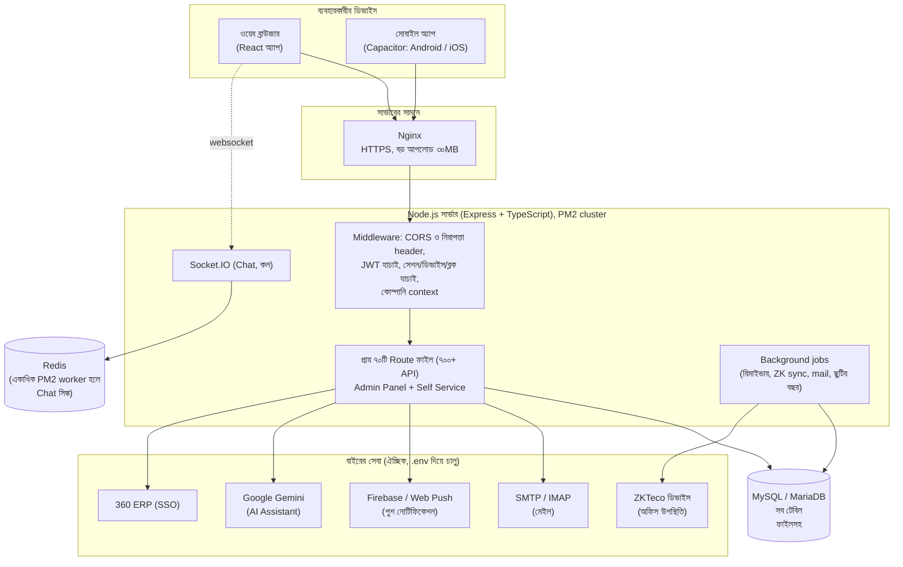

**মূল কথা:** একটাই সার্ভার প্রসেস ওয়েব পেজ, API আর Chat দেয়। ডাটা একটাই ডাটাবেসে (ফাইলসহ)। Background job শুধু এক worker-এ চলে (`jobRunner.ts`), যাতে রিমাইন্ডার দুবার না যায়।

---

## ২. একটি রিকোয়েস্টের জীবন (Request Lifecycle)

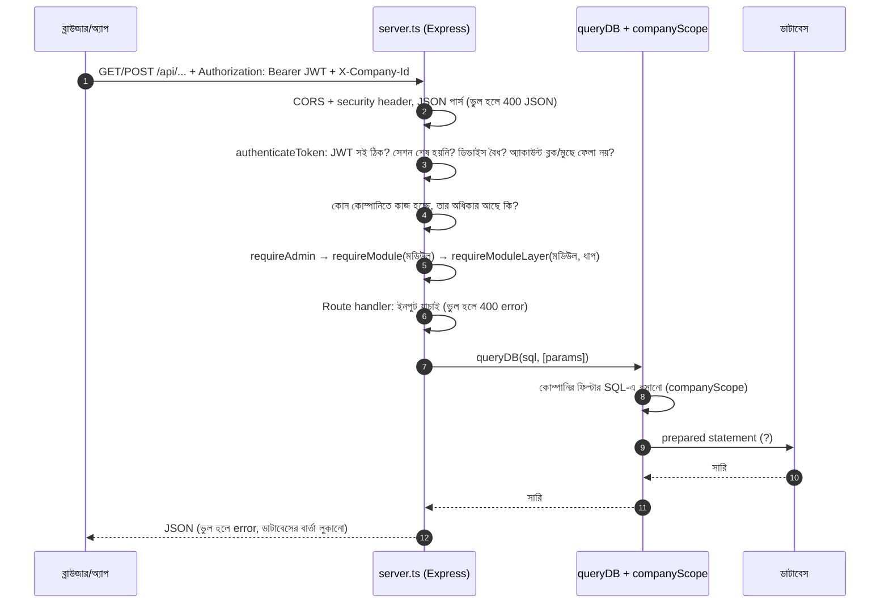

ফাইল: `server.ts` (`authenticateToken`, `requireAdmin`, `requireModule`, `requireModuleLayer`), `SessionSecurity.ts`, `DeviceRoutes.ts`, `AccountBlock.ts`, `companyContext.ts`, `companyScope.ts`, `ApiErrors.ts`, `WebSecurity.ts`।

---

## ৩. লগইন workflow

Login ID: কর্মীর **Employee ID** (যেমন `CPL-0201`, ছোট/বড় হাতের অক্ষর একই ধরা হয়); ইমেইল দিয়েও চলে। Employee ID-ই `users.username`, তাই দুজনের এক হতে পারে না; Employee ID বদলালে Login ID-ও বদলায় (`EmployeeLoginId.ts`)। Employee record ছাড়া অ্যাকাউন্ট (Superadmin, Project login) আগের Login ID-তেই চলে। সার্ভার চালু হলে যেসব কর্মীর login-এ username নেই, তারা নিজের Employee ID পায়।

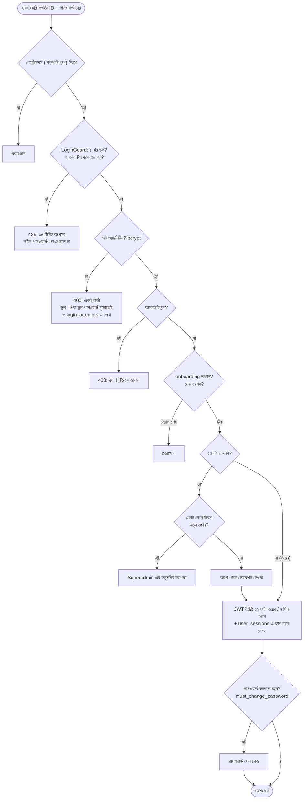

**বিকল্প প্রবেশ:** (ক) **Forgot password:** ইমেইলে ৬ অঙ্কের কোড (১৫ মিনিট, ৫ চেষ্টা) অথবা "HR-কে বলুন" (HR একটি অস্থায়ী পাসওয়ার্ড দেয়)। (খ) **Fingerprint/Passkey:** অ্যাপে ফোনের Keystore/Keychain-এর সিক্রেট, ওয়েবে WebAuthn passkey। দুটোই পাসওয়ার্ডের একই নিয়ম (ব্লক, ডিভাইস, কোম্পানি) মানে। অ্যাপে লগইন পাতায় fingerprint-এর জানালা নিজে একবার খোলে — অ্যাপ পুরো পর্দায় আসার পরে; আগে আঙুল, তারপর লোকেশন, তারপর সার্ভার। জানালা না খুললে বা সেন্সর ব্যস্ত থাকলে চালু করা fingerprint মুছে যায় না, "Sign in with fingerprint" চাপলেই আবার চেষ্টা হয়; শুধু ফোনের সংরক্ষিত চাবি সত্যিই না থাকলে (fingerprint বদলানো/মোছা) আবার চালু করতে বলে (`src/lib/fingerprint.ts`, টেস্ট `npm run test:fingerprint`)।
ফাইল: `AuthRoutes.ts`, `LoginGuard.ts`, `PasswordResetRoutes.ts`, `FingerprintRoutes.ts`, `SessionSecurity.ts`।

**সেশন শেষ হয় যখন:** ওয়েবে ১২ ঘণ্টা বা ৬০ মিনিট নিষ্ক্রিয়; অ্যাপে ৭ দিন বা ৩ দিন না খুললে (Superadmin বদলাতে পারে); Logout; Superadmin কাউকে বের করে দিলে; পাসওয়ার্ড বদলালে (বাকি সব সেশন); অ্যাকাউন্ট ব্লক হলে।

---

## ৪. কে কী দেখবে: অনুমতির সিদ্ধান্ত

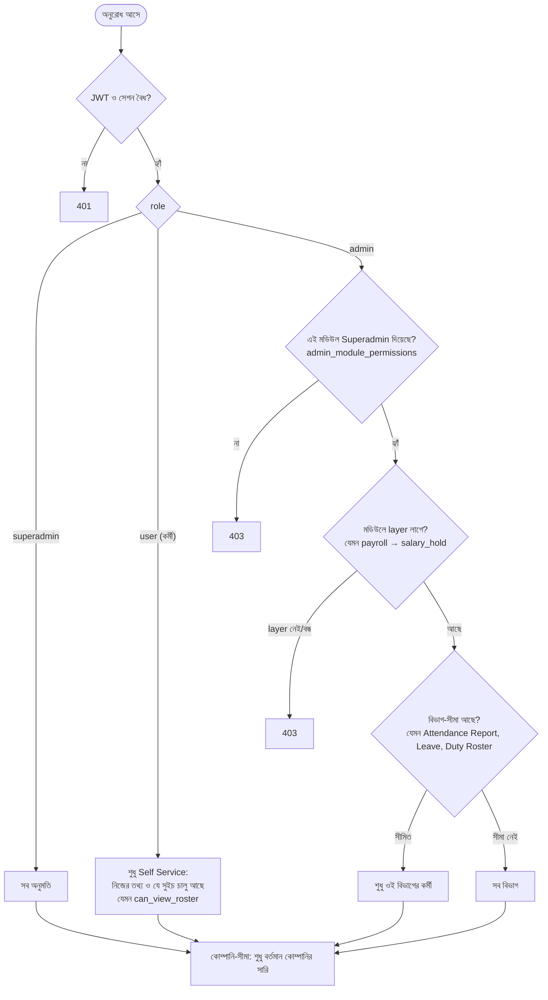

- **Layer:** একই মডিউলের ভেতরে ভাগ। যেমন Payroll: `read`, `salary_hold`, `audit_approve`, `accounts_pay`। যে layer ডিফল্টে বন্ধ (🔒), Superadmin টিক না দিলে কেউ পায় না। পুরো তালিকা: `security/access-control-matrix.md`।
- **নিয়ম (CLAUDE.md):** প্রতিটি নতুন ফিচারে UI লুকানো **এবং** API বন্ধ, দুটোই লাগে।
- **কোম্পানি বদলে কাজ (সাধারণ নিয়ম):** মাদার কোম্পানির HR-কে Superadmin sister company-র প্রবেশাধিকার ও সেখানকার Module Access দেন (Admin Panel → Companies → Company access); HR উপরের company switcher-এ ওই কোম্পানি বেছে সেখানকার কাজ করেন। একটা কোম্পানি বাছা থাকলে শুধু সেই কোম্পানির কর্মী ও রেকর্ড আসে।
- **All companies mode (আলাদা অনুমতি, ডিফল্টে বন্ধ):** Superadmin একই পাতায় "All companies mode" টিক দিলে switcher-এ **All companies** আসে। তখন যে কোম্পানিগুলোতে প্রবেশাধিকার আছে, সবগুলোর কর্মী এক তালিকায় (নামের পাশে কোম্পানির কোড) — রেকর্ড খোলা ও বদলানো (প্রোফাইল, ব্যাংক অ্যাকাউন্ট, ছুটি, উপস্থিতি…) কোম্পানি না বদলেই। নিয়ম: (১) প্রবেশাধিকার নেই এমন কোম্পানি আসে না; (২) নতুন রেকর্ড switcher-এ আগে বাছা কোম্পানিতে যায়; (৩) settings ও Module Access ওই বাছা কোম্পানির; (৪) বেতন (payroll) চালানো আগের মতো প্রতিটা কোম্পানিতে আলাদা — CBL-এর বেতন CBL বেছে চালাতে হয়। কোনো একটা কোম্পানি বাছলে আবার আগের মতো এক কোম্পানি। চালু/বন্ধ করা `user_access_audit`-এ থাকে।

---

## ৫. কর্মীর পুরো জীবনচক্র (HR-এর প্রধান প্রবাহ)

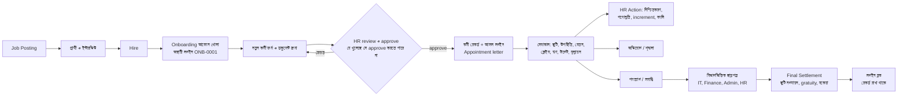

ফাইল: `RecruitmentRoutes.ts`, `OnboardingSelfServiceRoutes.ts`, `HROperationsRoutes.ts`, `ExitOffboardingRoutes.ts`, `EmployeeRecordsGuard.ts`।
Recruitment (ATS)-এ interview: HR তারিখ-সময়, দৈর্ঘ্য, কীভাবে (সামনাসামনি venue / online link / ফোন), interviewer আর candidate-এর জন্য নোট দিয়ে interview ঠিক করেন। পরে সময় বা জায়গা বদলানো, interviewer বদলানো বা বাতিল করা যায় — প্রতিটি বদল কারণসহ `candidate_interview_events`-এ থাকে (আগের → নতুন), আর interviewer-কে bell alert ("Interview scheduled / moved / place changed / cancelled") যায়। Candidate-কে email পাঠানো আলাদা অনুমতি (Recruitment → **Email candidates**, কাউকে আপনাআপনি দেওয়া হয় না): বদলের পরেই খসড়া খোলে (বদলানো যায়), interview-এর email-এর সাথে calendar invite (`.ics`, বাতিল হলে CANCEL) যায়, প্রতিটি email (পাঠানো / ব্যর্থ) `candidate_emails`-এ থাকে। শেষ বদলের পরে email না গেলে তালিকায় "Candidate not emailed yet" দেখায়। Offer / Regret / অন্য বার্তাও একইভাবে পাঠানো যায়। SMTP চালু না থাকলে কিছু পাঠানো যায় না, বাকি সব চলে।

গুরুত্বপূর্ণ: onboarding চলাকালে নতুন ব্যক্তি **কর্মী নন** (`all_employees`-এ নেই), তাই headcount, payroll, উপস্থিতিতে আসে না। শুধু "My Onboarding" পেজ খোলা যায় (বাকি সব 403 `ONBOARDING_ONLY`)।

**SIM ও ID card requisition** (`RequisitionRoutes.ts`, টেবিল `employee_requisitions`): কর্মী Self Service → "SIM & ID Card" থেকে (সুইচ `users.can_request_items`, ডিফল্টে বন্ধ) আর নতুন joiner My Onboarding থেকে (HR Ops Settings → "Joiners can ask for a SIM / ID card", ডিফল্টে বন্ধ) SIM বা ID card চান (New / Lost / Damaged / Replacement)। HR Operations → "SIM & ID Card" (layer `requisitions`, explicit-only) থেকে HR issue করে: SIM হলে Mobile Bill-এ ওই কর্মীকে আগে দেওয়া SIM বেছে নেয়, ID card হলে কার্ড নম্বর লেখে (onboarding checklist-এর "ID card issued" নিজে টিক হয়); অথবা কারণসহ turn down। কর্মী alert পান। Joiner-এর request onboarding approve হলে কর্মীর নামে যায়; তার আগে issue করা যায় না।

---

## ৬. ছুটির workflow

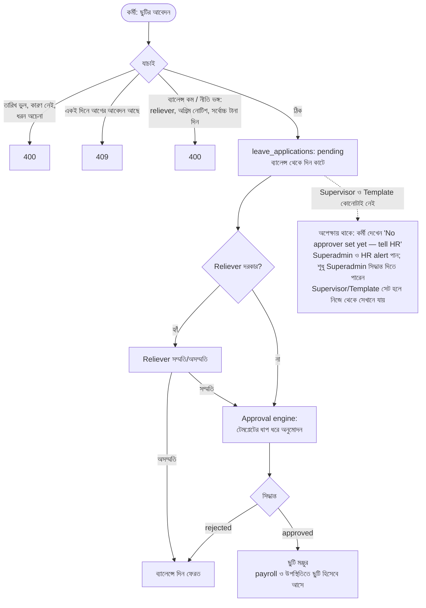

- ব্যালেন্স: ছুটির বছর শুরুতে নীতি (workflow) অনুযায়ী বসে; বছর শেষে rollover job চলে (`LeaveRoutes.ts`, ৬ ঘণ্টা পরপর পরীক্ষা)।
- কত দিন কাটবে: প্রতিটি Leave Type-এর নীতিতে HR ঠিক করেন (Leave Manage → Leave Policies → "Weekends & holidays inside the leave", `leave_category_policies.count_off_days`)। **Count them** (আগের মতো, default) হলে শুরু থেকে শেষ পর্যন্ত সব দিন কাটে। **Don't count them** হলে শুধু কর্মীর কাজের দিন কাটে: তাঁর শাখা-দলের Holiday Calendar, তার ওপর Duty Roster, অর্থাৎ payroll যে ক্যালেন্ডারে কাজের দিন গোনে (`leaveDayCount.ts`)। সংখ্যাটা সবসময় server গোনে। ফর্ম `GET /api/leave-applications/day-count` থেকে সেটা দেখায়, আর শুধু ছুটির দিনে পড়া আবেদন ফিরিয়ে দেওয়া হয়। Data Import-এ Days ঘর ফাঁকা থাকলেও একই নিয়মে গোনা হয়। বেতন দুই নিয়মেই এক: ছুটির ভেতরের সাপ্তাহিক বা সরকারি ছুটি কখনো বিনা বেতনে গোনা হয় না।
- অনুমোদনকারী ঠিক করে **Approval Template** (`approval_templates`/`_steps`/`_step_approvers`)। কর্মীর সুপারভাইজার বা নির্দিষ্ট ব্যক্তি/ভূমিকা হতে পারে।

---

## ৭. Approval engine (সব অনুমোদনের সাধারণ ইঞ্জিন)

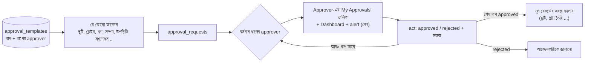

**কে প্রথম অনুমোদন দেন:** কর্মীর Direct Supervisor (না থাকলে Department Supervisor) ধাপ ১, তারপর Template-এর layer। Supervisor নিজে আবেদন করলে সরাসরি Template-এর layer-এ যায় (টেস্ট `test-logs/2026-10-25/07-supervisor-chain.log`, ৩৬/৩৬)।
**Supervisor ও Template দুটোই না থাকলে:** আবেদন "approver নেই" অবস্থায় অপেক্ষা করে (`approval_requests.awaiting_approver = 1`)। কর্মী alert পান এবং নিজের পেজে "No approver set yet — tell HR" দেখেন। Superadmin ও Approvals মডিউলের Admin alert পান। শুধু Superadmin সিদ্ধান্ত দিতে পারেন: আবেদনটা তাঁর "My Approvals"-এ "No approver set" চিহ্নসহ আসে, Admin Panel → Approvals-এও থাকে। Supervisor বা Template সেট হলে আবেদন নিজে থেকে সেখানে সরে যায়: কেউ Approvals তালিকা খুললে, নইলে প্রতি ১০ মিনিটে (`rehomeAwaitingApprovals`)। টেস্ট: `test-logs/2026-10-25/09-no-approver-after-fix.log`।
ফাইল: `ApprovalRoutes.ts` (তালিকা ও act: `GET /api/my-approvals`, `POST /api/my-approvals/:id/act`), `Alerts.ts` (notification)।

---

## ৮. উপস্থিতি: তিন উৎস, একটি হিসাব

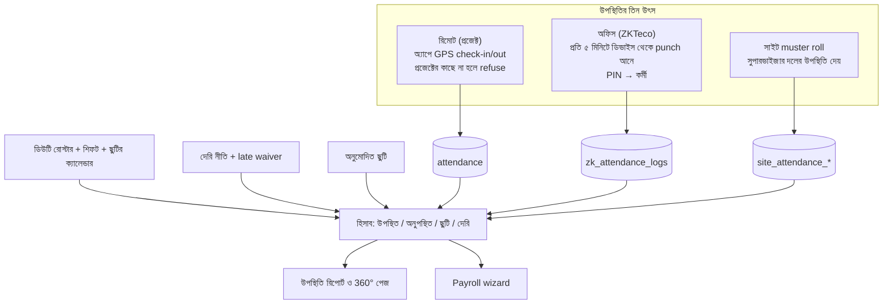

- রোস্টারে "Off" বা শিফট দিলে ওই কর্মীর ওই দিনের ছুটি/কর্মদিবস ও দেরির সময় বদলে যায় (`RosterRoutes.ts`)।
- ভুল উপস্থিতি: কর্মী **সংশোধন আবেদন** দেয় → Approval। In Time ওই দিনের; Out Time In Time-এর আগে দিলে সেটা night shift ধরে পরদিন সকালের সময় হিসেবে যায় (ফর্মে "Next day" লেখা দেখায়)। অন্য তারিখের সময় বা In-এর আগের Out সার্ভার নেয় না।
- ZK ডিভাইসের PIN কর্মীর সাথে না জুড়লে punch কারো নামে যায় না (Unlinked PINs তালিকা)।

---

## ৯. Payroll workflow (HR → Audit → Accounts)

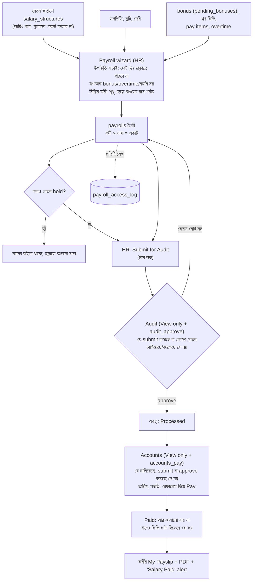

**হিসাব:** net = মোট আয় (বেসিক + ভাতা + overtime + bonus) − কর − PF − ঋণ কিস্তি − অনুপস্থিতি/দেরি কর্তন − অন্য কর্তন। কর ও PF **হাতে/কাঠামোতে দেওয়া** (আয়কর স্ল্যাবের স্বয়ংক্রিয় হিসাব নেই)।
**কে কোন layer পায়:** HR = "Payroll" (`read`, বানানো ও বদলানো)। Audit = "View only" (`payroll_view`) + Audit Approve। Accounts = "View only" + Accounts Pay। View only সব পেজ ও রিপোর্ট দেখে, কিছু বদলাতে পারে না। নিয়মগুলো Superadmin-এর জন্য খাটে না।
**Payslip পাঠানো (Payroll → Payslips):** একজনকে (সারির Email/PDF), কয়েকজনকে (টিক দিয়ে বা নাম/ID/বিভাগ খুঁজে বেছে "Email Selected" / "PDF of Selected"), অথবা কাউকে না বাছলে সবাইকে। Email পাঠানোর আগে কতজনকে যাবে তা জিজ্ঞেস করে। প্রত্যেকে নিজের payslip PDF পান (`POST /api/payroll/:id/email`, Payroll module ও "Payroll" layer লাগে)।
**কর্মীর বেতন অ্যাকাউন্ট বদল:** যোগ/বদল/মোছা `employee_change_log`-এ (পুরনো → নতুন, কে) থাকে, কর্মী "Salary account changed" alert পায়।
ফাইল: `PayrollRoutes.ts`, `PayrollApprovalRoutes.ts`, `PayrollItemsRoutes.ts`, `PayslipRoutes.ts`।

---

## ১০. Conveyance Bill Claim → Disbursement

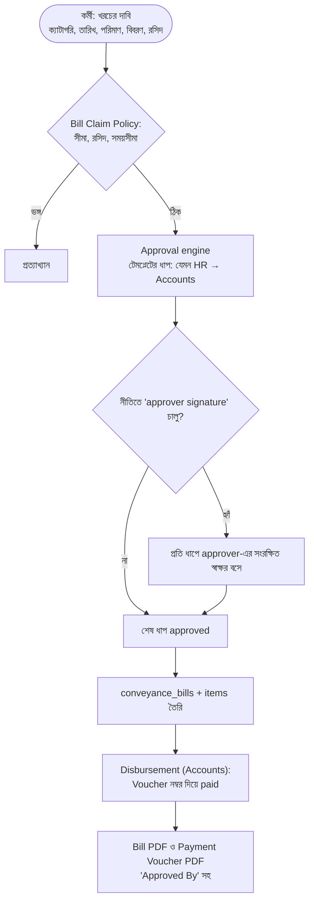

**Movement Claim** আলাদা: কর্মী কোথাও গেলে GPS-সহ ক্লেইম, একই Approval engine (`MovementClaimRoutes.ts`)।
ফাইল: `ConveyanceBillClaimRoutes.ts`, `BillClaimPolicy.ts`।

---

## ১১. ই-স্বাক্ষর (Document Vault)

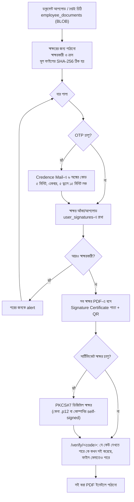

ফাইল: `DocumentVaultRoutes.ts`, `ESignRoutes.ts`, `ESignCertificate.ts`। Adobe Reader-এ "valid" দেখাতে লাইসেন্সপ্রাপ্ত CA-র সার্টিফিকেট দরকার (self-signed-এ "validity unknown")।

---

## ১২. PEPM: প্রকল্পের MPR চক্র

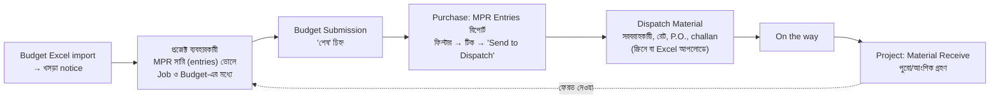

অনুমতি: Reports মডিউলের layer `dispatch_material`, `dispatch_all` (দুটোই 🔒)। Receive-এর সুইচ `can_receive_material`। ফাইল: `EntriesRoutes.ts`, `MprDispatchRoutes.ts`, `BudgetImportRoutes.ts`।

**Job Edit অনুমোদন:** Final Submit হয়ে যাওয়া Job-এ `can_job_edit` থাকা ব্যবহারকারী নতুন Job, Add MPR বা Delete MPR চাইলে সেটা সরাসরি হয় না, `job_edit_requests`-এ জমা থাকে। PEPM Manage → MPR Edit Log → Job Edit Approvals থেকে Approve/Reject (মডিউল `editlog`)। Details-এ দেখায় কী বদলাবে: মোছার সারির সব তথ্য (dispatch/receive হয়ে থাকলে সতর্কতা), যোগ হওয়া সারির Budget Qty আগে → পরে, আর Job-এর সব MPR সারি, বদলটা জায়গামতো চিহ্নিত (`GET /api/job-edits/:id/context`, একই `editlog` gate)। কয়েকটা অনুরোধ টিক দিয়ে একসাথে Approve/Reject করা যায় (প্রতিটা একই `POST /api/job-edits/:id/act` দিয়ে যায়; যেটা আর approve করা যায় না সেটা জানানো হয়, বাকিগুলো হয়ে যায়)।

---

## ১৩. যোগাযোগ: Notice, Chat, Mail, Alerts

| ব্যবস্থা | কীভাবে চলে |
|---|---|
| **Notice** | Admin HTML লেখে → সার্ভার `NoticeSafety.ts` দিয়ে পরিষ্কার করে → টার্গেট (সবাই বা নির্দিষ্ট ব্যক্তি, `notice_targets`) → লগইনের পর popup ও Notice board |
| **Chat** | Socket.IO; রুম, ব্যক্তিগত মেসেজ; edit (১৫ মিনিট), unsend, forward, pin, reaction; ফাইল ডাটাবেসে। Module Access-এর সুইচে চালু |
| **Credence Mail** | নিজস্ব মেইল ক্লায়েন্ট; IMAP/SMTP দিয়ে মেইল সার্ভারের সাথে; পাসওয়ার্ড AES-256-GCM-এ এনক্রিপ্ট; গ্রুপ, ফিল্টার, টেমপ্লেট, নির্ধারিত পাঠানো |
| **Alerts (বেল)** | সার্ভারে `createAlert()`; অ্যাপে পুশ (Firebase), ওয়েবে Web Push |
| **AI Assistant** | কর্মীর প্রশ্ন → স্থানীয় নিয়মে উত্তর; Gemini চালু থাকলে প্রশ্ন ও ফল Google-এ যায়। সব ডাটা **প্রশ্নকারীর নিজের token দিয়ে** অ্যাপের নিজের API থেকে আনে, তাই যা দেখার অধিকার নেই তা দেখায় না; কিছু লেখে না |

---

## ১৪. Background jobs (একটি worker-এ)

| কাজ | কত পরপর | ফাইল |
|---|---|---|
| ZKTeco ডিভাইস থেকে punch আনা | ৫ মিনিট | `zkSync.ts` (node-cron) |
| অপেক্ষমাণ approval নতুন approver-এ সরানো | ১০ মিনিট | `server.ts` |
| HR/সাইট/টাস্ক/টার্গেট রিমাইন্ডার | ৩০–৬০ মিনিট | `HrRemindersRoutes.ts`, `TaskRoutes.ts`, `TargetRoutes.ts`, `SiteAttendanceRoutes.ts` |
| ছুটির বছর rollover পরীক্ষা | ৬ ঘণ্টা | `LeaveRoutes.ts` |
| Onboarding মেয়াদ শেষ | ১ ঘণ্টা | `OnboardingSelfServiceRoutes.ts` |
| Mail: নির্ধারিত পাঠানো / ফোল্ডার watch / পুরোনো blob পরিষ্কার | ১ মিনিট / ১ মিনিট / ৬ ঘণ্টা | `MailRoutes.ts` |
| Vehicle ride মেয়াদ | ১ মিনিট | `VehicleManagementRoutes.ts` |
| নির্ধারিত HR রিপোর্ট | ১০ মিনিট | `HrOpsReportsRoutes.ts` |

---

## ১৫. ডিপ্লয়মেন্ট

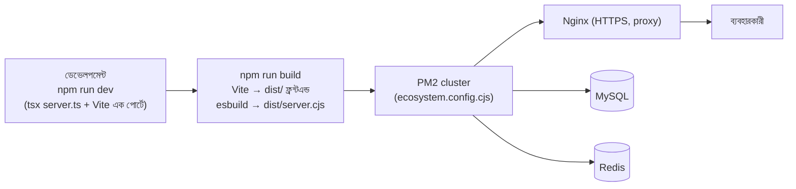

Node ≥ ২২। `.env`-এর মূল চাবি: `DB_*`, `JWT_SECRET`, `ADMIN_EMAIL/PASSWORD`, `CORS_ORIGINS`, `MAIL_ENCRYPTION_KEY`, `REDIS_URL`, `GEMINI_API_KEY` (ঐচ্ছিক), `ESIGN_CERT_*` (ঐচ্ছিক)।

---

## Book a Ride: pickup / destination মানচিত্রে বাছাই

মানচিত্র পুরো পর্দা জুড়ে, মাঝখানে স্থির pin ("This is your pickup point")। মানচিত্র থামলে pin-এর নিচের ঠিকানা আসে (`/api/vehicles/places/reverse`), আর নিচের প্যানেলে প্রস্তাব: ৫ কিমির মধ্যে সবচেয়ে কাছের অফিস / প্রজেক্ট সাইট (Projects-এর location, দূরত্বসহ — `/api/vehicles/places/nearby`), নিজের save করা জায়গা, আগে ব্যবহার করা গন্তব্য। খোঁজার icon চাপলে খোঁজার ঘর মানচিত্রের উপরে বসে (পেছনটা ঝাপসা হয় না), ফল নিচের প্যানেলে নম্বরসহ আসে আর মানচিত্রে প্রতিটার নম্বর দেওয়া চিহ্ন বসে; pin প্রথম ফলে চলে যায়, যে ফলে চাপা হয় সেটাই বাছাই হয়। Pin-এর ডগা ঠিক মানচিত্রের কেন্দ্রে, তাই যেখানে pin সেখানকার জায়গাই যায়; **Projects** বোতামও মানচিত্রের উপরেই খোলে (ঝাপসা নয়): location দেওয়া সব প্রজেক্ট মানচিত্রে নিজের pin আর নামসহ দেখায়, সবগুলো একসাথে পর্দায় আঁটে, নিচে তালিকা (কাছেরটা আগে, দূরত্বসহ — `/api/vehicles/places/projects`); নাম বা এলাকা লিখলে মানচিত্র আর তালিকা দুটোই ছোট হয়; pin বা তালিকায় চাপলে সেটা বাছাই, Back চাপলে মানচিত্র আগের জায়গায় ফেরে; "Add missing place" pin-এর জায়গার নিজের দেওয়া নাম বসায়। Bookmark দিয়ে জায়গাটা Home / Work / Other হিসেবে ড্রাইভারের জন্য নোটসহ save হয় (`ride_saved_places`, একজনের নিজের, Home ও Work একটাই করে, সর্বোচ্চ ৩০টা) — এটা Self Service switch **Book a Ride — saved places** (`users.can_save_ride_places`, শুরুতে বন্ধ); না থাকলে বোতাম লুকানো আর API 403। Save করা জায়গা বাছলে ride-এ ঠিকানার সাথে ড্রাইভারের নোটও যায়।

## ১৬. যা এই workflow-তে ধরা নেই

আসল ফোন অ্যাপের ভেতরের প্রবাহ (GPS, ক্যামেরা), প্রতিটি ছোট রিপোর্ট ও পেজ, মডিউলভিত্তিক সব এজ-কেস। বিস্তারিত দেখতে `docs/CredenceHR-Code-Guide-for-Laravel-Developers-BN.md` ও সংশ্লিষ্ট `*Routes.ts` ফাইলের শুরুর মন্তব্য পড়ুন (প্রতিটি ফাইলে প্রবাহ লেখা আছে)।

---

## Android app update

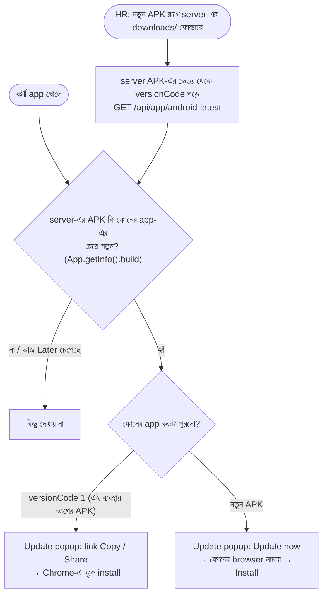

- প্রতিটা build-এর versionCode আগেরটার চেয়ে বড় (২০২৬-এর ১ জানুয়ারি থেকে কত মিনিট, `android/app/build.gradle`)। GitHub আর Android Studio দুই জায়গাতেই এক নিয়ম।
- পর্দাগুলো server থেকে আসে, তাই এই popup-এর আগে বানানো পুরনো APK-তেও popup দেখায় (`src/components/AppUpdatePrompt.tsx`)। শুধু এক চাপে নামানোটা নতুন APK-তে হয় (`MainActivity.java`-র DownloadListener)।
- "Later" চাপলে ওই version-এর জন্য এক দিন আর দেখায় না। Popup সব app ব্যবহারকারীর জন্য, কোনো অনুমতির দরকার নেই, কারণ APK নিজেই লগইন পাতায় সবার জন্য খোলা।
- **iPhone:** App Store ছাড়া iPhone-এ app দেওয়া যায় না (Apple-এর সই লাগে)। তাই iPhone/iPad-এ login পাতা Safari-র "Add to Home Screen"-এর তিন ধাপ দেখায় (`AddToHomeScreen.tsx`), আর একই web app আইকন থেকে পুরো পর্দায় খোলে (`manifest.webmanifest`)। Home Screen থেকে খুললে APK বা iPhone কোনো বোতামই দেখায় না। Phone-এর width-এ web header-ও app-এর মতো purple (আগে সাদা ছিল, status bar-ও সাদা দেখাত)। iPhone-এ notification আসে Web Push দিয়ে (iOS 16.4+, শুধু Home Screen থেকে খোলা app-এ); Apple-এর push সার্ভার VAPID-এর `sub`-এ `example.com` নেয় না, তাই `WEB_PUSH_CONTACT` না থাকলে সাইটের নিজের ঠিকানা যায়।
