# ডাটাবেস ডায়াগ্রাম ও ডাটা ডিকশনারি

> ডাটাবেস: **MySQL / MariaDB** (InnoDB, `utf8mb4`)। সার্ভার চালু হলেই সব টেবিল নিজে তৈরি/হালনাগাদ হয় (`schema.sql` + প্রতিটি মডিউলের `ensure*Schema()`)।
> এই ডকুমেন্টের সংখ্যাগুলো **চালু সার্ভারের `information_schema` থেকে নেওয়া** (২৫ অক্টোবর ২০২৬), হাতে লেখা নয়।

## ১. এক নজরে

<!-- AUTO:stats -->
| বিষয় | সংখ্যা |
|---|---|
| টেবিল | **২১৫** |
| কলাম | **২,৩০৪** |
| ঘোষিত Foreign Key | **২৪৯** (ON DELETE: CASCADE ১৪৪, SET NULL ৯১, RESTRICT ১৪) |
| `company_id` আছে এমন টেবিল (multi-company) | ৫২ |
| ফাইল/ছবি ডাটাবেসেই রাখা হয় (BLOB কলাম) | ২৮টি কলাম (ডকুমেন্ট, ছবি, স্বাক্ষর, মেইল সংযুক্তি, সার্টিফিকেট) |
| সবচেয়ে বেশি কলামের টেবিল | `users` (৬২), `all_employees` (৪৯), `payrolls` (৪২) |
<!-- /AUTO:stats -->

## ১ক. পুরো ডাটাবেস এক ছবিতে (সব <!--n:tables-->২১৫<!--/n--> টেবিল)

**[`full-diagram.html`](full-diagram.html)**: ব্রাউজারে zoom, টেনে সরানো ও টেবিলের নাম খুঁজে হাইলাইট করা যায় (ইন্টারনেট লাগে না)। প্রিন্ট/প্রেজেন্টেশনের জন্য:
[PDF (ভেক্টর, যত খুশি zoom)](diagrams/full-application-er.pdf) · [SVG](diagrams/full-application-er.svg) · [PNG](diagrams/full-application-er.png) · [Graphviz সোর্স](diagrams/full-application-er.dot)

- ১৩টি রঙিন বাক্স = ১৩ মডিউল। মাঝখানে **`users`** (সব মডিউল এর সাথে জোড়া)।
- প্রতিটি টেবিলে PK (লাল), FK (নীল), আর কয়েকটি মূল কলাম; বাকি কলাম "… +N কলাম" হিসেবে সংক্ষেপে, পুরোটা `data-dictionary.md`-তে।
- সরল রেখা = ঘোষিত foreign key (<!--n:fks-->২৪৯<!--/n-->টি), ধূসর ডটেড = যুক্তিগত সম্পর্ক (কোডে মানা হয়, ডাটাবেসে ঘোষিত নয়)। `users`-এ যাওয়া "কে বানিয়েছে/অনুমোদন করেছে" রেখাগুলোও এখানে আঁকা, তাই `users`-এর চারপাশে ঘন।

## ২. মডিউল মানচিত্র

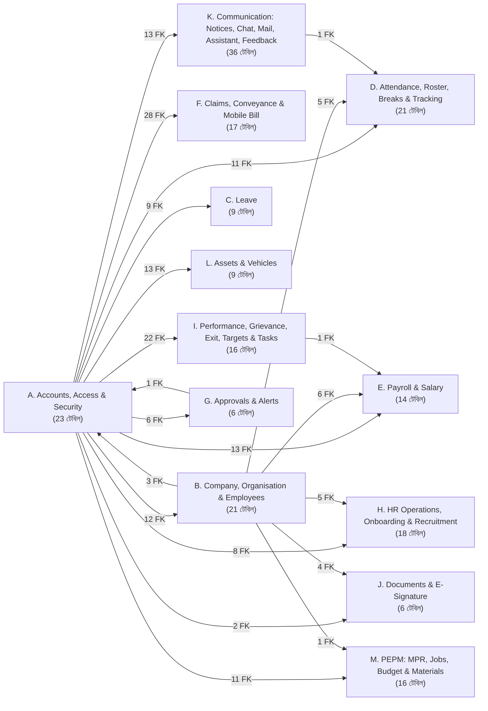

তীরের পাশের সংখ্যা = ওই দুই মডিউলের মধ্যে কয়টি foreign key। [বড় SVG](diagrams/00-module-map.svg)

## ৩. মূল ধারণাগুলো (ডাটাবেস বুঝতে প্রথমে এগুলো)

1. **`users` বনাম `all_employees`:** `users` = যে লগইন করে (পাসওয়ার্ড, role, অনুমতি)। `all_employees` = HR-এর কর্মী রেকর্ড (পদবি, বিভাগ, যোগদান, ব্যক্তিগত তথ্য)। একজন কর্মীর লগইন না-ও থাকতে পারে; থাকলে `all_employees.user_id` → `users.id`।
2. **Multi-company:** ৫৬টি টেবিলে `company_id`। এটা ডাটাবেসের foreign key নয়, **কোডে প্রয়োগ হয়** (`companyScope.ts` প্রতিটি SQL-এ নিজে থেকে কোম্পানির ফিল্টার বসায়)। তাই diagram-এ `company_id` লাইন আঁকা হয়নি।
3. **অনুমতি টেবিল:** `admin_module_permissions` (কোন Admin কোন মডিউল), `admin_module_permission_layers` (মডিউলের ভেতরে কোন কাজ)। বিস্তারিত: `../security/`।
4. **ঋণ/বেতন রেকর্ড সুরক্ষা:** বেতন ও সেবা-রেকর্ডের টেবিল (`payrolls`, `salary_structures`, `hr_actions`, `hr_letters`, `employee_transfers`, `employee_advances` ইত্যাদি) থেকে `all_employees`-এ foreign key **`ON DELETE RESTRICT`** (`EmployeeRecordsGuard.ts`, প্রতিবার চালুর সময় নিশ্চিত করা হয়)। কর্মী মুছতে গেলে ডাটাবেস নিজেই আটকায়।
5. **ফাইল রাখার ধরন:** আলাদা ফাইল সার্ভার নেই। ফাইল base64 হয়ে এসে ডাটাবেসের BLOB কলামে থাকে। তাই ব্যাকআপ মানেই ডাটাবেস ব্যাকআপ।
6. **নামের নিয়ম:** সব টেবিল `snake_case`, প্রাইমারি কী `id` (auto-increment), সময়: `created_at`/`updated_at`। তারিখ API-তে `"YYYY-MM-DD"` স্ট্রিং।
7. **কিছু সম্পর্ক ঘোষিত foreign key নয়** (কোডে মানা হয়)। diagram-এ এগুলো **ডটেড (...)** রেখায়। যেমন `*_by` (কে বানিয়েছে/অনুমোদন করেছে) কলাম diagram-এ দেখানো হয়নি, ডাটা ডিকশনারিতে আছে।

## ৪. মডিউল অনুযায়ী ডায়াগ্রাম

প্রতিটি diagram-এ: **PK**, **FK** আর কয়েকটি মূল কলাম। ধূসর রেখা = ঘোষিত foreign key, ডটেড = যুক্তিগত সম্পর্ক। অন্য মডিউলের টেবিল শুধু `id` সহ দেখানো। পুরো কলাম তালিকা `data-dictionary.md`-তে।

<!-- AUTO:modules -->
### K. Communication: Notices, Chat, Mail, Assistant, Feedback (36টি টেবিল)

নোটিশ, Chat, Credence Mail (সবচেয়ে বেশি টেবিল), Assistant, Feedback।

মূল টেবিল: `notices`, `chat_*`, `mail_*`, `assistant_*`

[বড় SVG](diagrams/k-communication-notices-chat-mail-assistant-feedback.svg) · [Mermaid সোর্স](diagrams/k-communication-notices-chat-mail-assistant-feedback.mmd)

এই মডিউলের সব টেবিলের নাম

`app_feedback`, `assistant_learned`, `assistant_support_messages`, `assistant_support_sessions`, `chat_message_hidden`, `chat_message_reactions`, `chat_messages`, `chat_pinned_messages`, `chat_push_tokens`, `chat_room_members`, `chat_room_reads`, `chat_rooms`, `chat_wallpapers`, `feedback_prompts`, `feedback_settings`, `mail_accounts`, `mail_admin_log`, `mail_blobs`, `mail_contacts`, `mail_events`, `mail_files`, `mail_filters`, `mail_folder_state`, `mail_groups`, `mail_messages`, `mail_personal_groups`, `mail_settings`, `mail_signature_images`, `mail_system_settings`, `mail_tasks`, `mail_templates`, `mail_vacation_log`, `notice_dismissals`, `notice_targets`, `notices`, `report_email_log`

### H. HR Operations, Onboarding & Recruitment (18টি টেবিল)

HR কাজ (পদোন্নতি, বদলি, increment, চিঠি), নতুন কর্মীর onboarding, নিয়োগ।

মূল টেবিল: `hr_actions`, `hr_letters`, `onboarding_applications`, `job_postings`, `job_candidates`

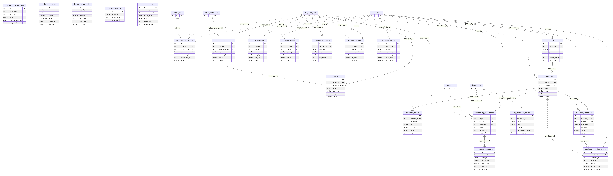

[বড় SVG](diagrams/h-hr-operations-onboarding-recruitment.svg) · [Mermaid সোর্স](diagrams/h-hr-operations-onboarding-recruitment.mmd)

এই মডিউলের সব টেবিলের নাম

`candidate_interviews`, `hr_action_approval_steps`, `hr_actions`, `hr_increment_policies`, `hr_info_requests`, `hr_letter_requests`, `hr_letter_templates`, `hr_letters`, `hr_onboarding_items`, `hr_onboarding_tasks`, `hr_ops_settings`, `hr_reminder_log`, `hr_report_runs`, `hr_saved_reports`, `job_candidates`, `job_postings`, `onboarding_applications`, `onboarding_documents`

### D. Attendance, Roster, Breaks & Tracking (21টি টেবিল)

তিন ধরনের উপস্থিতি (রিমোট GPS, অফিস ZKTeco, সাইট muster roll), রোস্টার, বিরতি, লাইভ লোকেশন।

মূল টেবিল: `attendance`, `zk_attendance_logs`, `site_attendance_*`, `duty_roster`, `employee_breaks`

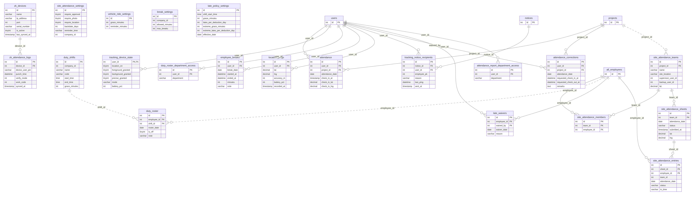

[বড় SVG](diagrams/d-attendance-roster-breaks-tracking.svg) · [Mermaid সোর্স](diagrams/d-attendance-roster-breaks-tracking.mmd)

এই মডিউলের সব টেবিলের নাম

`attendance`, `attendance_corrections`, `attendance_report_department_access`, `break_settings`, `duty_roster`, `duty_roster_department_access`, `duty_shifts`, `employee_breaks`, `late_policy_settings`, `late_waivers`, `location_pings`, `site_attendance_entries`, `site_attendance_members`, `site_attendance_settings`, `site_attendance_sheets`, `site_attendance_teams`, `tracking_device_state`, `tracking_notice_recipients`, `vehicle_ride_settings`, `zk_attendance_logs`, `zk_devices`

### A. Accounts, Access & Security (23টি টেবিল)

লগইন অ্যাকাউন্ট ও কে কী করতে পারবে। পুরো ডাটাবেসের কেন্দ্র `users` (১৫৮টি foreign key এখানে এসে মেলে)।

মূল টেবিল: `users` (লগইন), `user_sessions`, `user_devices`, `admin_module_permissions`(+`_layers`), `login_attempts`, `password_reset_*`

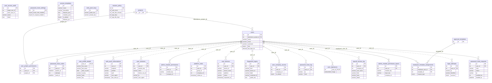

[বড় SVG](diagrams/a-accounts-access-security.svg) · [Mermaid সোর্স](diagrams/a-accounts-access-security.mmd)

এই মডিউলের সব টেবিলের নাম

`access_templates`, `admin_module_permission_layers`, `admin_module_permissions`, `employee_template_assignments`, `fingerprint_logins`, `login_attempts`, `password_reset_codes`, `password_reset_log`, `password_reset_requests`, `password_reset_settings`, `payroll_access_log`, `platform_visits`, `session_policy`, `user_access_audit`, `user_company_access`, `user_devices`, `user_profile_details`, `user_project_permissions`, `user_sessions`, `user_signatures`, `users`, `web_push_keys`, `web_push_subscriptions`

### M. PEPM: MPR, Jobs, Budget & Materials (18টি টেবিল)

প্রজেক্ট কেনাকাটার চক্র: MPR সারি → Dispatch → Receive।

মূল টেবিল: `jobs`, `entries`, `budgets`, `mpr_numbers`, `mpr_dispatches`

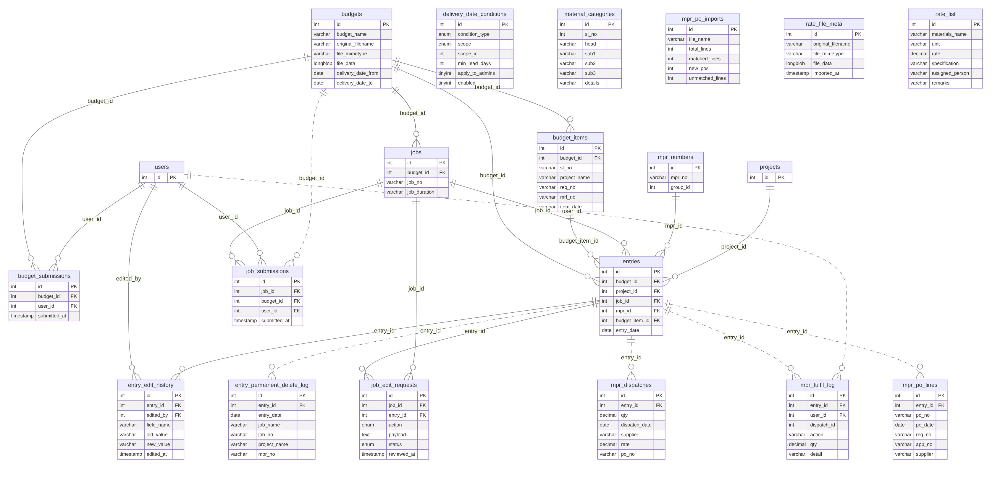

[বড় SVG](diagrams/m-pepm-mpr-jobs-budget-materials.svg) · [Mermaid সোর্স](diagrams/m-pepm-mpr-jobs-budget-materials.mmd)

এই মডিউলের সব টেবিলের নাম

`budget_items`, `budget_submissions`, `budgets`, `delivery_date_conditions`, `entries`, `entry_edit_history`, `entry_permanent_delete_log`, `job_edit_requests`, `job_submissions`, `jobs`, `material_categories`, `mpr_dispatches`, `mpr_fulfil_log`, `mpr_numbers`, `mpr_po_imports`, `mpr_po_lines`, `rate_file_meta`, `rate_list`

### F. Claims, Conveyance & Mobile Bill (17টি টেবিল)

Movement claim, Conveyance Bill Claim (employee claim → approval → bill → disbursement), মোবাইল বিল।

মূল টেবিল: `claims`, `user_claims`, `conveyance_bills`, `mobile_sims`, `bill_claim_*`

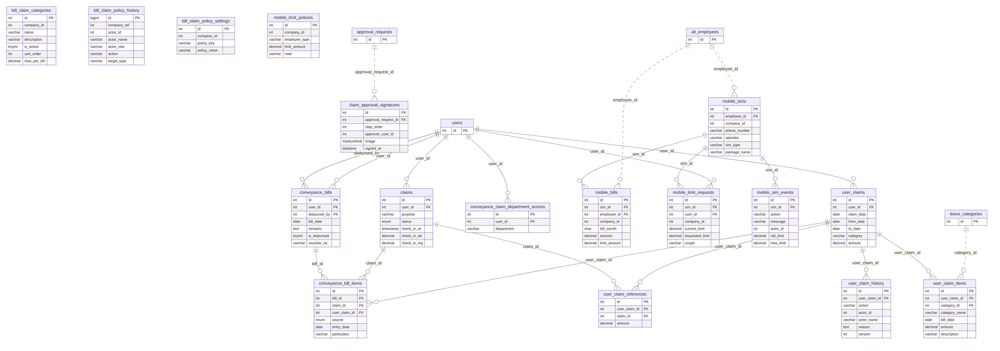

[বড় SVG](diagrams/f-claims-conveyance-mobile-bill.svg) · [Mermaid সোর্স](diagrams/f-claims-conveyance-mobile-bill.mmd)

এই মডিউলের সব টেবিলের নাম

`bill_claim_categories`, `bill_claim_policy_history`, `bill_claim_policy_settings`, `claim_approval_signatures`, `claims`, `conveyance_bill_items`, `conveyance_bills`, `conveyance_claim_department_access`, `mobile_bills`, `mobile_limit_policies`, `mobile_limit_requests`, `mobile_sim_events`, `mobile_sims`, `user_claim_history`, `user_claim_items`, `user_claim_references`, `user_claims`

### B. Company, Organisation & Employees (21টি টেবিল)

কোম্পানি-গ্রুপ, সংগঠন কাঠামো আর কর্মীর মূল রেকর্ড। `users` = লগইন, `all_employees` = HR-এর কর্মী-রেকর্ড; `all_employees.user_id` দিয়ে জোড়া।

মূল টেবিল: `companies`, `departments`, `branches`, `projects`, `all_employees`, `employee_*`, `hr_emp_*`

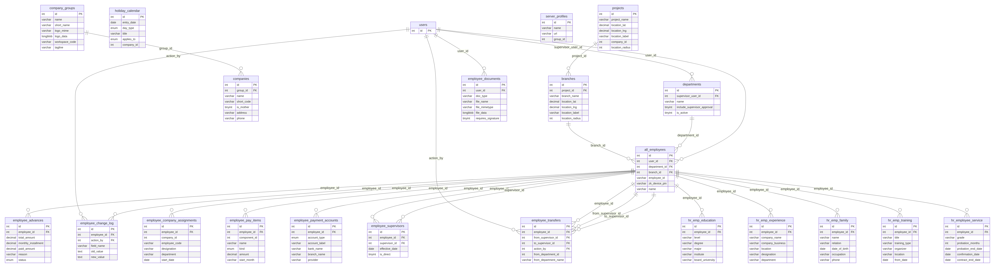

[বড় SVG](diagrams/b-company-organisation-employees.svg) · [Mermaid সোর্স](diagrams/b-company-organisation-employees.mmd)

এই মডিউলের সব টেবিলের নাম

`all_employees`, `branches`, `companies`, `company_groups`, `departments`, `employee_advances`, `employee_change_log`, `employee_company_assignments`, `employee_documents`, `employee_pay_items`, `employee_payment_accounts`, `employee_supervisors`, `employee_transfers`, `holiday_calendar`, `hr_emp_education`, `hr_emp_experience`, `hr_emp_family`, `hr_emp_training`, `hr_employee_service`, `projects`, `server_profiles`

### C. Leave (10টি টেবিল)

ছুটির ধরন, নীতি, ব্যালেন্স ও আবেদন।

মূল টেবিল: `leave_applications`, `leave_balances`, `leave_categories`, `leave_category_policies`

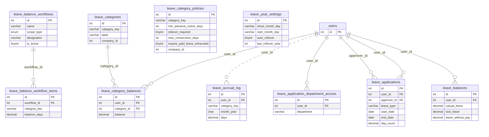

[বড় SVG](diagrams/c-leave.svg) · [Mermaid সোর্স](diagrams/c-leave.mmd)

এই মডিউলের সব টেবিলের নাম

`leave_accrual_log`, `leave_application_department_access`, `leave_applications`, `leave_balance_workflow_items`, `leave_balance_workflows`, `leave_balances`, `leave_categories`, `leave_category_balances`, `leave_category_policies`, `leave_year_settings`

### L. Assets & Vehicles (9টি টেবিল)

অফিস সম্পদ ও গাড়ি।

মূল টেবিল: `assets`, `asset_requisitions`, `vehicles`, `vehicle_requisitions`

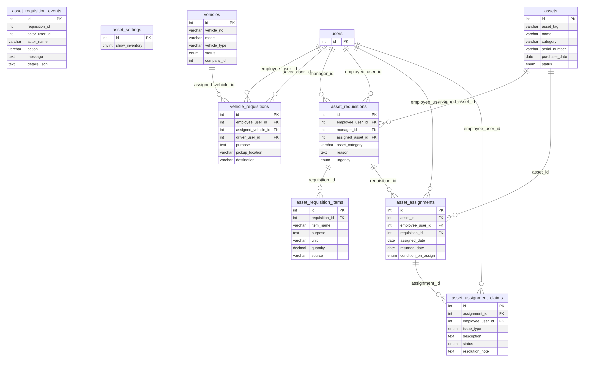

[বড় SVG](diagrams/l-assets-vehicles.svg) · [Mermaid সোর্স](diagrams/l-assets-vehicles.mmd)

এই মডিউলের সব টেবিলের নাম

`asset_assignment_claims`, `asset_assignments`, `asset_requisition_events`, `asset_requisition_items`, `asset_requisitions`, `asset_settings`, `assets`, `vehicle_requisitions`, `vehicles`

### J. Documents & E-Signature (6টি টেবিল)

Document Vault আর ডিজিটাল স্বাক্ষর।

মূল টেবিল: `employee_documents`, `document_signers`, `document_signatures`, `esign_certificates`

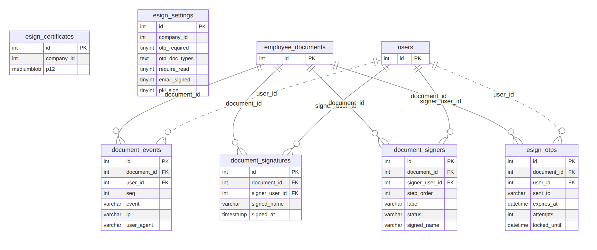

[বড় SVG](diagrams/j-documents-e-signature.svg) · [Mermaid সোর্স](diagrams/j-documents-e-signature.mmd)

এই মডিউলের সব টেবিলের নাম

`document_events`, `document_signatures`, `document_signers`, `esign_certificates`, `esign_otps`, `esign_settings`

### E. Payroll & Salary (14টি টেবিল)

বেতন কাঠামো থেকে payslip ও final settlement পর্যন্ত। `payrolls` একজন কর্মী ও একটি মাসে একটি (UNIQUE)।

মূল টেবিল: `salary_structures`, `payrolls`, `payroll_batches`, `final_settlements`, `employee_advances`

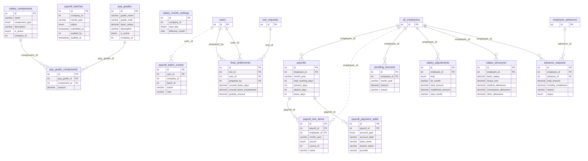

[বড় SVG](diagrams/e-payroll-salary.svg) · [Mermaid সোর্স](diagrams/e-payroll-salary.mmd)

এই মডিউলের সব টেবিলের নাম

`advance_requests`, `final_settlements`, `pay_grade_components`, `pay_grades`, `payroll_batch_events`, `payroll_batches`, `payroll_line_items`, `payroll_payment_splits`, `payrolls`, `pending_bonuses`, `salary_adjustments`, `salary_components`, `salary_month_settings`, `salary_structures`

### I. Performance, Grievance, Exit, Targets & Tasks (16টি টেবিল)

কর্মজীবনের বাকি অংশ: মূল্যায়ন, অভিযোগ, শৃঙ্খলা, বিদায়, লক্ষ্য ও কাজ।

মূল টেবিল: `performance_*`, `grievances`, `exit_requests`, `final_settlements`, `targets`, `tasks`

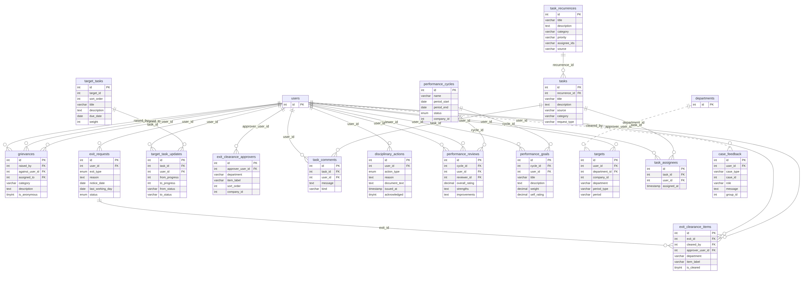

[বড় SVG](diagrams/i-performance-grievance-exit-targets-tasks.svg) · [Mermaid সোর্স](diagrams/i-performance-grievance-exit-targets-tasks.mmd)

এই মডিউলের সব টেবিলের নাম

`case_feedback`, `disciplinary_actions`, `exit_clearance_approvers`, `exit_clearance_items`, `exit_requests`, `grievances`, `performance_cycles`, `performance_goals`, `performance_reviews`, `target_task_updates`, `target_tasks`, `targets`, `task_assignees`, `task_comments`, `task_recurrences`, `tasks`

### G. Approvals & Alerts (6টি টেবিল)

সব অনুমোদন-প্রবাহের সাধারণ ইঞ্জিন আর নোটিফিকেশন।

মূল টেবিল: `approval_templates`, `approval_requests`, `alerts`

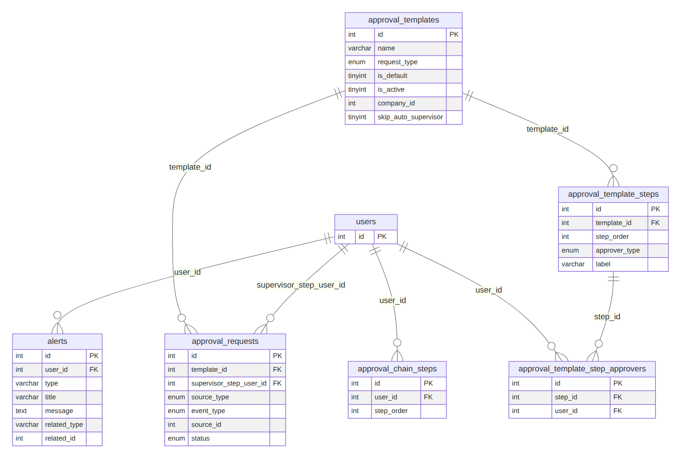

[বড় SVG](diagrams/g-approvals-alerts.svg) · [Mermaid সোর্স](diagrams/g-approvals-alerts.mmd)

এই মডিউলের সব টেবিলের নাম

`alerts`, `approval_chain_steps`, `approval_requests`, `approval_template_step_approvers`, `approval_template_steps`, `approval_templates`

<!-- /AUTO:modules -->

## ৫. ফাইল

| ফাইল | কী |
|---|---|
| `data-dictionary.md` | <!--n:tables-->২১৫<!--/n--> টেবিলের সব কলাম, ধরন, null, ডিফল্ট, সম্পর্ক |
| `diagrams/*.mmd` | Mermaid সোর্স (ডায়াগ্রাম আবার বানাতে) |
| `diagrams/*.svg`, `*.png` | তৈরি ছবি (প্রেজেন্টেশনে ব্যবহার করুন) |
| `full-diagram.html`, `diagrams/full-application-er.*` | পুরো ডাটাবেসের এক ছবি (HTML viewer, PDF, SVG, PNG) |
| `../index.html` | সব ডকুমেন্ট ব্রাউজারে (ইন্টারনেট ছাড়াই) |

## ৬. ডায়াগ্রাম নতুন করে বানাতে

নিজে থেকেই হয়: কোডে টেবিল বদলালে GitHub-এর **Docs sync** কাজটি সার্ভার চালিয়ে `information_schema` পড়ে এই পেজ, ডিকশনারি, সব ছবি ও draw.io ফাইল আবার বানায়। হাতে চালাতে: চালু MariaDB-তে সার্ভার একবার চালিয়ে `npm run docs:db` (বিস্তারিত `../README.md`-এর "স্বয়ংক্রিয় আপডেট")।

## draw.io ফাইল

`credencehr-database.drawio` — draw.io (diagrams.net) এ খোলা ও এডিট করা যায়।
১৪টি পেজ: পেজ ১ = সম্পূর্ণ ডাটাবেস (<!--n:tables-->২১৫<!--/n--> টেবিল), বাকি ১৩টি = মডিউল অনুযায়ী।
টেবিলে শুধু মূল কলাম (PK/FK/মূল ফিল্ড) আছে; পূর্ণ কলাম তালিকা `data-dictionary.md` তে।
জেনারেটর: `../tools/db/drawio_*` (`npm run docs:db` নিজে চালায়)।
